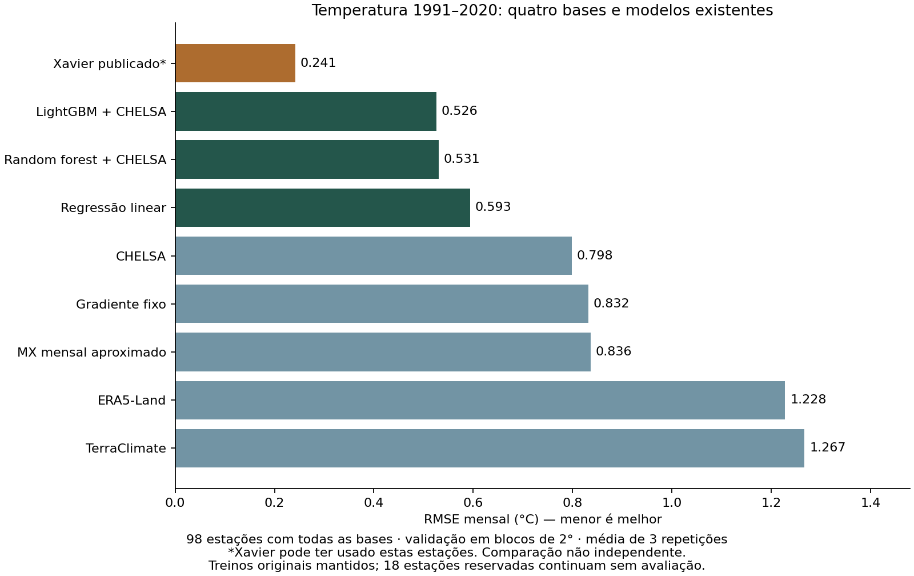
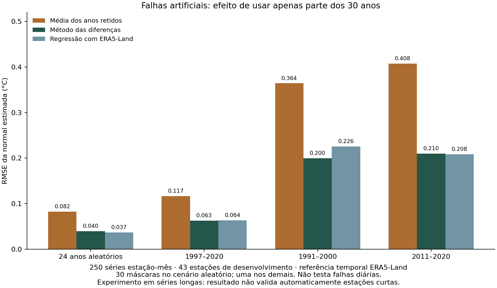

# Auditoria do escopo e avanço da temperatura

**Data: 03/11/2026.** Referências: áudio transcrito pelo usuário, mensagem de
07/10/2026, [instruções originais](../instrucoes.md) e
[relatório técnico do projeto](../../relatorios/relatorio_tecnico.md).

**O trabalho está dentro do escopo como desenvolvimento experimental, mas a
temperatura ainda não está pronta como produto nacional validado.** Já existe
uma cadeia funcional até GeoTIFF de 30 m em Curitiba. A pendência principal
é demonstrar a qualidade científica exigida, e depois ampliar a produção.

## Pedido de Fabrício e evidência encontrada

| Pedido | Evidência e julgamento |
|---|---|
| Trabalhar em `refinamento/` | Alterações desta revisão e dados novos permanecem nessa pasta. `instrucoes.md` foi preservado. |
| Começar pela temperatura | Feito. Chuva tem somente uma fonte inspecionada; não tomou o lugar da etapa de temperatura. |
| Usar observações reais | Tmax/Tmin reais, pareados por código. Há 1.186 estações na interseção e 120 com 12 normais mensais elegíveis. |
| Produzir cada pixel por modelo | O piloto aplica LightGBM a relevo, posição, sazonalidade e CHELSA. MX interpolado só é comparador. Reamostrar covariáveis não é interpolar estações para gerar a resposta. |
| Comparar estatística e ML | Regressão linear, random forest e LightGBM foram comparados nas mesmas dobras espaciais; ainda não há vencedor definitivo entre os dois ML. |
| Escala mensal e anual | Há 12 mapas mensais e uma média anual ponderada pelos dias. A resposta atual é `(Tmax + Tmin)/2`, com a diferença para outras definições ainda por medir. |
| Pixel de 30 m e arquivo TIF | 39 GeoTIFFs reais: 13 de temperatura, 13 de dispersão e 13 de flag. O piloto mede 12 × 12 km, em UTM 22S, com 400 × 400 pixels. |
| Disponibilizar no GEE | O formato local foi conferido, mas não houve publicação. O upload continua manual e depende da validação. |
| Brasil inteiro | Ainda não entregue. Curitiba é uma prévia pequena; falta uma região-piloto mais abrangente e produção nacional por tiles. |

O áudio descreve o Xavier de forma simplificada. As instruções identificam
IDW/ADW como métodos do artigo e permitem usá-los apenas como régua. O MX atual
é uma aproximação mensal com cinco vizinhos e gradiente fixo; não foi apresentado
como reprodução integral do artigo.

A escolha de UTM é uma adaptação cartográfica justificada: EPSG:4326 tem unidades
em graus e não fornece uma grade de 30 × 30 metros constantes. O tamanho do
pixel está atendido no piloto; a habilidade climática nessa escala ainda não.

## Verificação do que já existia

- A suíte original passou: **67 testes**. A primeira tentativa teve erro de
  preparação do diretório temporário; após criar `.local/pytest`, passou inteira.
- Os **39 GeoTIFFs** conferiram contra seus hashes e metadados: CRS, alinhamento,
  resolução, tipo, escala, nodata, compressão e estado experimental. A diferença
  máxima entre anual e combinação dos mensais foi **0,007527 °C**, dentro da
  quantização de 0,01 °C.
- Os hashes da tabela de covariáveis e dos scripts registrados nos manifestos
  continuam compatíveis com os arquivos atuais.
- As cinco tabelas originais de predições contêm apenas as 102 estações de
  desenvolvimento. As 18 reservadas não aparecem no ajuste ou avaliação; meses
  da mesma estação e estações do mesmo bloco permanecem juntos em cada repetição.
- No desenvolvimento há quatro flags de constância de Tmax, cinco de Tmin e
  dois saltos de Tmax para revisão. Três estações têm flag de coordenadas
  compartilhadas com outra estação da base bruta, mas **não há coordenadas
  repetidas entre as 102 estações de desenvolvimento**. Flags não foram apagadas
  nem usadas para excluir dados sem revisão.

## C1 e parte de C9: comparação que estava faltando

Foram extraídas as séries mensais de 1991–2020 de Xavier, ERA5-Land e TerraClimate
nas 102 estações de desenvolvimento, usando a grade nativa e conversão explícita
para °C. São **110.160 combinações estação-mês-base**, incluindo ausências.
CHELSA foi reaproveitado da extração já conferida.

ERA5-Land tem pixels mascarados nas séries de quatro estações (1.440 valores
ausentes); Xavier, em uma delas (360 valores); TerraClimate, em nenhuma. Assim,
a comparação pareada usa **98 estações**, com 12 meses e todas as bases. Não
houve preenchimento espacial. Os modelos **não foram retreinados**: suas
predições originais foram avaliadas nesse conjunto comum, conservando dobras e
repetições. Os treinos originais continuam partindo das 102 estações.

RMSE em °C, média de três repetições, blocos de 2°:

| Método | Mensais agrupados | Anual |
|---|---:|---:|
| Xavier publicado | 0,241 | 0,236 |
| LightGBM corrigindo CHELSA | 0,526 | 0,456 |
| Random forest corrigindo CHELSA | 0,531 | 0,460 |
| Regressão linear | 0,593 | 0,523 |
| CHELSA | 0,798 | 0,722 |
| M1: gradiente fixo | 0,832 | 0,759 |
| MX: aproximação mensal | 0,836 | 0,753 |
| ERA5-Land | 1,228 | 1,138 |
| TerraClimate | 1,267 | 1,227 |

O anual é avaliado depois de agregar as 12 previsões de cada estação, não pela
média dos 12 RMSEs. Também foram gravadas métricas por mês e pelas faixas de
altitude `<300 m`, `300–800 m` e `≥800 m`; regiões e biomas continuam pendentes.

O LightGBM supera CHELSA neste desenvolvimento: diferença de RMSE agrupado
**−0,272 °C**, intervalo pareado por blocos **[−0,340; −0,195] °C**. Contra a
grade Xavier a diferença é **+0,284 °C**, intervalo **[+0,220; +0,353] °C**.
Logo, **o critério de superar a grade Xavier ainda não foi cumprido**.
Esses intervalos são condicionais às predições de CV; não são intervalos por pixel.

**Limite de interpretação:** o Xavier pode ter usado as próprias estações
avaliadas. Sua vantagem não equivale a evidência independente de superioridade.
Trocar a covariável para Xavier só por esse ranking não resolve C14. As definições
de temperatura também diferem. Além das normais integrais das grades, foram
comparadas médias apenas nos anos realmente observados: o RMSE do Xavier fica
0,232 °C, do ERA5 1,232 °C e do TerraClimate 1,272 °C. CHELSA não entra nessa
segunda análise, pois aqui só dispomos de sua normal integral.

**Decisão:** conservar o piloto experimental e o CHELSA como referência do
ensaio existente; não declarar sucesso contra Xavier nem escolher uma nova base
final antes de resolver a independência e a definição da variável.



## C12 parcial: efeito de períodos reduzidos

Entre as estações de desenvolvimento, 254 séries estação-mês tinham os 30 anos
elegíveis. A exigência de referência completa nas duas grades deixou **250 séries
de 43 estações**. O teste retirou anos, sem consultar as observações retiradas
para estimar a normal. Comparou média simples dos anos retidos, método das
diferenças e regressão com a referência, esta última preenchendo somente os anos
artificialmente retirados. Foram usadas ERA5 e TerraClimate, com as mesmas máscaras.

| Anos retidos | Média disponível: RMSE | Diferenças com ERA5: RMSE | Regressão com ERA5: RMSE |
|---|---:|---:|---:|
| 24 aleatórios, 30 repetições | 0,082 | 0,040 | 0,037 |
| 1997–2020 | 0,117 | 0,063 | 0,064 |
| 1991–2000 | 0,364 | 0,200 | 0,226 |
| 2011–2020 | 0,408 | 0,210 | 0,208 |

Em 2011–2020, o viés da média disponível foi **+0,309 °C**. As diferenças com
ERA5 reduziram para **+0,016 °C**, e a regressão para +0,069 °C.
O método das diferenças está implementado como média observada nos anos retidos
mais a diferença entre a média da referência nos 30 anos e nesses mesmos anos
retidos. Cada normal mensal usa anos correspondentes ao seu próprio mês.

**Decisão:** o ajuste temporal merece continuar; usar apenas séries recentes
como se representassem 1991–2020 produz viés neste ensaio. Não aplicar uma regra
nova automaticamente às séries curtas: foram avaliadas séries longas com anos
retirados artificialmente, e os meses de origem já admitem até 20% de dias
ausentes. Faltam falhas diárias, validação por domínio/região e incerteza do ajuste.



## C13: transferência temporal com referência ERA5

O ensaio usa **68 estações de desenvolvimento**, com pelo menos oito anos
observados por mês em cada década e os 12 meses nas duas décadas. A grade é
agregada nos mesmos anos de cada observação. Regressão linear, RF e LightGBM
aprendem observado menos ERA5 em 2001–2010 e são avaliados em outras estações,
em 2011–2020, por blocos de 1°/2°, cinco dobras externas, três repetições e
seleção de hiperparâmetros dentro do treino.

O controle contemporâneo aprende em 2011–2020, também em outras estações/blocos.
Todos usam ERA5 da década avaliada: trata-se de avaliação retrospectiva com
covariável conhecida, não de previsão de clima futuro.

| Condição | RMSE, blocos 1° | RMSE, blocos 2° |
|---|---:|---:|
| ERA5 sem correção | 1,267 | 1,267 |
| Linear, treino 2001–2010 | 0,817 | 0,849 |
| RF, treino 2001–2010 | 0,742 | 0,770 |
| LightGBM, treino 2001–2010 | 0,751 | 0,750 |
| LightGBM, treino contemporâneo | 0,736 | 0,747 |

Em 2°, a diferença agrupada do LightGBM transferido contra o contemporâneo foi
**+0,003 °C**, intervalo **[−0,048; +0,046] °C**. Contra ERA5 sem correção,
**−0,517 °C**, intervalo **[−0,694; −0,330] °C**.

**Decisão:** há evidência favorável à transferência da correção de ERA5 neste
conjunto, sem diferença conclusiva contra o ajuste contemporâneo. Isso não
valida a correção de CHELSA do piloto, nem a transferência retrospectiva a
1991–2000, nem o detalhe espacial de 30 m. Não substituir o mapa por este ensaio.

## O que falta para a entrega de temperatura

O [quadro C1–C15](../resultados/tabelas/status_comparacoes.csv) relaciona cada
comparação à evidência e à decisão pendente. A sequência de trabalho é:

1. **C11 e qualidade das observações:** obter e conferir séries horárias do
   INMET para comparar média de extremos, média das 24 h e compensada sobre dias
   equivalentes. Revisar os sinais de constância/salto e os históricos das estações.
   Os arquivos locais usados aqui contêm extremos diários, não essa referência
   horária. A fonte pública é o [acervo histórico do INMET](https://portal.inmet.gov.br/dadoshistoricos).
2. **Concluir C12 e o alvo:** estender o teste a falhas diárias e verificar a
   transportabilidade do ajuste temporal antes de ampliar de 120 para estações
   curtas. Congelar a nova amostra/partição e a definição do alvo antes de reajustar.
3. **C14/C15:** auditar participação das estações nas grades, obter um conjunto
   independente e conferir a reprodução do comparador Xavier no artigo completo.
   A documentação anterior registra que o texto integral ainda não foi obtido.
   Sem isso, a superioridade exigida permanece sem demonstração independente.
4. **C5–C8 e modelos:** comparar relevo em 30/90/1.000 m, contribuição de MODIS e
   outros grupos, tratamento mensal e subamostragem espacial das estações. Subir
   na escada de métodos conforme essas comparações, preservando o teste reservado.
5. **C9/C10 e produção:** completar avaliação por região/bioma, perfis de relevo e
   artefatos; produzir e conferir uma região-piloto abrangente; só então tiles do
   Brasil, incerteza/aplicabilidade e teste final. Upload manual após essa etapa.

Chuva continua na fase posterior; a [nota do asset](fonte_chuva_inmet.md) já
registra os preenchimentos com Xavier e a cobertura até julho de 2020.

## Reprodução e arquivos

Na pasta `refinamento/`, a extração é o único comando novo que requer rede e a
credencial GEE existente. Os demais usam os arquivos locais e geram resultados
agregados; não regravam os GeoTIFFs antigos.

```powershell
.venv/Scripts/python.exe -B -m codigo.bases_gee
.venv/Scripts/python.exe -B -m codigo.comparar_bases
.venv/Scripts/python.exe -B -m codigo.falhas_artificiais
.venv/Scripts/python.exe -B -m codigo.transferencia_temporal
.venv/Scripts/python.exe -B -m codigo.figuras_auditoria
```

O [notebook de resultados](../notebooks/auditoria_temperatura.ipynb) lê somente
tabelas agregadas. As séries extraídas, predições por estação, máscaras artificiais,
parâmetros e manifestos ficam em `dados/bases/` e `.local/bases_gee/`, ignorados.

A suíte final passou com **92 testes**. Duas mutações em memória foram detectadas
pelos testes de completude e de ajuste temporal. As seis células de código do
notebook foram executadas, os links locais conferidos e as duas figuras novas
inspecionadas. Isso verifica a implementação; não fecha as pendências científicas
listadas acima.

Fontes das conversões: metadados `BAND_Tmax/Tmin_MULT/ADD` da coleção mensal do
[autor do Xavier](https://sites.google.com/site/alexandrecandidoxavierufes/brazilian-daily-weather-gridded-data),
[ERA5-Land](https://developers.google.com/earth-engine/datasets/catalog/ECMWF_ERA5_LAND_MONTHLY_AGGR)
(`temperature_2m` em K, subtração de 273,15) e
[TerraClimate](https://developers.google.com/earth-engine/datasets/catalog/IDAHO_EPSCOR_TERRACLIMATE)
(`tmmx/tmmn`, fator 0,1, média dos extremos). As referências nativas têm resoluções
e definições térmicas diferentes; não foram transformadas em observações de 30 m.
