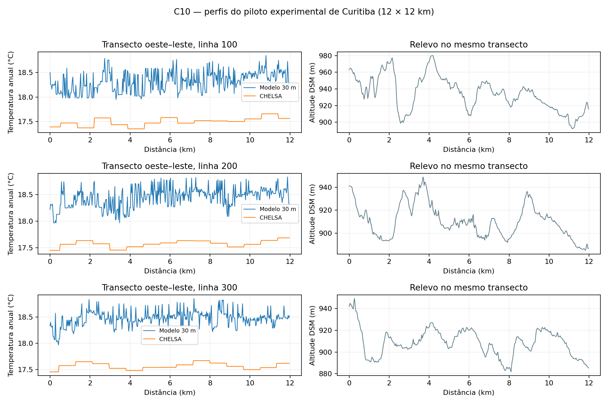
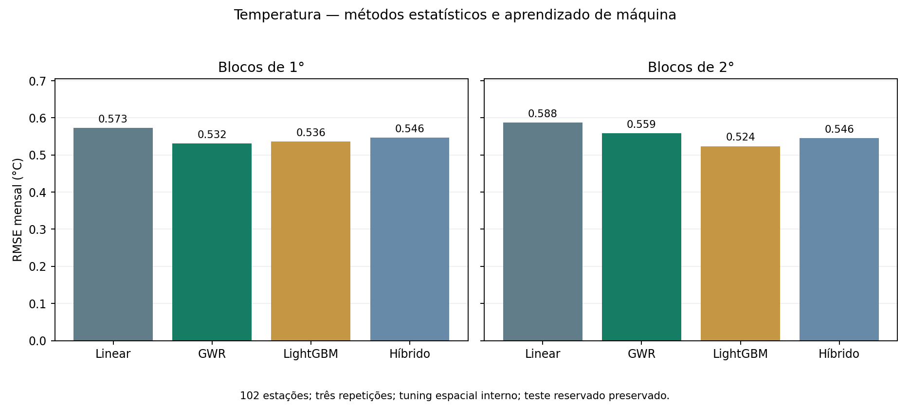
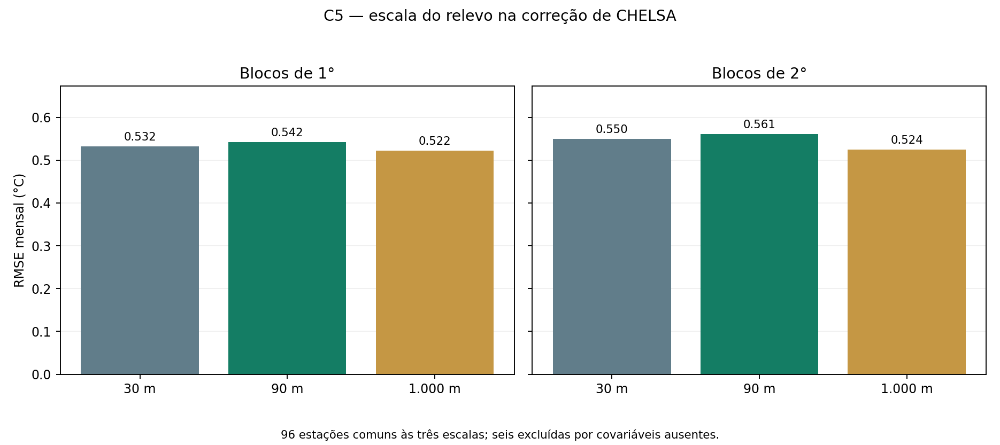
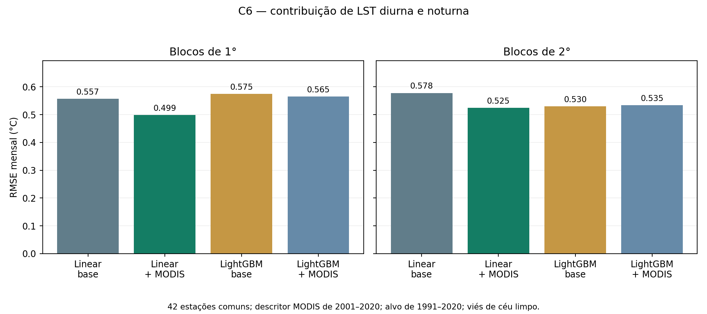
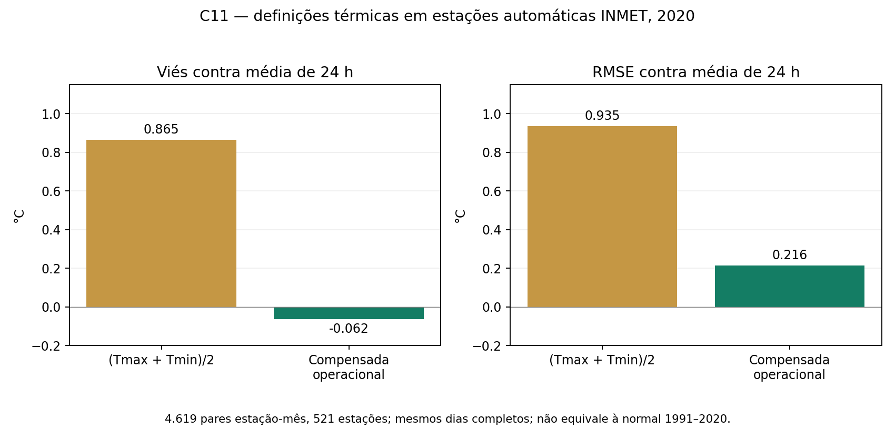

# Comparações complementares — execução de 07/11/2026

Este registro complementa o [atendimento às instruções](entrega_brasil.md).
Resultados desfavoráveis são mantidos: executar uma comparação não garante
que o modelo, o satélite ou a resolução mais fina produzam ganho.

## C10 — perfis do piloto

Foram extraídos três transectos oeste–leste do piloto de 12 × 12 km, nas linhas
100, 200 e 300, sem escolher os perfis pelo resultado. Temperatura modelada,
CHELSA e altitude são mostrados lado a lado. O mapa modelado apresenta
oscilações finas que não devem ser interpretadas automaticamente como clima
observado. Não há observações independentes em cada pixel para essa confirmação.



Os [saltos entre pixels](../resultados/tabelas/c10_saltos_curitiba.csv) foram
separados entre pares com e sem mudança de valor anual do CHELSA. No sentido
oeste–leste, a diferença absoluta média foi 0,141 °C nas mudanças da grade e
0,117 °C no interior; máximos de 0,78 e 0,71 °C por 30 m. Isso é diagnóstico
descritivo, sem controle do relevo: não prova que todo salto seja erro, mas
também não aprova o detalhe de 30 m. Emendas nacionais continuam pendentes.
Reprodução: `python -B -m codigo.perfis_temperatura`.

## M3/GWR e M6/híbrido — temperatura

[Implementação](../codigo/modelos_adicionais_temperatura.py): correção de CHELSA
com GWR de kernel gaussiano geodésico, bandwidth de 250/750 km escolhido na CV
interna; estabilização numérica ridge de 1e-6 nas covariáveis padronizadas.
M6 ajusta regressão linear e LightGBM aos resíduos do treino. O ajuste inteiro
é refeito em cada dobra interna; nenhum resíduo de avaliação entra no treino.

Mesmas 102 estações, blocos 1°/2°, cinco dobras externas, três repetições e três
dobras internas. As 18 estações reservadas continuam fora da comparação.

| Modelo | RMSE 1° | RMSE 2° |
|---|---:|---:|
| Linear | 0,573 | 0,588 |
| GWR | 0,532 | 0,559 |
| Random forest | 0,535 | 0,528 |
| LightGBM | 0,536 | 0,524 |
| Linear + LightGBM residual | 0,546 | 0,546 |

RMSE mensal em °C, média de três repetições. Em 2°, GWR menos LightGBM:
+0,035 °C, IC por blocos [−0,001; +0,072]; híbrido menos LightGBM:
+0,022 °C [−0,001; +0,049]. Não há evidência para substituir o modelo atual
por esses métodos. [Métricas](../resultados/tabelas/m3_m6_temperatura_2graus.csv)
e [diferenças](../resultados/tabelas/m3_m6_diferencas_2graus.csv).



## C5 — relevo a 30, 90 e 1.000 m

O DSM é reamostrado bilinearmente na grade UTM de 30 m. As escalas 90/1.000 m
agregam esse DSM por média de área, sem `bestEffort`; declividade é calculada
após a projeção de cada escala. Cada covariável é amostrada na própria grade.
Ausências permanecem ausências: seis estações de desenvolvimento não tinham
todas as covariáveis, deixando **96 estações comuns**. As comparações dentro
deste experimento usam as mesmas dobras; seus números não devem ser subtraídos
diretamente dos ensaios em 102 estações.

| Escala do relevo | LightGBM, RMSE 1° | LightGBM, RMSE 2° |
|---|---:|---:|
| 30 m | 0,532 | 0,550 |
| 90 m | 0,542 | 0,561 |
| 1.000 m | 0,522 | 0,524 |

Em 2°, 1.000 m menos 30 m: **−0,026 °C [−0,053; −0,002]**.
O ensaio **não demonstra vantagem preditiva do relevo de 30 m**. Produzir
pixels de 30 m continua sendo uma especificação geométrica, não prova de ganho.
Não foi trocado silenciosamente o modelo dos rasters existentes.
[Tabela](../resultados/tabelas/escalas_temperatura_2graus.csv) e
[cobertura](../resultados/tabelas/escalas_auditoria_2graus.json).



## C6 — MODIS LST diurna/noturna

Descritores de superfície MOD11A2.061 de **2001–2020**, agrupando compostos de
oito dias pelo mês de início. Conversão `0,02 × valor − 273,15`. Isso não é
temperatura do ar nem uma normal satelital de 1991–2020.

A tentativa inicial com todos os bits QC iguais a zero não produziu amostras
noturnas elegíveis e foi preservada em dados locais. A regra executada aceita
pixel produzido (mandatory QA 0/1), data quality 0, erro de emissividade ≤0,02
e erro de LST ≤2 K; requer pelo menos 20 compostos válidos por mês no período.
Não há preenchimento nem seleção da regra pelo erro dos modelos.
Os contadores ficam registrados para explicitar a cobertura e o viés de céu limpo.

Restaram **42 estações** com as duas variáveis nos 12 meses. Nessa amostra pareada,
LightGBM em 2°: base 0,530 °C; com MODIS 0,535 °C; diferença agrupada
+0,005 °C [−0,009; +0,017]. **Não houve ganho conclusivo para LightGBM**.
A regressão linear passou de 0,578 para 0,525 °C; essa diferença descritiva não
equivale a validação nacional do descritor. A redução da cobertura é uma limitação
importante. [Tabela](../resultados/tabelas/modis_temperatura_2graus.csv),
[auditoria](../resultados/tabelas/modis_auditoria_2graus.json) e
[catálogo oficial MODIS](https://developers.google.com/earth-engine/datasets/catalog/MODIS_061_MOD11A2).



## C9 — biomas

Usada a malha oficial IBGE 2025, escala 1:250.000, SIRGAS 2000; pontos WGS84
transformados para o CRS da malha. Nenhum ponto foi deslocado para forçar atribuição.
Nas 102 estações de desenvolvimento: Cerrado 35, Mata Atlântica 32, Amazônia 12,
Caatinga 12, Pampa 10 e uma sem atribuição unívoca. **Não há estação no Pantanal**
nessa amostra; não foi criada uma métrica artificial para esse bioma.

As métricas usam as predições pareadas de C1 (98 estações) e publicam grupos
com pelo menos cinco estações. [Resultados](../resultados/tabelas/c9_biomas_2graus.csv),
[cobertura](../resultados/tabelas/c9_biomas_cobertura_2graus.csv),
[proveniência](../resultados/tabelas/c9_biomas.json) e
[fonte oficial IBGE](https://geoftp.ibge.gov.br/informacoes_ambientais/estudos_ambientais/biomas/vetores/).

## C11 — definições de temperatura em observações horárias reais

Baixado o [arquivo oficial INMET 2020](https://portal.inmet.gov.br/uploads/dadoshistoricos/2020.zip):
589 CSVs, 103.653.055 bytes, SHA256
`e6cf2016dd3b78d7180dac8cbd482e5f549b227dc87a9dff642ecb7bb9e5ba0b`.
Foram obtidos **149.249 dias completos em 553 estações**, com os mesmos dias
para as três definições. O dia UTC usa registros 01:00 até 00:00 seguinte
(24:00) e extremos da hora anterior. Exige as 24 observações válidas de cada
série, sem duplicatas, valores fora de −30/50 °C ou mínimo maior que máximo.

Comparam-se a média dos 24 valores horários, a média dos extremos diários e
`(Tmax + Tmin + T12 + 2 × T24)/5`. Esta última é a **compensada operacional
nas automáticas**: usa a fórmula do INMET, mas não reproduz as janelas de
leitura dos termômetros convencionais. A referência metodológica está nas
[Normais Climatológicas INMET, páginas 22–23](https://portal.inmet.gov.br/uploads/normais/NORMAISCLIMATOLOGICAS.pdf).

Médias mensais exigem pelo menos 80% dos dias pareados: **4.619 pares
estação-mês em 521 estações**. Diferenças contra a média de 24 horas:

| Definição | Viés mensal | RMSE mensal |
|---|---:|---:|
| `(Tmax + Tmin)/2` | +0,865 °C | 0,935 °C |
| Compensada operacional | −0,062 °C | 0,216 °C |

O alvo atual não deve ser apresentado como equivalente à média horária.
**Não foi aplicado um desconto uniforme de 0,865 °C aos mapas:** o experimento
cobre um ano, não demonstra estabilidade temporal e espacial desse ajuste.
Resultados por região e mês estão na [tabela diária](../resultados/tabelas/c11_definicoes_2020.csv);
[tabela mensal](../resultados/tabelas/c11_definicoes_mensais_2020.csv) e
[auditoria](../resultados/tabelas/c11_definicoes_2020.json).



## C14 — triagem de independência

Os 589 códigos e coordenadas do arquivo INMET foram cruzados com as listas
de Tmax/Tmin cedidas pelo autor: **571 códigos coincidem**, 564 pontos ficam
até 5 km de uma estação da fonte e **18 são candidatos** sem coincidência de
código nem proximidade de até 5 km. São candidatos, não estações comprovadamente
independentes: faltam versões históricas das listas, aliases, relocações e
procedência por grade. Além disso, 2020 sozinho não constitui uma normal 1991–2020.
**C14 não está concluída.** [Auditoria](../resultados/tabelas/c14_triagem_inmet_2020.json).

## Reprodução

No ambiente de `refinamento/`, com `pyshp==2.3.1` adicional:

```powershell
.venv/Scripts/python.exe -B -m codigo.modelos_adicionais_temperatura
.venv/Scripts/python.exe -B -m codigo.relevo_estacoes_gee --variable temperatura
.venv/Scripts/python.exe -B -m codigo.comparar_covariaveis_temperatura --experiment escalas
.venv/Scripts/python.exe -B -m codigo.modis_temperatura_gee
.venv/Scripts/python.exe -B -m codigo.comparar_covariaveis_temperatura --experiment modis
.venv/Scripts/python.exe -B -m codigo.biomas_temperatura
.venv/Scripts/python.exe -B -m codigo.definicoes_temperatura_inmet
.venv/Scripts/python.exe -B -m codigo.independencia_inmet
.venv/Scripts/python.exe -B -m codigo.figuras_comparacoes
```

O extrator de relevo recebeu uma correção operacional de reprojeção após esta
execução da temperatura. As tabelas preservam os hashes da versão efetivamente
executada. A equivalência amostral da retomada da chuva é registrada em dados
locais; o relatório da chuva registra quais lotes anteriores foram reutilizados.

Os testes não substituem a validação científica. Cobertura nacional completa,
chuva modelada e validada, incerteza calibrada, perfis/emendas, independência e
reprodução integral de MX continuam necessários para encerrar o projeto.
