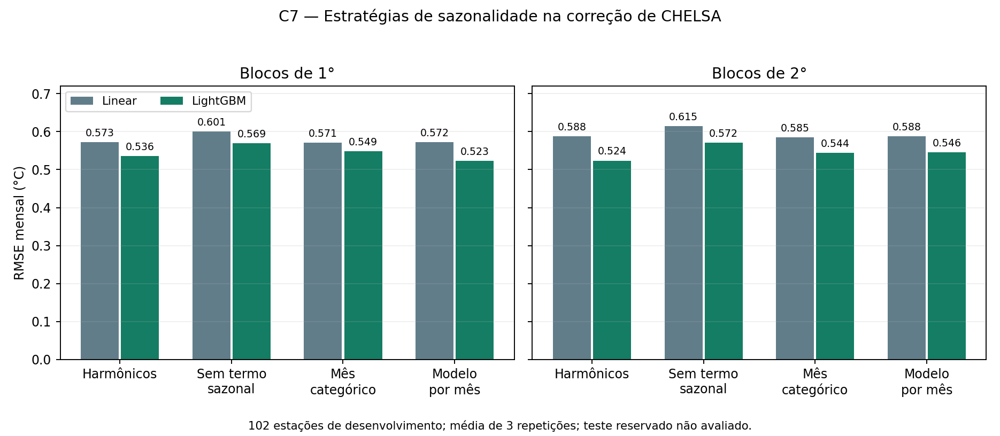
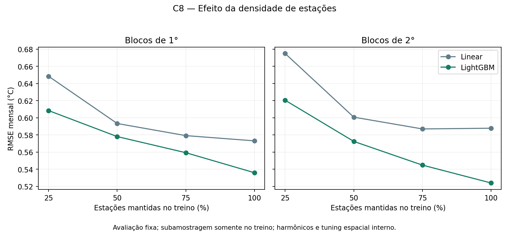
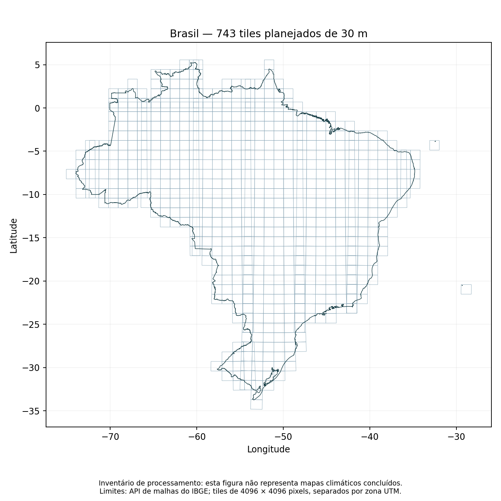
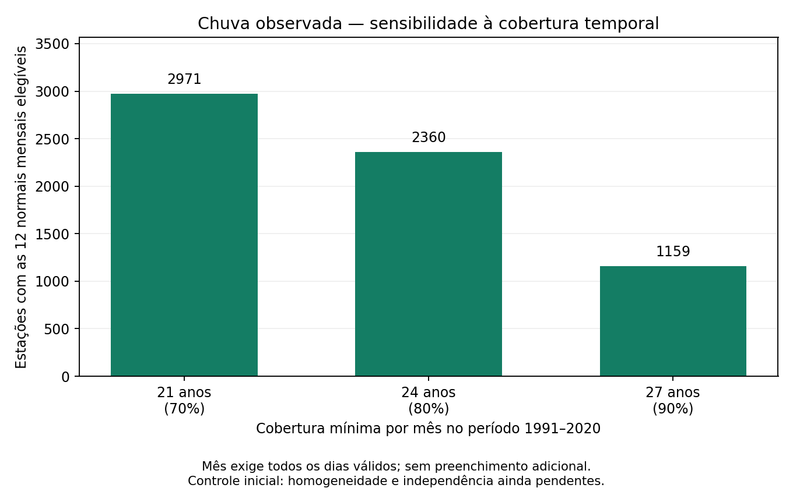

# Atendimento às instruções — produção para o Brasil

Atualização iniciada em 06/11/2026 e continuada em **07/11/2026**, a pedido do usuário. O objetivo é executar
temperatura e precipitação para o Brasil e demonstrar, requisito por requisito,
como as entregas foram obtidas. As [instruções originais](../instrucoes.md)
permanecem preservadas. Este documento será atualizado com resultados executados;
implementação de código, execução de experimentos e entrega validada são estados
distintos.

## Sequência de execução e critérios de conclusão

1. **Disponibilidade e capacidade:** conferir fontes, fronteira nacional, espaço
   e estimativa de tiles. Evidências: inventário nacional e consulta às fontes.
2. **Comparações científicas:** executar C1–C15 com alvos e estações comparáveis,
   sem consumir o conjunto reservado durante a escolha. Cada conclusão deve
   apontar tabela e decisão, inclusive resultados desfavoráveis.
3. **Produção nacional:** gerar e auditar tiles de 30 m, meses e anual, com
   retomada, máscaras, escala, nodata, proveniência e camadas auxiliares.
4. **Precipitação:** preparar observações sem confundir preenchimento com medição,
   comparar modelos e repetir a validação apropriada à chuva.
5. **Entrega:** conferir cobertura nacional efetiva, critérios de sucesso,
   documentação, figuras e arquivos para o upload manual previsto no pedido.

## Situação inicial comprovada

O [mapa da pasta](../mapa.md) (antigo README) e a [auditoria](auditoria_escopo.md) descrevem o trabalho
anterior: 39 GeoTIFFs experimentais em Curitiba, 102 estações de desenvolvimento,
18 reservadas, comparação C1 em 98 estações, C12 em 43 e C13 em 68. Esses números
não constituem uma entrega nacional. O teste reservado continua fechado.

## Execução desta etapa

- Confirmado acesso aos assets de CHELSA e chuva no GEE.
- Baixada a malha de UFs pela API oficial do IBGE, com 27 feições.
- Confirmado acesso ao portal de dados históricos do INMET; os dados horários
  foram baixados e processados para C11 (2020, comparação em dias equivalentes).
- Encontrados aproximadamente 124 GB livres em C:. Foi solicitado ao usuário
  um destino para a coleção nacional. Compressão não deve ser presumida como
  garantia de espaço antes da medição.
- Executada C7/C8, com avaliação espacial fixa e tuning interno, comparando
  harmônicos, ausência de sazonalidade explícita, mês categórico e modelos por
  mês; densidades de 25%, 50%, 75% e 100% apenas no treino.
- Em 07/11, concluídos download e processamento da chuva: 2.360 estações com
  12 normais elegíveis a 80% de cobertura, ainda sujeitas à auditoria científica.
- Executada C2 com gradiente fixo, global ajustado, mensal e mensal por região.
  A melhoria dos gradientes ajustados sobre CHELSA não foi conclusiva.
- Espaço livre reconferido em 07/11: aproximadamente 165 GB antes do término
  do download e processamento da chuva; destino nacional ainda não informado.

## O que foi pedido e como foi atendido

| Instrução | Como foi executada / evidência | Estado real |
|---|---|---|
| §1: pixels estimados por modelo, sem interpolação como produto | LightGBM prevê correção de CHELSA por pixel; MX permanece apenas referência. [Código de produção](../codigo/mapa_brasil.py). | Implementado e executado em janelas reais; produto nacional incompleto. |
| §2: temperatura e chuva, normal 1991–2020, 12 meses e anual | Temperatura: normal de extremos diários pareados; anual ponderada pelos dias. Chuva: soma diária com mês completo e anual como soma das normais mensais. | Normais de ambas executadas; mapas nacionais e validação final pendentes. |
| §2: Brasil a 30 m | Limites de 27 UFs unidos; divisão por zona UTM e hemisfério; origem múltipla de 30 m; tiles de 4096 pixels. [Inventário](../resultados/tabelas/brasil_tiles.csv). | Grade nacional concluída; mapas nacionais não concluídos. |
| §3.1: observações, calendário e QC | Tmax/Tmin pareados por ID, calendário explícito, limites físicos, cobertura, flags de constância/saltos/duplicatas. [QC de temperatura](../resultados/tabelas/controle_qualidade_temperatura.csv). | QC inicial executado; homogeneidade, relocação e revisão de flags pendentes. |
| §3.1: cobertura 70/80/90%, falhas e séries curtas | Sensibilidade executada em temperatura e chuva; C12 com anos artificiais. Chuva exige mês sem dia faltante e 21/24/27 anos. | Parcial; correção de séries curtas reais e falhas diárias não concluída. |
| §3.1: INMET horário e independência | C11 executada em 2020: 4.619 pares estação-mês. C14: 18 candidatas após triagem de IDs e distância. | C11 parcial no tempo; nenhuma candidata tem independência comprovada. Testes reservados preservados. |
| §3.2: covariáveis de relevo, posição, clima e satélite | CHELSA, altitude, declividade, latitude/longitude e sazonalidade. Reconferência remota nas 120 estações em 06/11. | Executado para essas covariáveis; MODIS comparado em 42 estações; relevo 30/90/1.000 m comparado em 96. Orientação, TPI/TRI, curvatura, exposição, distância ao oceano e outras superfícies pendentes. |
| §4: validação espacial aninhada e mesmas dobras | Blocos de 1°/2°, cinco dobras externas, três repetições, três dobras internas; métricas e bootstrap pareado por bloco. | Executado no desenvolvimento de temperatura e chuva; falta teste final independente. |
| §5: estatística versus ML, direta versus correção | M0, M1 fixo/ajustado/mensal/regional, M2, M4 e M5 comparados; forma direta e correção avaliadas. | M3/GWR e M6/híbrido também executados para temperatura. Chuva: regressão, LightGBM e híbrido executados; random forest em execução. M7 é opcional. |
| §6: C1–C15 e critério de sucesso | Tabelas agregadas, decisões e limites documentados abaixo. | Parcial. O modelo atual não supera a grade Xavier na C1; não declarar sucesso. |
| §7: incerteza e extrapolação | Dispersão de cinco modelos de dobras; flag mínimo/máximo das covariáveis por pixel. | Camadas experimentais geradas; calibração e aplicabilidade multivariada pendentes. |
| §8: GeoTIFF, nomes, escala, compressão e tiles | 39 arquivos por tile: 13 de temperatura, 13 de dispersão e 13 de flag; DEFLATE, int16 ×0,01 °C, nodata e projeção conferidos. [Implementação](../codigo/mapa_brasil.py). | Testado com dados reais e retomada; nenhum tile nacional completo ainda. |
| §8: projeção e bordas | UTM por zona, máscara territorial por pixel e margem do helper de relevo. A escolha métrica adapta EPSG:4326 para manter 30 m em unidades projetadas. | Testes de zona/hemisfério executados; verificação visual nacional de emendas ainda pendente. |
| §8: upload manual no GEE | Metadados de escala e política de pirâmide registrados nos rasters. | Não realizado; a entrega pedida é para upload manual após validação. |
| §9–10: relatório, notebook, README, código e resultados | Este documento, mapa.md (antigo README), notebook anterior, registro, tabelas e figuras. Código em `codigo/`, testes dentro dele, resultados agregados em `resultados/`. | Documentação atualizada; nenhum dado cedido ou raster incluído no Git. |
| §11: referências | [Referências verificadas](referencias.md) e fontes oficiais consultadas. | Referências registradas; leitura integral e reprodução do artigo Xavier ainda pendentes. |

## Comparações C1–C15

| Item | O que concluímos e como | Limite / próximo passo |
|---|---|---|
| C1 | Quatro grades comparadas em 98 estações comuns de 1991–2020. LightGBM 0,526 °C, CHELSA 0,798 °C, Xavier 0,241 °C no RMSE mensal com blocos de 2°. [Tabela](../resultados/tabelas/c1_modelos_2graus.csv). | Desenvolvimento, não teste independente. Conferir equivalência da coleção mensal Xavier com agregação diária. |
| C2 | Correção fixa de −6,5 °C/km e coeficientes ajustados globalmente, por mês e por mês/região, somente no treino. [Tabela](../resultados/tabelas/c2_gradientes_2graus.csv). | Executada para a altitude grosseira atual; não há ganho conclusivo sobre CHELSA. Revisar escala do relevo em C5. |
| C3 | Temperatura: M2/M3/M4/M5/M6 nas mesmas dobras. Chuva: linear, LightGBM e híbrido já executados em 1°/2°. | Random forest de chuva em execução; sem vencedor científico final. |
| C4 | Forma direta e correção de CHELSA comparadas, favorecendo a correção. [Direta](../resultados/tabelas/modelos_exploratorios_2graus_grade_direct.csv), [correção](../resultados/tabelas/modelos_exploratorios_2graus_grade_correction.csv). | Escolha ainda condicionada à definição térmica e ao período. |
| C5 | Temperatura: 30/90/1.000 m, 96 estações comuns. LightGBM em 2°: 0,550/0,561/0,524 °C. | O relevo de 1.000 m foi melhor nesse conjunto; pixel de 30 m não demonstra ganho. Experimentos de chuva em execução. |
| C6 | MODIS dia/noite comparado em 42 estações comuns; LightGBM em 2°: 0,530 sem e 0,535 °C com MODIS. | Sem ganho conclusivo para LightGBM; viés de céu limpo e descritor 2001–2020 explicitados. CHIRPS para chuva em execução. |
| C7 | Executadas quatro estratégias de sazonalidade, com linear e LightGBM, blocos de 1°/2°. [Métricas](../resultados/tabelas/c7_c8_metricas_2graus.csv). | Resultado para temperatura corrigindo CHELSA; chuva pendente. Modelo mensal não vence de forma consistente entre tamanhos de bloco. |
| C8 | Executadas frações 25/50/75/100%, sorteadas apenas no treino por estação inteira, com avaliação fixa e tuning interno. [Diferenças](../resultados/tabelas/c7_c8_diferencas_2graus.csv). | A perda com menos estações foi demonstrada neste conjunto; não equivale a mapa de incerteza calibrado. Chuva pendente. |
| C9 | Temperatura: mês, altitude, grandes regiões e biomas IBGE 2025. | Pantanal sem estação de desenvolvimento; uma estação sem atribuição de bioma. Chuva ainda requer estratificação. |
| C10 | Curitiba auditada; grade nacional e geração por janelas implementadas, com retomada testada. | Faltam tiles completos, perfis de relevo e avaliação das emendas/artefatos no território. |
| C11 | INMET 2020: 149.249 dias pareados; 4.619 meses em 521 estações. Viés mensal de extremos +0,865 °C e da compensada operacional −0,062 °C contra média de 24 h. | Não representa estabilidade em 1991–2020; alvo final precisa ser resolvido. Não aplicar um deslocamento nacional uniforme. |
| C12 | 250 séries estação-mês de 43 estações, anos removidos artificialmente; diferenças e regressão avaliadas contra a média disponível. [Tabela](../resultados/tabelas/c12_falhas_artificiais.csv). | Faltam falhas diárias e transporte para séries curtas reais; ajuste não incorporado automaticamente aos mapas. |
| C13 | Correção ERA5 treinada em 2001–2010 e avaliada em 2011–2020 em 68 estações, com separação espacial. [Tabela](../resultados/tabelas/c13_modelos_2graus.csv). | Não valida automaticamente a correção CHELSA nem retrospectiva 1991–2000. |
| C14 | Triagem de 589 estações automáticas: 18 candidatas sem coincidência de ID nem proximidade de 5 km. | Zero estações comprovadamente independentes; aliases, histórico e uso nas grades ainda precisam ser verificados. |
| C15 | Modelo comparado com MX mensal de cinco vizinhos e gradiente fixo, mesmas dobras. | Reprodução integral/recalibração e análise por subgrupos pendentes. MX não entra na geração do produto. |

## Resultado de C2 — gradientes ajustados

O [experimento](../codigo/gradientes_temperatura.py) usa as mesmas 102 estações,
cinco dobras e três repetições, em blocos de 1°/2°, preservando as 18 reservadas.
Estima `Tobservada − CHELSA = gamma × (DEM30 − DEMgrosseiro)` por mínimos
quadrados pela origem, exclusivamente no treino. Não há hiperparâmetro a ajustar
em dobras internas. O coeficiente é uma correção efetiva da grade, não uma
medição direta do gradiente atmosférico. Não foram impostos limites ao coeficiente.

Grupos com menos de cinco estações ou sem variação de elevação suficiente usam
fallback mensal → global → fixo. Região desconhecida usa o coeficiente mensal.
Os coeficientes, estações por dobra e hashes ficam registrados nos dados locais.

| Correção | RMSE mensal, blocos 1° | RMSE mensal, blocos 2° |
|---|---:|---:|
| Nenhuma (CHELSA) | 0,794 | 0,794 |
| Fixa −6,5 °C/km | 0,826 | 0,826 |
| Global ajustada | 0,789 | 0,788 |
| Mensal ajustada | 0,790 | 0,789 |
| Mensal por grande região | 0,786 | 0,775 |

Valores em °C, média das três repetições. Para mensal/regional em 2°, a diferença
de RMSE agrupado contra CHELSA foi **−0,019 °C**, intervalo pareado por bloco
**[−0,062; +0,027] °C**: não há ganho conclusivo. A correção fixa piora em
**+0,031 °C [0,013; 0,050]**. A alteração dos coeficientes não resolve a maior
parte do erro. [Diferenças](../resultados/tabelas/c2_gradientes_diferencas_2graus.csv).
Isso não encerra C5 nem torna final a escolha do modelo.

## Resultados novos de C7 e C8

RMSE mensal (°C), média de três repetições, **102 estações de desenvolvimento**:

| Estratégia LightGBM | Blocos de 1° | Blocos de 2° |
|---|---:|---:|
| Harmônicos, 100% do treino | 0,536 | 0,524 |
| Sem termo sazonal explícito | 0,569 | 0,572 |
| Mês categórico | 0,549 | 0,544 |
| Um modelo por mês | 0,523 | 0,546 |
| Harmônicos, 75% do treino | 0,559 | 0,545 |
| Harmônicos, 50% do treino | 0,578 | 0,572 |
| Harmônicos, 25% do treino | 0,608 | 0,620 |

As frações são aninhadas dentro de cada treino externo; os meses de uma estação
permanecem juntos. Em 2°, reduzir para 25% aumenta o RMSE agrupado em **0,097 °C**,
intervalo pareado **[0,056; 0,139] °C**. O modelo por mês apresenta diferença
**+0,022 °C**, intervalo **[−0,007; +0,049] °C**, em relação aos harmônicos.
Isso não sustenta substituição definitiva por modelos mensais. A covariável CHELSA
é mensal mesmo no cenário sem termo sazonal explícito.





## Produção nacional e capacidade

O [inventário](../resultados/tabelas/brasil_tiles.csv) contém **743 tiles**, com
aproximadamente **9,44 bilhões de pixels territoriais**, estimados pela área
projetada dividida por 900 m². O valor é uma estimativa geométrica, não uma
contagem de pixels climáticos já gerados.



A [estimativa de capacidade](../resultados/tabelas/brasil_capacidade.json) indica
**491 GB sem compressão** apenas para os 26 mapas climáticos (duas variáveis ×
13 períodos), ou **1,72 TB** incluindo dispersão float32 e flag uint8 para cada
mapa. Não inclui caches, metadados ou margens de tiles. A compressão reduz o
armazenamento, mas seu tamanho final ainda não foi medido no país inteiro.

O primeiro ensaio real usa o tile `utm22S_5_58`, em janelas de 512 × 512 pixels,
para respeitar o limite de 32 MB por download síncrono do GEE. Foram iniciados
39 GeoTIFFs desse tile, ainda **parciais**. Na auditoria de 07/11, foram conferidas
**6 de 64 janelas**, com **1.572.864 pixels** válidos. A produção foi retomada
para concluir o tile; consultar o manifesto para o progresso posterior. Isso representa um tile parcial, e **zero de 743 tiles
completos**. Não contar os arquivos parciais como mapas nacionais entregues.

A segunda execução levou cerca de **90 segundos**, incluindo inicialização,
ajuste do candidato e download. Esse tempo isolado não deve ser extrapolado
diretamente para a duração nacional, que depende de cache, rede, máscaras e
organização dos lotes.

A [auditoria de produção](../resultados/tabelas/brasil_auditoria_producao.json)
conferiu **1.572.864 pixels válidos**, nenhum pixel preenchido fora da máscara
territorial e erro máximo anual/mensais de **0,007724 °C**, compatível com a
quantização de 0,01 °C. Os arquivos parciais ocupam **28.168.460 bytes**; esse
recorte não fornece uma razão de compressão representativa do Brasil inteiro.
O [controle por tile](../resultados/tabelas/brasil_progresso_temperatura.csv)
distingue os 742 não iniciados do único tile parcial.

### Reconferência da fonte de relevo

O produtor recusou inicialmente o DEM porque `updateTime` havia mudado desde
a extração original. Foram extraídas novamente as covariáveis nas 120 estações:
as **1.440 linhas e o SHA256 permaneceram idênticos**. Foi criado um novo manifesto
da fonte, preservando os arquivos anteriores. A [comparação registrada](../resultados/tabelas/reconferencia_covariaveis_20261106.json)
confirma diferença zero em todas as colunas. Isso confere os pontos de treino;
não afirma que todos os pixels do DEM antigo e atual são idênticos.

## Precipitação

A pasta cedida pelo autor contém `pr.npz` e um README que declara dados diários
de 1961–2025, em mm/dia. Em 07/11, o download foi concluído: **1.345.945.948 bytes**,
SHA256 `26c4f28f8e4f0f72b3069b0418eb4c05be951d60942a4bf61f1acede74b699fd`.
O [processamento real](../codigo/dados_precipitacao.py) confirmou **14.170 estações
e 23.741 dias** na fonte. Foram selecionados os **10.958 dias de 1991–2020**.

Regra: 0 ≤ pr < 450 mm/dia; mês exige todos os dias válidos. Zero observado é
válido, dia ausente não vira zero e nenhum preenchimento foi acrescentado.
A normal anual soma as 12 normais mensais elegíveis. A cobertura anual registrada
é o mínimo de anos válidos entre os meses, não a contagem de anos completos comuns.

| Mínimo de anos por mês | Estações com os 12 meses elegíveis |
|---|---:|
| 21 (70%) | 2.971 |
| 24 (80%, regra principal) | 2.360 |
| 27 (90%) | 1.159 |

[Tabela de sensibilidade](../resultados/tabelas/chuva_sensibilidade_cobertura.csv).
Dos 5.101.200 pares estação-mês possíveis, **1.617.793** têm todos os dias
válidos. Foram sinalizados **24 valores diários finitos fora do limite**,
101.355.414 valores não finitos e **555 estações com coordenadas repetidas**
na fonte completa. Esses flags não demonstram, sozinhos, erro da estação.
[Controle inicial](../resultados/tabelas/chuva_controle_qualidade.csv).

Entre as 2.360 estações elegíveis, não há coordenadas repetidas, mas **602 não
têm altitude informada**. A modelagem precisa obter altitude consistente do DEM;
não foram descartadas silenciosamente. A [auditoria das normais](../resultados/tabelas/chuva_auditoria_normais.json)
conferiu integridade, não negatividade, cobertura e soma anual: diferença máxima
de arredondamento **0,00000075 mm** no CSV. Arquivos por estação permanecem em
`dados/processados/`, fora do Git.



A [fonte GEE indicada por Fabrício](fonte_chuva_inmet.md) continua documentada e
acessível. Sua comparação com `pr.npz`, especialmente valores preenchidos e meses
ausentes de 2020, permanece pendente. Também faltam homogeneidade, independência,
conferência completa entre as fontes e validação final independente. Covariáveis e primeiras comparações espaciais da chuva já foram executadas; ver o relatório de modelagem. **Nenhum mapa de
chuva foi produzido**; preparar normais observadas não conclui essa entrega.

## Reprodução desta etapa

Executar em `refinamento/`, no ambiente já documentado em
[metodologia e reprodução](metodologia_reproducao.md), com Shapely 2.1.2 adicional:

```powershell
.venv/Scripts/python.exe -m pip install shapely==2.1.2
.venv/Scripts/python.exe -B -m codigo.grade_brasil
.venv/Scripts/python.exe -B -m codigo.robustez_temperatura
.venv/Scripts/python.exe -B -m codigo.regioes_temperatura
.venv/Scripts/python.exe -B -m codigo.gradientes_temperatura
.venv/Scripts/python.exe -B -m codigo.figuras_brasil
.venv/Scripts/python.exe -B -m codigo.covariaveis_gee --saida dados/brasil/normais_covariaveis_20261106.csv
.venv/Scripts/python.exe -B -m codigo.mapa_brasil --tile utm22S_5_58 --max-windows 1 --input dados/brasil/normais_covariaveis_20261106.csv
.venv/Scripts/python.exe -B -m codigo.auditar_brasil
```

Para reproduzir a preparação da chuva (download concluído em 07/11):

```powershell
.venv/Scripts/python.exe -B -m codigo.baixar_precipitacao
.venv/Scripts/python.exe -B -m codigo.dados_precipitacao
.venv/Scripts/python.exe -B -m codigo.auditar_normais_chuva
.venv/Scripts/python.exe -B -m codigo.figura_cobertura_chuva
```

Se o download anterior falhar e estiver encerrado, `baixar_precipitacao --retomar`
permite aproveitar o arquivo parcial. O processamento exige o manifesto de
download e confere o SHA256 antes de ler as observações.

Repetir `codigo.mapa_brasil` continua na próxima janela. Sem `--max-windows`, o
produtor tenta concluir esse tile. Fonte, grade, scripts e manifesto de entrada
precisam corresponder à assinatura da execução. Um tile com covariáveis ausentes
é distinguido de um tile com cobertura completa. Não há comando de publicação.

## Verificações

- **107 testes passaram** na suíte completa (12,47 s), incluindo novos testes de
  subamostragem por estação, categorias mensais, zonas UTM/equador, ilhas,
  máscaras/nodata, escala e agregação de chuva.
- Em 07/11, a suíte ampliada passou com **111 testes em 9,46 s**, incluindo os
  quatro testes novos de C2. Conferidas, nos resultados reais, a identidade das
  dobras e previsões de CHELSA com C7/C8 e a ausência do teste reservado.
- Notebook atualizado e oito células executadas sem erro; figura de cobertura
  da chuva gerada e inspecionada.
- Reconferência remota das covariáveis, com igualdade exata à tabela anterior.
- Auditoria de seis janelas reais e retomada registrada em manifesto privado.
- Suíte ampliada: 121 testes passaram; comparação real da nova extração de relevo com a anterior: 12 valores idênticos.
- Figuras geradas a partir de resultados agregados, sem divulgar estações.
- Um aviso de futura depreciação do operador de Affine foi emitido; não houve
  falha de teste. Os métodos de produção anteriores foram preservados.

## Fontes operacionais

- [API oficial de malhas do IBGE](https://servicodados.ibge.gov.br/api/docs/malhas?versao=3): limite territorial de planejamento.
- [GEE: getDownloadURL](https://developers.google.com/earth-engine/apidocs/ee-image-getdownloadurl): limite de download síncrono, formatos e grade.
- [Portal de dados históricos do INMET](https://portal.inmet.gov.br/dadoshistoricos): fonte prevista para C11 e independência.

## Critério de encerramento

Não marcar esta entrega como concluída enquanto faltarem cobertura nacional
efetiva, análise de precipitação, comparações obrigatórias ou validação do
critério de sucesso. Um modelo que não supera a referência deve ter esse
resultado reportado; não se pode garantir antecipadamente que os experimentos
produzirão o ganho desejado.

## Comparações adicionais de 07/11/2026

O [relatório das comparações complementares](comparacoes_complementares.md) detalha M3/M6, C5, C6, C9, C11 e a triagem C14, com tabelas, figuras e comandos. A [modelagem da chuva](modelagem_chuva.md) apresenta o conjunto comum, os métodos, as métricas e as limitações. Esses resultados substituem estados pendentes das descrições históricas anteriores.
