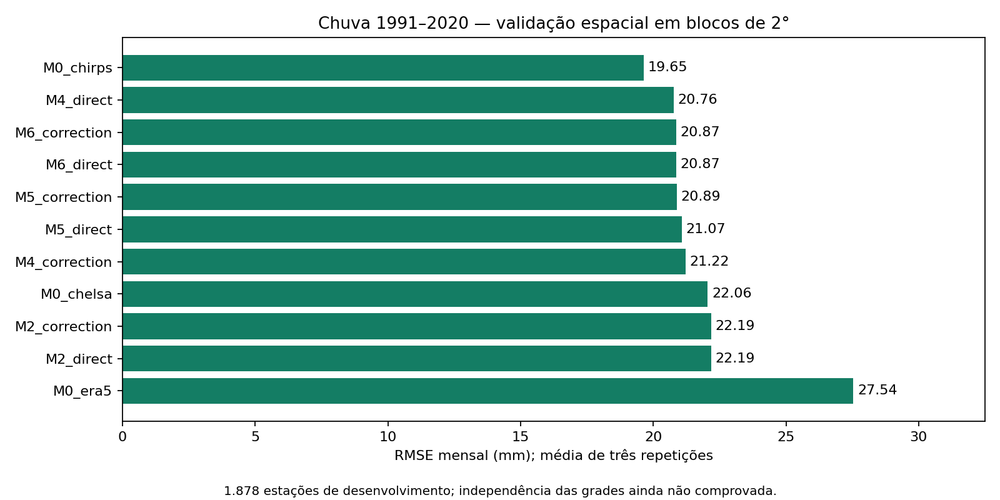
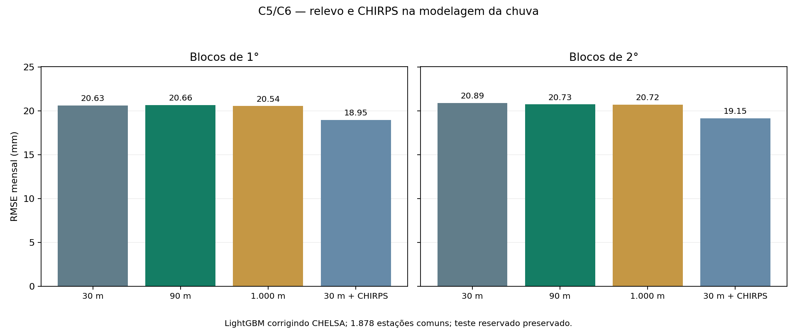
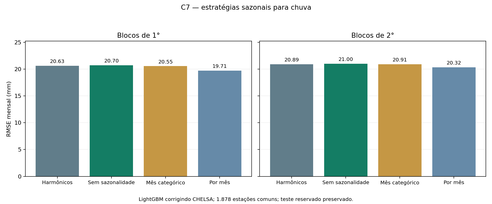
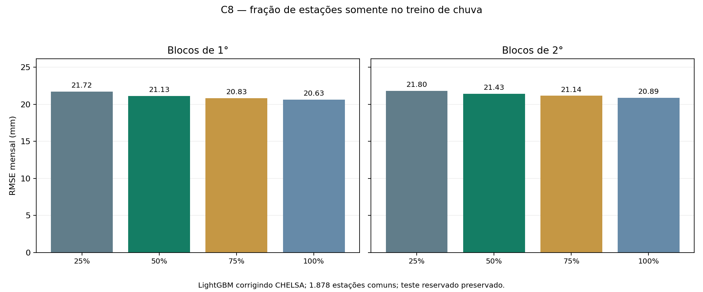
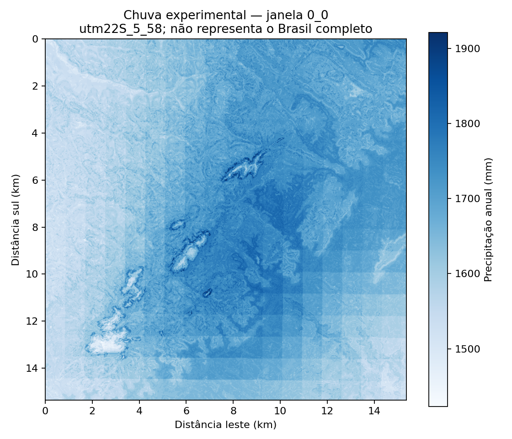

# Modelagem da precipitação — Brasil, 1991–2020

As normais observadas foram preparadas para 2.360 estações. A comparação usa
o mesmo conjunto completo de covariáveis para permitir comparações pareadas:
CHELSA, ERA5-Land, CHIRPS e altitude/declividade a 30, 90 e 1.000 m. Foram
excluídas 66 estações por ausência de alguma dessas covariáveis, sem preenchimento.
Restaram **1.878 estações de desenvolvimento e 416 reservadas**. A reserva por
blocos foi definida antes das exclusões (428 originalmente reservadas).

O CHIRPS incorpora observações de estações; sua comparação não demonstra
independência. CHELSA, ERA5-Land e CHIRPS foram extraídos nas grades nativas,
com calendário 1991–2020 e unidades verificadas. A coleção mensal Xavier também
foi extraída, mas a divergência previamente encontrada entre o produto mensal
e a agregação diária ainda precisa ser esclarecida antes da conclusão C1.
A fonte do professor e o NPZ ainda precisam de comparação de conteúdo e flags.

## Como os modelos foram avaliados

[Código](../codigo/modelos_chuva.py): blocos espaciais de 1° e 2°, cinco dobras
externas, três repetições e três dobras internas para escolher hiperparâmetros.
Todas as observações de uma estação permanecem juntas. O teste reservado não
participa da escolha de métodos ou covariáveis.

M2 é regressão linear; M4, random forest; M5, LightGBM; M6, regressão linear
seguida de LightGBM dos resíduos do treino. Duas formulações são comparadas:
`log1p(chuva)` diretamente e correção de `log1p(CHELSA)`. A retransposição usa
smearing calculado apenas nos resíduos do treino de cada ajuste e restringe a
chuva a valores não negativos. A escolha interna minimiza RMSE na unidade original,
mm. As previsões anuais são a soma dos 12 meses, nunca a média.

Para M2, a formulação direta e a correção são equivalentes porque o logaritmo
do CHELSA também é um preditor linear com coeficiente livre. M6 igualmente
absorve essa mudança na primeira regressão. Resultados idênticos dessas duas
formulações não constituem duas confirmações independentes de habilidade.

## Resultados executados

As tabelas [blocos de 1°](../resultados/tabelas/chuva_metodos_1graus.csv) e
[blocos de 2°](../resultados/tabelas/chuva_metodos_2graus.csv) contêm métricas
mensais e anuais por repetição. O [manifesto](../resultados/tabelas/chuva_comparacoes.json)
lista exatamente os métodos concluídos; execuções em andamento não entram nas tabelas.

Primeiros resultados completos em 2°, RMSE médio das três repetições:

| Método | Mensal (mm) | Anual (mm) |
|---|---:|---:|
| CHELSA | 22,055 | 196,920 |
| ERA5-Land | 27,543 | 240,596 |
| CHIRPS | 19,647 | 161,809 |
| Linear | 22,189 | 197,220 |
| LightGBM, direto | 21,071 | 178,817 |
| LightGBM, correção | 20,889 | 180,677 |
| Híbrido | 20,866 | 180,286 |

LightGBM e híbrido reduziram o RMSE em relação ao CHELSA nesse desenvolvimento,
mas não superaram o CHIRPS. As diferenças pareadas e seus intervalos por blocos
estão nas tabelas `chuva_metodos_diferencas_*`. Nenhum desses números comprova
o critério de sucesso em estações independentes. Random forest e os experimentos
de relevo/CHIRPS estão sendo ampliados; consultar o manifesto de execuções.



## Covariáveis e reprodução

O experimento C5 substitui apenas altitude e declividade por suas versões a
90 e 1.000 m. C6 acrescenta CHIRPS ao conjunto de 30 m. As estações e dobras
permanecem iguais; as tabelas `chuva_covariaveis_*` verificam o pareamento antes
de calcular diferenças contra LightGBM de 30 m sem CHIRPS.

```powershell
.venv/Scripts/python.exe -B -m codigo.modelos_chuva --method M2 --block-size 2
.venv/Scripts/python.exe -B -m codigo.modelos_chuva --method M4 --block-size 2
.venv/Scripts/python.exe -B -m codigo.modelos_chuva --method M5 --block-size 2
.venv/Scripts/python.exe -B -m codigo.modelos_chuva --method M6 --block-size 2
.venv/Scripts/python.exe -B -m codigo.modelos_chuva --method M5 --block-size 2 --scale 90
.venv/Scripts/python.exe -B -m codigo.modelos_chuva --method M5 --block-size 2 --scale 1000
.venv/Scripts/python.exe -B -m codigo.modelos_chuva --method M5 --block-size 2 --satellite
.venv/Scripts/python.exe -B -m codigo.consolidar_chuva
```

Repetir com `--block-size 1`. Dados e predições por estação ficam fora do Git;
somente métricas agregadas, figuras e auditorias são compartilhadas. Ainda
faltam independência, reprodução integral de MX e conclusão dos mapas nacionais de precipitação. Modelagem
executada não equivale a coleção nacional gerada ou validada.

## C5/C6, C7/C8 e C9 concluídas no desenvolvimento

Em blocos de 2°, o RMSE mensal do LightGBM foi 20,889 mm com relevo de 30 m,
20,727 mm a 90 m e 20,715 mm a 1.000 m. A diferença de 90 m contra 30 m foi
−0,162 mm, IC [−0,285; −0,024]; a de 1.000 m foi −0,174 mm,
IC [−0,393; +0,035]. Não foi demonstrado benefício preditivo da escala mais fina.

Adicionar CHIRPS reduziu o RMSE a **19,155 mm**. Contra o modelo sem CHIRPS,
a diferença foi −1,734 mm, IC [−2,048; −1,351]. Contra a própria grade CHIRPS,
porém, a diferença foi −0,492 mm, IC [−1,577; +0,510]: **o ganho sobre CHIRPS
não é conclusivo**. O CHIRPS contém informação de pluviômetros e ainda precisa
da auditoria de independência. As comparações usam 153 blocos e 1.000 reamostragens.



C7 comparou harmônicos, ausência de sazonalidade explícita, mês categórico e
um modelo por mês. Em 2°, LightGBM por mês apresentou RMSE 20,323 mm,
contra 20,889 mm com harmônicos; diferença −0,566 mm,
IC [−0,995; −0,162]. Essa comparação usa o conjunto sem CHIRPS; não foi testada
a interação entre modelo mensal e CHIRPS e não se devem somar seus ganhos.



C8 manteve a avaliação fixa e reduziu apenas o número de estações de treino.
Com 25%, 50%, 75% e 100%, o RMSE mensal foi 21,802, 21,432, 21,143 e 20,889 mm.
A perda com 25% foi +0,914 mm, IC [+0,589; +1,289]. Isso mede sensibilidade à
densidade no conjunto atual; não é um intervalo preditivo de cada pixel.



[C9](../resultados/tabelas/chuva_c9_2graus.csv) estratificou as predições por
mês, altitude do DEM, cinco grandes regiões e seis biomas. O desenvolvimento
inclui 864 estações na Mata Atlântica, 407 no Cerrado, 350 na Caatinga,
169 na Amazônia, 69 no Pampa e 19 no Pantanal. Métricas só são publicadas para
grupos com pelo menos cinco estações. Essa distribuição desigual precisa
acompanhar a interpretação nacional. Não houve novo ajuste com o teste reservado.

Reprodução adicional: `codigo.robustez_chuva --block-size 1` e `--block-size 2`,
`codigo.estratos_chuva` e `codigo.figuras_chuva`.

## Primeiros GeoTIFFs de chuva, ainda parciais

[Produtor](../codigo/mapa_chuva.py) executado no tile nacional `utm22S_5_58`,
com 39 arquivos: 13 precipitações, 13 dispersões entre modelos das dobras e
13 flags de covariável fora da faixa de treino. São pixels de 30 m em UTM,
precipitação `uint16` em mm, nodata 65535, compressão DEFLATE e metadados.
O anual soma as previsões mensais antes do arredondamento; dispersão anual
é calculada somando os meses de cada membro antes de calcular seu desvio padrão.

O candidato de engenharia é LightGBM corrigindo CHELSA sem CHIRPS; não é a
seleção científica final. A [auditoria](../resultados/tabelas/brasil_auditoria_chuva.json)
conferiu duas janelas e a retomada: **524.288 pixels válidos**, erro máximo de
4 mm entre anual e soma dos meses armazenados, compatível com quantização de
1 mm. **Zero dos 743 tiles de chuva está completo.** Não contar 39 arquivos
parciais como 39 mapas nacionais concluídos.



A figura mostra textura fina e descontinuidades associadas à grade de origem.
Elas não demonstram detalhe climático verdadeiro e ainda precisam da revisão
C10. Dispersão entre modelos não é intervalo preditivo calibrado.

```powershell
.venv/Scripts/python.exe -B -m codigo.mapa_chuva --tile utm22S_5_58 --max-windows 1
.venv/Scripts/python.exe -B -m codigo.auditar_chuva_mapas
```

Repetir o produtor continua na próxima janela e recusa fontes, treino ou código
incompatíveis com o manifesto. Arquivos permanecem locais e ignorados no Git;
não houve upload. O armazenamento da coleção nacional completa segue indefinido.
