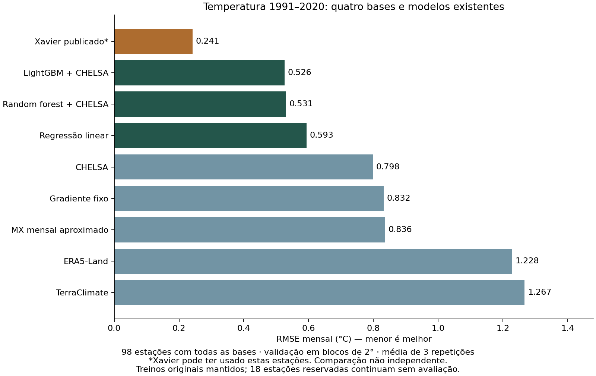
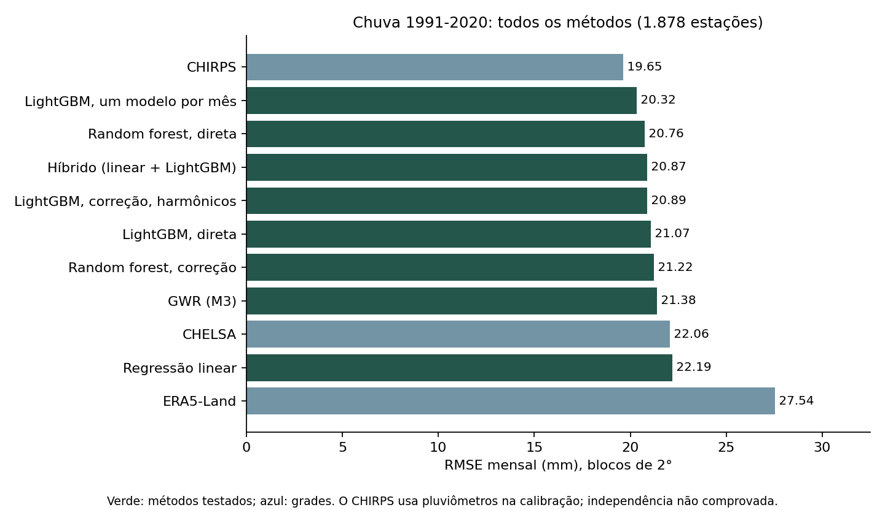
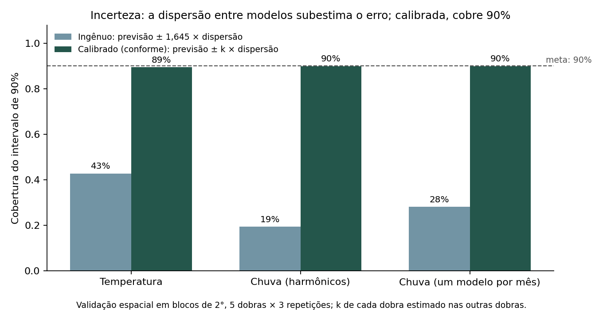
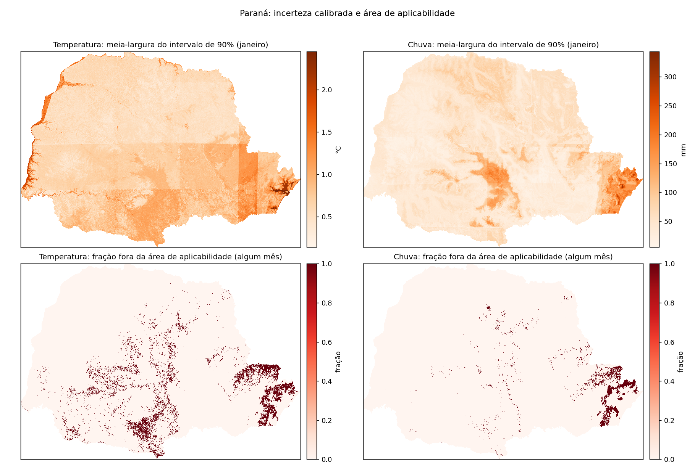
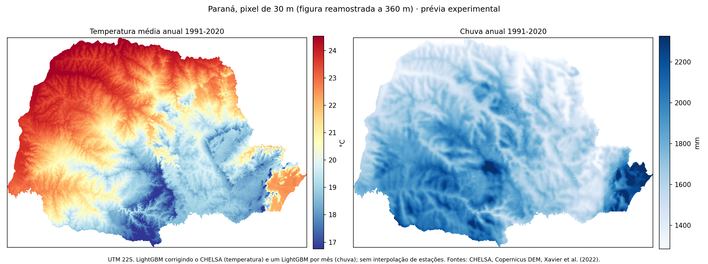

# Mapa: refinamento da temperatura e da chuva para 30 m

**Pergunta.** Dá para produzir mapas de **temperatura média do ar** e de **precipitação** com pixel de **30 m**,
normal **1991-2020** (12 meses e anual), em que cada pixel sai de um **modelo** aplicado às covariáveis do
próprio pixel, sem interpolar estações, validados contra estações e entregues para o Google Earth Engine (GEE)?
O pedido completo do Fabrício está em [`instrucoes.md`](instrucoes.md).

**Versão para o navegador:** [`mapa.html`](mapa.html) conta a mesma história com figuras e exemplos de cada
decisão (abrir o arquivo num navegador, de dentro desta pasta, para as figuras aparecerem).

Este arquivo substitui o antigo `README.md` da pasta e traz o estado consolidado de todas as sessões. O diário
de cada sessão, com datas, decisões e verificações, está em [`docs/registro.md`](docs/registro.md).

---

## 1. Situação em 09/11/2026

| Entrega pedida | Situação |
|---|---|
| Normais observadas 1991-2020 | **Feito.** Temperatura: 120 estações com as 12 normais (102 de desenvolvimento, 18 reservadas). Chuva: 2.294 estações com covariáveis completas (1.878 de desenvolvimento, 416 reservadas). |
| Métodos estatísticos × aprendizado de máquina, em validação espacial por blocos | **Feito**, temperatura e chuva: regressão linear, GWR, random forest, LightGBM e híbrido, nos blocos de 1° e de 2°. |
| Comparações C1-C15 | **12 executadas**, C13 encerrada com justificativa, C14 registrada como limitação (não existem estações fora do Xavier com normal 1991-2020) e C10 resolvida na causa principal (degraus de 1 km). |
| Teste reservado | **Avaliado uma única vez**, com o método congelado (seção 5.1). |
| Mapas de 30 m | **Paraná inteiro**, temperatura e chuva, 12 meses e anual, com incerteza calibrada e área de aplicabilidade (seção 5.5). Piloto de Curitiba no GEE. |
| Brasil inteiro | **Falta.** O Paraná é a região-piloto completa; a grade nacional de 743 tiles está pronta e o mesmo produtor serve para outros estados. |
| Upload no GEE | Piloto de Curitiba **no GEE**. Paraná **empacotado** para o upload manual. |
| Critério de sucesso (§6) | **Atingido nos testes justos.** O modelo é melhor que o CHELSA nas duas variáveis (validação e teste reservado) e melhor que o método do Xavier reproduzido nas mesmas dobras (validação nas duas variáveis; no teste reservado, na chuva, e no limite na temperatura). Não supera a grade publicada do Xavier, que usou as estações de avaliação, e empata com o CHIRPS na chuva. |

---

## 2. Dados

### 2.1 Temperatura

- **Observações:** Tmax e Tmin diários de Xavier et al. (2022), cedidos pelo autor, 1961-2025 (1.186 estações
  com os dois extremos). Só 1991-2020 é usado.
- **Resposta:** `(Tmax + Tmin)/2` do dia, só com os dois extremos válidos; mês com pelo menos 80% dos dias;
  normal mensal com pelo menos 24 dos 30 anos. Resultado: 120 estações (com 70%, seriam 191; com 90%, 58).
- **Controle de qualidade:** limites físicos; flags de saltos, séries constantes e coordenadas repetidas;
  altitude cadastrada × Copernicus DSM (viés +6,0 m, MAE 11,8 m); homogeneidade testada contra o ERA5-Land
  (seção 5.2).
- **INMET horário** de 2008, 2012, 2016, 2020 e 2024: definição da temperatura média (C11) e triagem de
  independência (C14).

### 2.2 Chuva

- **Observações:** `pr.npz` de Xavier et al. (2022), 14.170 pluviômetros, 1961-2025.
- **Regra:** 0 ≤ pr < 450 mm/dia; o mês só vale se **todos** os dias forem válidos; nada é preenchido; a anual é
  a soma das 12 normais. Normais com 24 dos 30 anos: 2.360 estações (2.294 com covariáveis completas).
- **Asset indicado pelo Fabrício** (`projects/fcoliveira/assets/observados_inmet/pr`): conferido numa amostra;
  os registros medidos batem com o `pr.npz` e os preenchidos pela grade não entram como observação.

### 2.3 Covariáveis

| Grupo | Em uso nos modelos | Observação |
|---|---|---|
| Clima de grade | CHELSA do mês, **reamostrado por interpolação bilinear** (temperatura ou chuva) | a interpolação é da covariável de grade, não das estações; ERA5-Land, TerraClimate, Xavier e CHIRPS entram como referências |
| Relevo | altitude e declividade do Copernicus GLO-30 (DSM) a 30 m | 90 m e 1 km testados no C5 |
| Posição e época do ano | latitude, longitude; harmônicos do mês na temperatura | na chuva, um modelo por mês |
| **Ainda não usados** | orientação, TPI/TRI, curvatura, distância ao oceano, exposição ao vento, NDVI/EVI, MapBiomas, IMERG | — |

---

## 3. Como os modelos são validados

- **Blocos espaciais de 1° e 2°**, cinco dobras × três repetições; meses e estações de um bloco saem juntos.
- **Hiperparâmetros** escolhidos em três dobras internas, só com o treino.
- **Teste reservado:** 15% dos blocos de 2°, sorteados em 18/10/2026 antes de qualquer modelo (18 estações de
  temperatura e 416 de chuva). Ficou fechado durante todas as escolhas e foi aberto **uma vez**, em 09/11/2026,
  com o método congelado; o script recusa uma segunda avaliação.
- **Métricas:** viés, PBIAS, MAE, RMSE, r, NSE, d de Willmott e KGE, mensais e anuais, por mês, altitude,
  região e bioma; diferenças pareadas com intervalo de 95% por bootstrap de blocos.

---

## 4. Métodos comparados

| Código | Método | Temperatura | Chuva |
|---|---|---|---|
| M0 | grade sem correção | CHELSA, Xavier, ERA5-Land, TerraClimate | CHELSA, ERA5-Land, CHIRPS |
| MX | método do Xavier reproduzido: 5 estações de treino mais próximas | IDW com gradiente recalibrado por pares a até 90 km (−5,4 °C/km) | IDW e ADW (CDD ≈ 365 km estimada no treino) |
| M1 | correção por elevação, fixa e ajustada | feito | — |
| M2 | regressão linear | feito | feito (log1p) |
| M3 | GWR | feito | feito |
| M4 | random forest | feito | feito |
| M5 | LightGBM | feito (**escolhido**) | feito; **um modelo por mês escolhido** |
| M6 | linear + LightGBM no resíduo | feito | feito |
| M7 | rede neural (opcional) | não feito | não feito |

Formulação escolhida: **correção da grade** (o modelo prevê estação − CHELSA; na chuva, sobre log1p).

---

## 5. Resultados

### 5.1 Teste reservado (avaliação final, uma vez)

RMSE nas estações nunca usadas em escolhas; intervalos de 95% por blocos de 2°.

| | Modelo | CHELSA | Método do Xavier (MX) | CHIRPS | ERA5-Land |
|---|---:|---:|---:|---:|---:|
| Temperatura, 18 estações, mensal (°C) | **0,717** | 0,966 | 0,875 | — | — |
| Temperatura, anual (°C) | **0,648** | 0,902 | 0,729 | — | — |
| Chuva, 416 estações, mensal (mm) | **17,05** | 19,63 | 21,61 | 16,66 | 23,31 |
| Chuva, anual (mm) | **133,5** | 169,4 | 165,7 | 113,0 | 180,7 |

- Modelo − CHELSA: **−0,25 °C [−0,41; −0,12]** e **−2,59 mm [−4,18; −0,37]**.
- Modelo − MX: −0,16 °C [−0,32; +0,00] (no limite) e **−4,56 mm [−8,76; −1,93]**.
- Modelo − CHIRPS: +0,39 mm [−0,92; +1,95] (empate).
- Intervalo de 90% calibrado: cobre **90%** dos erros mensais da chuva (94% no anual), mas só **75%** na
  temperatura (72% no anual). Nessas 18 estações o erro foi maior que na validação (0,72 contra 0,52 °C);
  com tão poucas estações, a cobertura real da temperatura fica entre essas duas referências.
- Fora da área de aplicabilidade: 0% das linhas de temperatura e 1% das de chuva.

Tabelas: [`teste_reservado_temperatura.csv`](resultados/tabelas/teste_reservado_temperatura.csv),
[`teste_reservado_chuva.csv`](resultados/tabelas/teste_reservado_chuva.csv) e
[`teste_reservado.json`](resultados/tabelas/teste_reservado.json).

### 5.2 Temperatura (validação, desenvolvimento)

**C1, 98 estações com todas as bases, blocos de 2°, RMSE em °C:** Xavier publicado 0,241; LightGBM 0,526;
random forest 0,531; linear 0,593; CHELSA 0,798; gradiente fixo 0,832; MX 0,836; ERA5-Land 1,228;
TerraClimate 1,267. O Xavier publicado provavelmente usou essas estações.



- **C15, método do Xavier nas mesmas dobras:** MX com gradiente recalibrado 0,860 °C contra LightGBM 0,524
  (−0,337 [−0,453; −0,225]); em blocos de 1°, 0,797 contra 0,536 (−0,261 [−0,361; −0,154]).
- **C2:** gradiente fixo piora (0,826 contra 0,794 °C do CHELSA); ajustados sem ganho conclusivo.
- **C3:** linear 0,588; GWR 0,559; random forest 0,528; LightGBM 0,524; híbrido 0,546.
- **C4:** a correção da grade venceu a forma direta nas árvores (LightGBM 0,570 → 0,524).
- **C5:** relevo de 1 km (0,524) tão bom ou melhor que o de 30 m (0,550): o pixel de 30 m não trouxe ganho
  preditivo demonstrado.
- **C6:** MODIS sem ganho (0,530 sem, 0,535 com).
- **C7:** harmônicos do mês ficam (0,524).
- **C8:** com 25% das estações de treino, +0,097 °C.
- **C10:** o CHELSA bilinear tira os degraus de 1 km sem custo na validação (diferença +0,0001 °C [−0,013; +0,013]).
- **C11 (INMET 2008-2024):** `(Tmax + Tmin)/2` fica +0,78 a +0,89 °C acima da média de 24 h, estável no tempo,
  mas de +0,1 a +1,6 °C conforme a estação. Um desconto único não serve.
- **C12:** só com 2011-2020, a média simples erra 0,408 °C e o método das diferenças, 0,210 °C; 20% dos dias
  faltando num bloco erram a média do mês em ~0,3 °C.
- **Homogeneidade:** 31 de 98 estações com quebra provável (degrau mediano 0,60 °C), mas o erro do modelo nelas
  é igual ao das demais (0,519 e 0,526 °C); mantidas e marcadas para revisão.

### 5.3 Chuva (validação, desenvolvimento)

1.878 estações, blocos de 2°, RMSE mensal em mm: CHIRPS 19,65; **LightGBM por mês 20,32** (20,31 com CHELSA
bilinear); random forest 20,76; híbrido 20,87; LightGBM com harmônicos 20,89; GWR 21,38; CHELSA 22,06; linear
22,19; MX ADW 27,72; ERA5-Land 27,54.



- **C7:** um modelo por mês é melhor que os harmônicos nos dois blocos (−0,92 mm [−1,25; −0,58] em 1°;
  −0,57 [−1,00; −0,16] em 2°) e vai para o mapa.
- **C15:** LightGBM 20,89 contra ADW 27,72 (−6,83 [−8,83; −4,96]); em 1°, 20,63 contra 24,56.
- **C5/C6:** relevo de 90 m ou 1 km não melhora; o CHIRPS como covariável reduz o erro, mas fica fora do produto
  até a auditoria de independência (ele usa pluviômetros na calibração).
- **C12:** um único dia faltando já tira 3,3% da soma do mês; 20% tiram 19,8%. A regra de mês completo fica.

### 5.4 Incerteza e área de aplicabilidade

- A dispersão entre os cinco modelos subestima muito o erro: o intervalo ingênuo (± 1,645 × dispersão) cobre
  43% na temperatura e 28% na chuva. **Calibrado por conformidade**, cobre 89-90% na validação
  (k = 6,13 na temperatura, 10,59 na chuva; anual com largura constante de 0,75 °C e 253 mm).
- **Área de aplicabilidade** (Meyer & Pebesma, 2021): fora dela o erro sobe de 0,52 para até 0,70 °C e de 20 para
  31-33 mm. Nos mapas, ela substitui a flag antiga de covariável fora do mínimo/máximo.



### 5.5 Mapas

**Paraná inteiro**, grade única WGS 84 / UTM 22S (EPSG:32722), pixel de 30 m, 22.132 × 15.494 pixels
(199.271 km²), produzido em 942 janelas de 512 × 512 pixels: **221.411.999 pixels no estado, todos com valor**.

| | Mínimo | 1% | Mediana | 99% | Máximo |
|---|---:|---:|---:|---:|---:|
| Temperatura média anual (°C) | 14,3 | 16,7 | 21,0 | 24,6 | 25,4 |
| Chuva anual (mm) | 1.191 | 1.286 | 1.709 | 2.327 | 2.899 |

Os pixels mais quentes ficam no extremo noroeste, nos vales do Paranapanema e do Paraná; os mais frios, nas
serras do sul (General Carneiro, Palmas). A chuva é maior na Serra do Mar e no sudoeste. Fora da área de
aplicabilidade em algum mês: 10,2% dos pixels na temperatura e 4,1% na chuva. Lembrete: a temperatura é
`(Tmax + Tmin)/2`, que fica ~0,8 °C acima da média de 24 h (C11).

**Limitação visível nos mapas:** a camada de incerteza mostra retângulos com bordas retas em latitude e
longitude. Eles vêm das divisões que as árvores do LightGBM fazem nas coordenadas (cada membro corta em lugares
diferentes). Na média o efeito é bem menor, mas existe; trocar a latitude e a longitude por covariáveis físicas
(distância ao oceano, continentalidade) é a forma de reduzi-lo numa próxima versão.





Seis camadas de 13 bandas (meses e anual):

| Camada | Tipo | Conteúdo |
|---|---|---|
| `parana_temperatura_media_30m.tif` | int16 × 0,01 °C | temperatura média do ar |
| `parana_temperatura_incerteza90_30m.tif` | uint16 × 0,01 °C | meia-largura do intervalo de 90% |
| `parana_temperatura_fora_aoa_30m.tif` | uint8 | 1 = fora da área de aplicabilidade |
| `parana_chuva_media_30m.tif` | uint16, mm | chuva |
| `parana_chuva_incerteza90_30m.tif` | uint16, mm | meia-largura do intervalo de 90% |
| `parana_chuva_fora_aoa_30m.tif` | uint8 | 1 = fora da área de aplicabilidade |

Ficam em `dados/parana/saida/` (fora do git). Para o GEE, `codigo/pacote_gee_parana.py` junta cada variável
num GeoTIFF int16 de 39 bandas em `dados/gee/`; o visualizador está em
[`gee/visualizar_parana.js`](gee/visualizar_parana.js).

**Brasil inteiro, calculado no GEE:** o mesmo modelo congelado roda dentro do GEE (árvores do LightGBM convertidas
para `ee.Classifier.decisionTreeEnsemble`), sem processamento local nem upload. A biblioteca
[`gee/brasil_30m.js`](gee/brasil_30m.js) devolve as imagens `temperatura` e `chuva` (12 meses, anual e incerteza
de 90%) para todo o país, e [`gee/visualizar_brasil.js`](gee/visualizar_brasil.js) mostra no mapa. Os 78 modelos
dão o mesmo valor que em Python, e no Paraná a imagem do GEE fica a 0,005 °C e 0,4 mm (medianas) do mapa local.
A área de aplicabilidade ainda não está no GEE.

**Piloto de Curitiba:** 12 × 12 km, 39 GeoTIFFs, no GEE em
`projects/mystic-hull-480913-h5/assets/refinamento_30m/piloto_curitiba_30m`, com o visualizador
[`gee/visualizar_piloto.js`](gee/visualizar_piloto.js).

---

## 6. Decisões tomadas

| # | Decisão | Por quê | Evidência |
|---|---|---|---|
| D1 | Cada pixel sai de um modelo; o método do Xavier (MX) só serve de régua | regra do §1 | `codigo/mapa_parana.py`; `codigo/mx_completo.py` |
| D2 | Prever a **correção** do CHELSA | a grade traz o padrão regional; o modelo aprende só o desvio | `modelos_exploratorios_2graus_grade_*.csv` |
| D3 | Blocos de 1° e 2°, com teste reservado aberto uma vez no fim | estações vizinhas inflam o resultado | §3; `teste_reservado.json` |
| D4 | Manter `(Tmax + Tmin)/2`, sem desconto | a diferença para a média de 24 h varia de +0,1 a +1,6 °C entre estações | `c11_definicoes_multianual.csv` |
| D5 | Cobertura de 80% (24 de 30 anos), com 70% e 90% como sensibilidade | equilíbrio entre estações e normal representativa | `sensibilidade_cobertura_temperatura.csv` |
| D6 | Chuva: mês com qualquer dia faltando é descartado; nada é preenchido | um dia faltando já tira 3,3% da soma | `c12_falhas_diarias_chuva.csv` |
| D7 | Chuva em log1p com smearing; anual = soma dos meses | assimetria da chuva | `codigo/modelos_chuva.py` |
| D8 | Grade UTM com pixel de 30 × 30 m, no lugar de EPSG:4326 | em graus o pixel muda com a latitude (30,9 m no equador, 25,7 m no Chuí) | `docs/referencias.md` |
| D9 | Escala inteira (int16 × 100, uint16 em mm) e DEFLATE | uma banda nacional em int16 já tem ~19 GB | `brasil_capacidade.json` |
| D10 | Janelas de 512 × 512 com retomada | o download do GEE aceita até 32 MB por pedido | `codigo/mapa_parana.py` |
| D11 | Sem gradiente fixo de −6,5 °C/km; sinal da fórmula antiga corrigido | o gradiente fixo piorou o CHELSA | `c2_gradientes_2graus.csv` |
| D12 | O detalhe de 30 m não é apresentado como ganho de previsão | relevo de 1 km foi tão bom quanto o de 30 m | `escalas_temperatura_2graus.csv` |
| D13 | A comparação justa com o Xavier é o MX nas mesmas dobras e o teste reservado | a grade publicada usou as estações; não há estações independentes com normal 1991-2020 | `c15_*`; `teste_reservado_*` |
| D14 | Temperatura: LightGBM corrigindo o CHELSA, com harmônicos do mês | melhor ou empatado em todas as comparações | `m3_m6_temperatura_2graus.csv` |
| D15 | CHIRPS fora do produto por enquanto | usa pluviômetros na calibração | `chuva_covariaveis_diferencas_2graus.csv` |
| D16 | Chuva: um LightGBM por mês | melhor nos dois blocos (C7) | `chuva_c7_c8_diferencas_*graus.csv` |
| D17 | CHELSA reamostrado por bilinear no treino e no mapa | tira os degraus de 1 km sem custo na validação (C10) | `c10_chelsa_bilinear_*.csv` |
| D18 | Intervalo de 90% calibrado e área de aplicabilidade no lugar da dispersão e da flag | a dispersão cobria 19-43% dos erros | `incerteza_aoa_bilinear.json`; `aoa_*_2graus.csv` |
| D19 | Estações com quebra provável ficam no treino, marcadas | o erro do modelo nelas é igual ao das demais | `homogeneidade_temperatura.csv` |

---

## 7. O que as instruções pedem × o que foi feito

Legenda: **Feito** · **Parcial** · **Falta** · **Adaptado** (feito de outro jeito, com justificativa).

| § | Pedido | Situação | Observação |
|---|---|---|---|
| 1 | Cada pixel gerado por modelo, sem interpolação | **Feito** | MX só como referência |
| 1 | Comparar métodos estatísticos com ML | **Feito** | cinco métodos, nas duas variáveis |
| 2 | Começar pela temperatura | **Feito** | — |
| 2 | Normal 1991-2020, 12 meses e anual | **Feito** | — |
| 2 | Região-piloto com relevo (Sul ou Sudeste) | **Feito** | Paraná inteiro |
| 2 | Brasil inteiro | **Parcial** | grade nacional pronta; produzido o Paraná |
| 2 | 30 m em EPSG:4326 | **Adaptado** | 30 m em UTM (D8) |
| 3.1 | Observações do Xavier | **Feito** | — |
| 3.1 | INMET para completar séries e validar de forma independente | **Parcial** | 5 anos usados em C11 e C14; não há estações independentes com normal 1991-2020 |
| 3.1 | Definição da temperatura média (C11) | **Feito** | medida em 5 anos; escolha final é do professor |
| 3.1 | QC: cobertura, dias mínimos, limites, saltos, duplicatas, altitude | **Feito** | — |
| 3.1 | QC: homogeneidade | **Feito** | 31 de 98 marcadas, sem efeito no erro |
| 3.1 | Falhas e normal de período reduzido (C12) | **Feito** | anos e dias testados; regras mantidas |
| 3.1 | Estabilidade no tempo (C13) | **Feito** | encerrada com justificativa e evidência do ERA5 |
| 3.2 | Relevo: elevação e declividade | **Feito** | — |
| 3.2 | Relevo: orientação, TPI, TRI, curvatura | **Falta** | — |
| 3.2 | Distância ao oceano, continentalidade, exposição | **Falta** | — |
| 3.2 | Clima de grade | **Feito** | CHELSA bilinear como covariável |
| 3.2 | Satélite: MODIS e CHIRPS | **Feito** | C6 |
| 3.2 | IMERG, NDVI/EVI, MapBiomas | **Falta** | — |
| 4 | Blocos espaciais, dobras e repetições | **Feito** | — |
| 4 | Teste independente reservado | **Feito** | aberto uma vez, no fim |
| 4 | Métricas completas; por região, bioma, altitude e mês | **Feito** | C9 |
| 4 | Linhas de base nas mesmas estações | **Feito** | na chuva, sem Xavier e TerraClimate |
| 4 | Comparações pareadas com intervalo | **Feito** | — |
| 5.1 | Ler o artigo do Xavier | **Falta** | texto integral não obtido |
| 5.1 | MX reproduzido, mesmas dobras | **Feito** | gradiente recalibrado; IDW e ADW |
| 5.2 | Escada M0-M6, direta × correção, log/Tweedie, validação aninhada | **Feito** | M7 opcional não feito |
| 6 | Comparações C1-C15 | **Feito** | C14 como limitação |
| 6 | Critério de sucesso | **Feito nos testes justos** | seção 1 |
| 7 | Incerteza por mapa | **Feito** | intervalo de 90% calibrado (no lugar do random forest quantílico) |
| 7 | Área de aplicabilidade | **Feito** | Meyer & Pebesma |
| 8 | Janelas com retomada, GeoTIFF, DEFLATE, escala inteira | **Feito** | — |
| 8 | COG | **Falta** | GeoTIFF com blocos internos |
| 8 | Região-piloto completa antes do Brasil | **Feito** | Paraná |
| 8 | Upload manual no GEE | **Parcial** | Curitiba no GEE; Paraná empacotado |
| 8 | Rota alternativa (modelo aplicado no GEE) | **Falta** | o LightGBM validado não roda no GEE; seria outro modelo a validar |
| 9 | Fases 0 a 4 | **Feito** | — |
| 9 | Fase 5 (produção) | **Parcial** | Paraná; Brasil pendente |
| 9 | Fase 6 (documentação) | **Feito** | — |
| 10 | Organização da pasta | **Feito** | o `README.md` do §10 se chama `mapa.md` |

---

## 8. Comparações C1-C15

| # | Situação | Resultado |
|---|---|---|
| C1 | Executada | Xavier 0,241; LightGBM 0,526; CHELSA 0,798; ERA5 1,228; TerraClimate 1,267 °C |
| C2 | Executada | gradiente fixo piora; ajustados sem ganho conclusivo |
| C3 | Executada | ML melhora a linear e a GWR nas duas variáveis |
| C4 | Executada | correção da grade adotada |
| C5 | Executada | relevo de 1 km tão bom ou melhor que 30 m |
| C6 | Executada | MODIS sem ganho; CHIRPS ajuda, sem independência comprovada |
| C7 | Executada | temperatura: harmônicos; chuva: um modelo por mês |
| C8 | Executada | menos estações piora as duas variáveis |
| C9 | Executada | métricas por mês, altitude, região e bioma; Pantanal sem estação de temperatura |
| C10 | Executada | degraus de 1 km resolvidos com o CHELSA bilinear; a textura fina vem do relevo de 30 m |
| C11 | Executada | +0,78 a +0,89 °C entre 2008 e 2024; +0,1 a +1,6 °C entre estações |
| C12 | Executada | método das diferenças para séries curtas; regras de dias mantidas |
| C13 | Encerrada | normais exigem 24 de 30 anos em 1991-2020; ERA5 mostra estabilidade |
| C14 | Limitação | não há estações fora do Xavier com normal 1991-2020 |
| C15 | Executada | modelo vence o MX nas duas variáveis e nos dois blocos; no teste reservado, na chuva |

Quadro com os arquivos de evidência: [`status_comparacoes.csv`](resultados/tabelas/status_comparacoes.csv).

---

## 9. O que falta

**Decisões pendentes**

1. Qual temperatura média mapear: `(Tmax + Tmin)/2`, como o Xavier, ou a média de 24 h, como o CHELSA e o ERA5
   (nesse caso, a correção precisa variar no espaço, não ser um desconto único).
2. Aceitar a grade em UTM no lugar de EPSG:4326.
3. Onde guardar a coleção nacional (491 GB a 1,72 TB sem compressão) e se vale produzir o Brasil inteiro, estado
   a estado, com o mesmo produtor.

**Pendências técnicas**

1. Covariáveis do §3.2 ainda não testadas (orientação, TPI/TRI, curvatura, distância ao oceano, exposição, NDVI,
   MapBiomas, IMERG). Elas também permitiriam tirar a latitude e a longitude do modelo, que causam os retângulos
   vistos na camada de incerteza.
2. Auditoria de independência do CHIRPS antes de usá-lo como covariável da chuva.
3. Revisão das 31 estações com quebra provável.
4. Produção dos demais estados e conversão para COG.
5. Ler o artigo completo do Xavier.

---

## 10. Organização da pasta e reprodução

```text
refinamento/
├── mapa.md                  # este arquivo
├── mapa.html                # a mesma história em página visual, com figuras e exemplos
├── instrucoes.md            # pedido original do Fabrício (preservado)
├── codigo/                  # scripts Python: dados, covariáveis, modelos, validação, mapas e figuras
│   └── testes/              # testes (pytest)
├── gee/                     # visualizadores no GEE e descrição do asset do piloto
├── notebooks/               # leitura comentada das tabelas de temperatura
├── resultados/
│   ├── tabelas/             # métricas, diferenças pareadas e auditorias (só agregados)
│   └── figuras/             # figuras PNG
├── docs/                    # registro.md (diário das sessões) e relatórios detalhados de cada etapa
└── dados/                   # FORA DO GIT: dados cedidos, séries, modelos e GeoTIFFs
```

| Etapa | Código (em `codigo/`) | Saída |
|---|---|---|
| 1. Observações de temperatura | `baixar_observacoes.py`, `dados_temperatura.py` | `controle_qualidade_temperatura.csv` |
| 2. Covariáveis nas estações | `covariaveis_gee.py`, `relevo_estacoes_gee.py`, `modis_temperatura_gee.py`, `chelsa_bilinear.py` | `dados/brasil/` |
| 3. Bases de grade (C1) | `bases_gee.py`, `comparar_bases.py`, `diagnostico_bases.py` | `c1_*` |
| 4. Modelos de temperatura (C2-C8) | `modelos.py`, `metricas.py`, `gradientes_temperatura.py`, `modelos_adicionais_temperatura.py`, `comparar_covariaveis_temperatura.py`, `robustez_temperatura.py` | `modelos_exploratorios_*`, `c2_*`, `m3_m6_*`, `escalas_*`, `c7_c8_*` |
| 5. Estratos (C9) | `regioes_temperatura.py`, `biomas_temperatura.py` | `c9_*` |
| 6. Definição, falhas, tempo, independência e qualidade | `definicoes_temperatura_inmet.py`, `definicoes_multianual.py`, `falhas_artificiais.py`, `falhas_diarias.py`, `transferencia_temporal.py`, `independencia_inmet.py`, `homogeneidade.py` | `c11_*`, `c12_*`, `c13_*`, `c14_*`, `homogeneidade_*` |
| 7. Observações de chuva | `baixar_precipitacao.py`, `dados_precipitacao.py`, `auditar_normais_chuva.py`, `conferir_fonte_chuva.py` | `chuva_controle_qualidade.csv` |
| 8. Modelos de chuva | `covariaveis_chuva_gee.py`, `modelos_chuva.py`, `gwr_chuva.py`, `consolidar_chuva.py`, `robustez_chuva.py`, `estratos_chuva.py` | `chuva_*` |
| 9. Método do Xavier (C15) | `mx_completo.py` | `c15_*` |
| 10. Incerteza, AOA e degraus (C10) | `incerteza_aplicabilidade.py`, `chelsa_bilinear.py` | `incerteza_*`, `aoa_*`, `c10_chelsa_bilinear_*` |
| 11. Teste reservado | `teste_reservado.py` (uso único) | `teste_reservado_*` |
| 12. Mapas | `mapa_piloto.py`, `mapa_brasil.py`, `mapa_chuva.py`, `mapa_parana.py`, `geotiff.py`, `grade_brasil.py` | `dados/piloto/`, `dados/brasil/`, `dados/parana/` |
| 13. Pacotes para o GEE | `pacote_gee_piloto.py`, `pacote_gee_parana.py` | `dados/gee/` |
| 14. Figuras | `figuras*.py`, `figura_cobertura_chuva.py` | `resultados/figuras/*.png` |

Reprodução: de dentro de `refinamento/`, `python -B -m codigo.<script>`. O ambiente (Python ≥ 3.12, versões
fixadas) e os comandos estão em [`docs/metodologia_reproducao.md`](docs/metodologia_reproducao.md). O Paraná:

```bash
python -B -m codigo.chelsa_bilinear extrair --project <projeto-gee>
CHELSA_BILINEAR=1 python -B -m codigo.incerteza_aplicabilidade temperatura chuva_por_mes
python -B -m codigo.mapa_parana preparar --chelsa-bilinear
python -B -m codigo.mapa_parana produzir --project <projeto-gee> --worker 0 --workers 10   # e os demais workers
python -B -m codigo.mapa_parana montar
python -B -m codigo.pacote_gee_parana
```

Testes: `python -B -m pytest codigo/testes -q -p no:cacheprovider --basetemp .local/pytest/execucao`.
Ficam só na máquina local, pelo [`.gitignore`](../.gitignore) da raiz: `dados/`, `.local/`, `.tmp/`, `.venv/`,
`requirements.txt` e `AGENTS.md`.

---

## 11. Documentos de apoio

| Documento | Conteúdo |
|---|---|
| [`docs/registro.md`](docs/registro.md) | diário das sessões |
| [`docs/entrega_brasil.md`](docs/entrega_brasil.md) | atendimento às instruções de 06-07/11, grade nacional, C2, C7, C8 |
| [`docs/comparacoes_complementares.md`](docs/comparacoes_complementares.md) | M3/M6, C5, C6, C9, C10, C11 e C14 da temperatura (07/11) |
| [`docs/modelagem_chuva.md`](docs/modelagem_chuva.md) | modelagem da chuva até 07/11 |
| [`docs/auditoria_escopo.md`](docs/auditoria_escopo.md) | auditoria de 03/11: C1, C12 e C13 |
| [`docs/metodologia_reproducao.md`](docs/metodologia_reproducao.md) | ambiente, versões e comandos |
| [`docs/fonte_chuva_inmet.md`](docs/fonte_chuva_inmet.md) | asset de chuva indicado pelo Fabrício |
| [`docs/referencias.md`](docs/referencias.md) | referências e a decisão sobre o pixel de 30 m |
| [`gee/descricao_piloto_curitiba.md`](gee/descricao_piloto_curitiba.md) | descrição do asset do piloto |

Os documentos de `docs/` guardam o estado de cada data; quando um deles disser que algo está pendente, vale este mapa.
