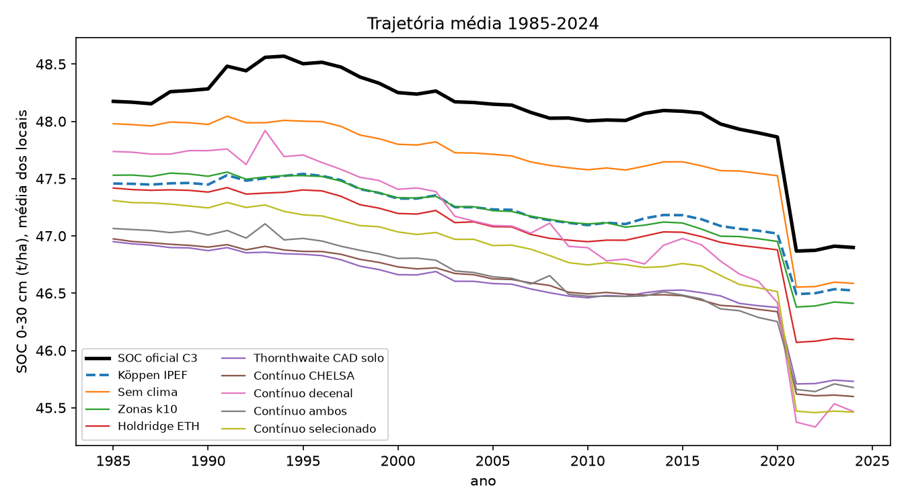

# Clima para estimativas de SOC no MapBiomas Solo

**Existe uma representação do clima melhor que o Köppen para o modelo de carbono orgânico do solo?**

Síntese dos relatórios técnicos v1 a v5 (outubro de 2026)
Fabrício Correia de Oliveira (UTFPR)

---

## O problema

- O MapBiomas Solo C3 usa o **Köppen IPEF** (Alvares et al. 2013) como **única** informação climática no
  modelo de SOC: 13 dummies, num modelo com 131 covariáveis.
- O produto é **anual (1985-2024)**, mas o Köppen é **estático** e **categórico**.
- Pergunta: trocar o Köppen melhora a estimativa do SOC
  - **onde não há amostra** (espaço),
  - **em anos sem amostra** (tempo),
  - **nos dois ao mesmo tempo**?

---

## Caminho percorrido: 5 experimentos

| | Experimento | Tratamentos de clima testados |
|---|---|---|
| **v1** | Bases climáticas e classificações (modelo aproximado) | Köppen, Holdridge, Thornthwaite, zonas k10, 12 variáveis contínuas, estratificação por zona |
| **v2** | Pipeline de produção reconstruído; espaço **e** tempo | 9 cenários: classes estáticas, contínuo CHELSA, **contínuo decenal**, seleção aninhada; + 6 algoritmos |
| **v3** | Classificações que mudam por **década** | Köppen, Holdridge, Thornthwaite, k10: estático × decenal (Xavier) |
| **v4** | 39 variáveis decenais (ETo pelo Rn, balanço hídrico) | 5 grupos: temperatura, chuva, energia, balanço hídrico (2 CADs); todas; com seleção |
| **v5** | Köppen **dinâmico** por média móvel de 30 anos | Köppen recalculado a cada ano (normal Y−30 a Y−1) |

---

## Como foi feito (comum a v2-v5)

- **Matriz de treino idêntica à de produção** (`trainingFinal`: 27.425 linhas); o OOB publicado pelo MapBiomas
  foi reproduzido na 2ª casa decimal (MEC 0,73 e 0,58).
- **Só o clima muda** entre os cenários; as outras 118 covariáveis são as da produção.
- **Dois modelos:**
  - o **ranger** que o MapBiomas validou;
  - o **modelo que gera o mapa** (`smileRandomForest`, maxNodes 40), que é outro modelo.
- **Três validações**, 3 repetições cada, perfil e réplicas sempre na mesma dobra:
  - **V2 espacial**: blocos de 2°;
  - **V3 temporal**: deixa uma década de fora;
  - **V4 espaço-temporal**: lugar e década novos.
- Métrica: **MEC** nas amostras reais de 0-30 cm; ganho pareado sobre o Köppen na mesma dobra.

---

## v1: base climática e primeiras comparações

**Base climática** (22 estações, 2010-2019):
- Temperatura: CHELSA e Xavier equivalentes (r ≈ 0,99).
- Chuva: **Xavier** é o melhor (r 0,92 contra 0,82 das outras).
- O CHELSA foi escolhido para as classificações (1 km e ETP pronta).

**Dentro do modelo** (ganho de R² no SOC sobre o Köppen):

| Clima | Ganho |
|---|---|
| **12 variáveis contínuas** | **+0,025 a +0,038** |
| Zonas k10 | +0,009 a +0,015 |
| Thornthwaite / Holdridge | +0,002 a +0,010 |
| Sem clima | +0,002 |

- O Köppen não acrescenta nada: tirá-lo não piora o modelo.
- **Estratificar (um modelo por zona) piora.**

---

## v2: no modelo de produção, espaço × tempo

MEC, amostras reais 0-30 cm (ganho sobre o Köppen):

| Cenário | Ranger V2 | Ranger V3 | Ranger V4 | Mapa V2 | Mapa V3 | Mapa V4 |
|---|---|---|---|---|---|---|
| Köppen IPEF | 0,240 | 0,172 | 0,152 | 0,179 | 0,124 | 0,111 |
| Sem clima | −0,002 | **+0,011** | +0,004 | **+0,007** | **+0,005** | **+0,010** |
| Contínuo CHELSA (estático) | **+0,014** | **+0,006** | +0,001 | **+0,034** | **−0,016** | −0,003 |
| **Contínuo decenal** | **+0,011** | **+0,013** | +0,007 | **+0,015** | **+0,008** | **+0,011** |
| Contínuo selecionado | **+0,015** | **+0,010** | **+0,002** | **+0,025** | −0,004 | +0,003 |
| Thornthwaite CAD solo | +0,003 | **+0,009** | **+0,006** | **+0,010** | **+0,010** | +0,005 |

Em negrito: mesmo sinal nas 3 repetições.

---

## v2: o que aprendemos

1. **O Köppen não é o melhor em nenhum esquema, com nenhum dos dois modelos.** No modelo do mapa, até
   **tirar o clima** é melhor que ele.
2. **Clima contínuo estático** (normais CHELSA) é o melhor **no espaço**, mas **piora no tempo** com o
   modelo do mapa.
3. **Clima contínuo decenal** (temperatura e chuva dos 10 anos anteriores + dias secos consecutivos) é o
   **único que ganha do Köppen nos três esquemas com o modelo do mapa**.
4. **Robusto ao algoritmo:** o decenal ganha do Köppen em **26 de 27** combinações (9 algoritmos × 3
   esquemas).
5. **Achado lateral:** o mapa usa árvores rasas (maxNodes 40). Usar o ranger validado no mapa dá
   **+0,04 a +0,06** de MEC, mais que qualquer troca de clima.

---

## v2: trajetórias 1985-2024

- As **classificações** só deslocam o nível (~1 t/ha); a forma das trajetórias não muda.
- **Só o clima decenal muda a dinâmica:** a tendência dobra (−0,53 t/ha/década; oficial −0,28).
- Limite: só 289 pares com coletas repetidas, e nenhum modelo acerta nem o sinal da variação temporal.

---

## v3: classificar por década resolve?

O mesmo sistema em duas versões (Xavier): **estática** (1991-2020) × **decenal** (década da amostra).

| Decenal − estática | V2 | V3 | V4 |
|---|---|---|---|
| Köppen | +0,009 / +0,011 | +0,002 / −0,002 | 0,000 / −0,004 |
| Holdridge | +0,001 / +0,003 | 0,000 / +0,003 | −0,002 / −0,007 |
| Thornthwaite | +0,008 / +0,011 | −0,003 / +0,003 | −0,003 / **−0,011** |
| k10 | +0,002 / −0,003 | +0,002 / +0,006 | +0,005 / +0,006 |

(ranger / modelo do mapa)

- **Não.** No tempo, a diferença fica perto de zero ou é negativa. O ganho na V2 é efeito da resolução, não
  do tempo.
- **O Köppen perde por ser classe** (sem gradiente e redundante com biomas e fitofisionomias), **não por ser
  estático**.
- Surpresa: o **Holdridge do Xavier** é a melhor classificação. Ganha do Köppen nos 3 esquemas e nos 2
  modelos e, no modelo do mapa, é o melhor cenário (V2 0,199; V3 0,141; V4 0,129). Mas, com o CHELSA, o
  Holdridge foi o pior: **depende da fonte dos dados**.

---

## v4: mais variáveis decenais ajudam?

39 variáveis em média móvel de 10 anos (ETo de Penman-Monteith pelo Rn, balanço hídrico com 2 CADs).

| Grupo (ranger) | V2 | V3 | V4 |
|---|---|---|---|
| Contínuo decenal v2 (3 variáveis) | 0,251 | 0,184 | 0,159 |
| **Temperatura (7)** | 0,251 | 0,191 | **0,163** |
| Chuva (6) | 0,240 | 0,178 | 0,145 |
| Balanço hídrico CAD 100 (9) | 0,234 | 0,158 | 0,123 |
| **Todas (39)** | 0,245 | 0,157 | **0,109** |
| Todas com seleção | 0,251 | **0,195** | 0,148 |

- **Mais variáveis pioram no tempo:** com as 39, a V4 cai de 0,159 para 0,109.
- Apenas a **temperatura decenal** ajuda no tempo nos dois modelos e na importância por permutação (+0,025
  de MEC na V3 e na V4).
- **Balanço hídrico, energia e chuva decenais** ajudam no espaço, mas viram **"marcadores de período"** no
  tempo.
- Ajudam nos três esquemas: armazenamento (ARM) com a CAD do solo, CDD, temperatura do mês mais frio e
  biotemperatura.

---

## v5: e um Köppen dinâmico de 30 anos?

Köppen recalculado **a cada ano** com a normal completa dos 30 anos anteriores (Xavier).

- 15,8% do Brasil mudou de classe entre 1985 e 2024 (Am → Aw, Af → Am, Aw → BSh).
- Nos pontos, 28% dos locais mudam de classe, mas a maioria das trocas é **oscilação na fronteira**:
  10.098 trocas em 3.882 locais.

| Ganho sobre o IPEF | V2 | V3 | V4 |
|---|---|---|---|
| ranger | −0,009 | +0,007 | −0,001 |
| modelo do mapa | +0,006 | +0,002 | +0,002 |

- **Empate.** Os ganhos ficam abaixo de 0,015 e na maioria trocam de sinal entre as repetições.
- Confirma o v3: **o problema é ser classe, não ser estático.**

---

## Quadro geral dos tratamentos

| Tratamento | Espaço (V2) | Tempo (V3) | Espaço-tempo (V4) | Veredito |
|---|---|---|---|---|
| Köppen IPEF (hoje) | ref. | ref. | ref. | pior que "sem clima" no mapa |
| Köppen decenal / móvel 30 anos | ≈ | ≈ | ≈ | não ajuda |
| Zonas k10 | ≈ / + | ≈ | ≈ | neutro no modelo de produção |
| Thornthwaite (CAD do solo) | + | **+** | + | melhor classe na v2 |
| Holdridge Xavier | **+** | **+** | **+** | melhor classe na v3; depende da fonte |
| Contínuo estático (CHELSA) | **++** | − (mapa) | ≈ | melhor no espaço |
| **Contínuo decenal** | **+** | **+** | **+** | o único que ganha nos 3 esquemas, nos 2 modelos |
| 39 variáveis decenais juntas | ≈ | − | −− | redundância e ruído |
| Estratificar por zona (v1) | − | | | piora |

---

## Mensagens principais

1. **O Köppen pode ser trocado com vantagem.** Ele não é o melhor em nenhum esquema, e no modelo do mapa
   perde até para "sem clima".
2. **Gradiente vence classe.** Variáveis contínuas ajudam mais que qualquer classificação, estática, decenal
   ou móvel.
3. **No tempo, menos é mais.** O que funciona é um clima decenal **curto e centrado na temperatura**; chuva e
   balanço hídrico decenais adicionam ruído.
4. **Os ganhos de clima são pequenos** (0,01-0,03 de MEC, até ~1 t/ha de RMSE). O maior ganho disponível é
   **usar no mapa o modelo validado** (+0,04 a +0,06).

---

## Recomendação: 3 abordagens climáticas para o SOC

| # | Abordagem | Variáveis | Quando usar |
|---|---|---|---|
| **1** | **Contínuo decenal** | temperatura e chuva dos 10 anos anteriores + CDD decenal (GT de clima + Xavier) | **mapa anual 1985-2024** (escolha principal) |
| **2** | **Híbrido contínuo: estático no espaço, decenal no tempo** | normais 1991-2020 (chuva do mês seco, ETP, DEF, biotemperatura, sazonalidade) + temperatura e chuva decenais, com seleção de redundância | melhor estimativa pontual / **ranger** |
| **3** | **Uma classificação com gradiente físico**: Holdridge (Xavier) ou Thornthwaite (CAD do solo) | dummies L1-L2 | quando a equipe **precisa de uma classe** interpretável |

---

## Por que 1: contínuo decenal

- É o **único** tratamento que ganha do Köppen **nos três esquemas** com o **modelo do mapa** e em todas as
  repetições: +0,015, +0,008 e +0,011.
- **Robusto:** ganha do Köppen em 26 de 27 combinações de algoritmo e esquema.
- É o **único** clima que muda a **dinâmica** das trajetórias, e não só o nível. Coerente com um produto
  anual.
- **Barato:** são 3 variáveis, e temperatura e chuva já existem no GT de clima do MapBiomas.
- **Ajuste do v4:** priorizar a **temperatura** decenal, que é o grupo que ajuda no tempo. Ainda precisa ser
  validado de forma independente.

---

## Por que 2: híbrido estático + decenal com seleção

- No espaço, as **normais estáticas** são as que mais ajudam: +0,034 no modelo do mapa e +0,015 no ranger.
- No tempo, elas atrapalham se forem usadas sozinhas, e o decenal compensa isso.
- A **seleção aninhada** (descartar uma variável de cada par com |r| > 0,9, dentro da dobra) é o que ganha do
  Köppen **nos três esquemas com o ranger** (+0,015, +0,010, +0,002).
- Combinado com o ranger + LightGBM, deu o **maior MEC observado** no espaço (0,263).
- O v4 mostra o desenho certo: **hídricas e energia na versão estática** (informação espacial sem ruído
  temporal) e **temperatura na decenal**.

---

## Por que 3: uma classificação, se for preciso

- Às vezes a equipe precisa de uma covariável **categórica e interpretável** (zoneamento, comunicação,
  estratificação de relatórios).
- **Holdridge (Xavier):** é a melhor classificação. Ganha do Köppen nos 3 esquemas e nos 2 modelos e é o
  melhor cenário com o modelo do mapa. Usa a biotemperatura e a razão ETP/P, que têm sentido físico para a
  decomposição.
  - **Ressalva:** o resultado depende da fonte (com o CHELSA foi o pior), por causa da fronteira de 24 °C.
- **Thornthwaite (CAD do solo):** é a alternativa estável. Foi a melhor classe na v2 (ganha na V3 e na V4) e
  integra o solo pela AWC.
- Usar a versão **estática** da classe: classificar por década ou recalcular a cada ano não ajuda (v3, v5).

---

## O que não recomendamos

- **Manter o Köppen IPEF**: no modelo do mapa ele perde até para o modelo sem clima.
- **Köppen decenal ou dinâmico de 30 anos**: empate. Ele continua sendo classe, com oscilação na fronteira.
- **Colocar todas as variáveis climáticas**: com 39 variáveis decenais a V4 cai 0,05.
- **Balanço hídrico decenal**: vira marcador de período e piora no tempo.
- **Um modelo por zona climática**: cada modelo fica com poucos dados.

---

## Próximos passos

1. Validar o **conjunto curto** do v4 (temperatura decenal + CDD + ARM com a CAD do solo) e o **híbrido**
   (temperatura decenal + balanço hídrico estático) nas mesmas V2/V3/V4.
2. Levar a abordagem escolhida ao **mapa com o ranger** (ou aumentar o maxNodes no GEE).
3. Completar 2020-2024 com o Xavier atualizado (no GEE, a temperatura acaba em 07/2020).
4. **Validação temporal independente:** buscar locais com coletas repetidas, porque hoje nenhum modelo acerta
   a variação no tempo.

---

# Obrigado

Relatórios completos em `relatorios/`: `relatorio_tecnico.md` (v1) a `relatorio_tecnicov5.md`
Código e resultados: GitHub `fcoliveira-utfpr/climate_for_soil`
