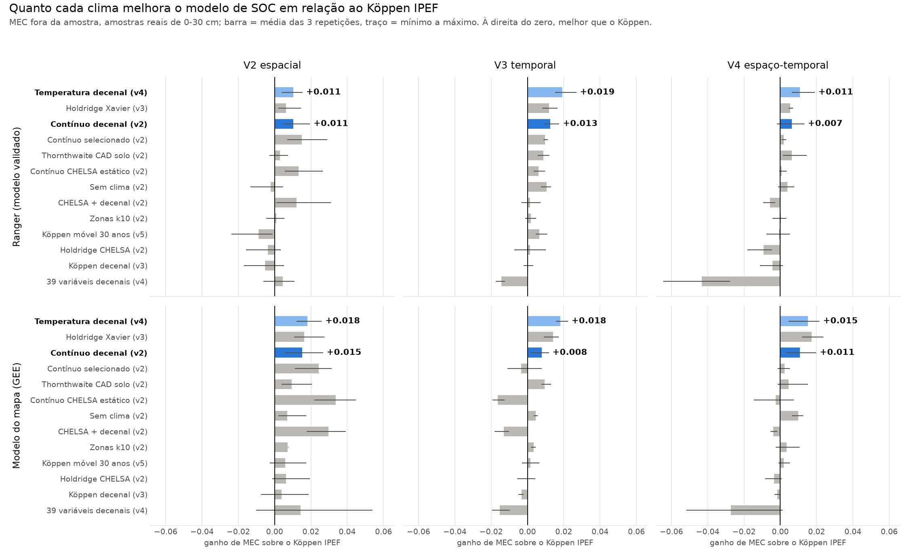
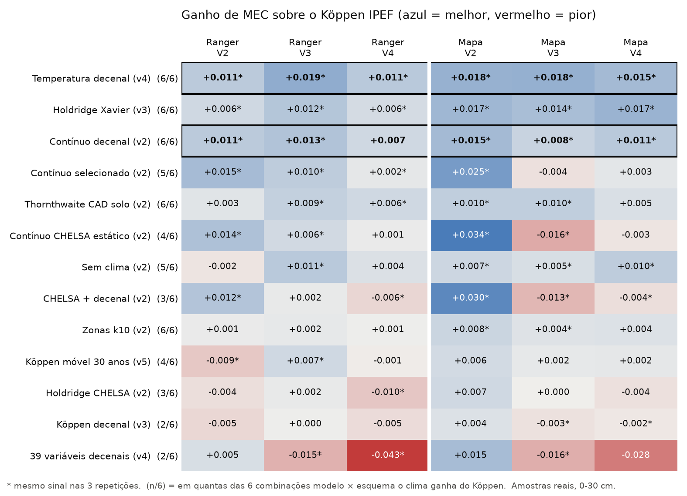
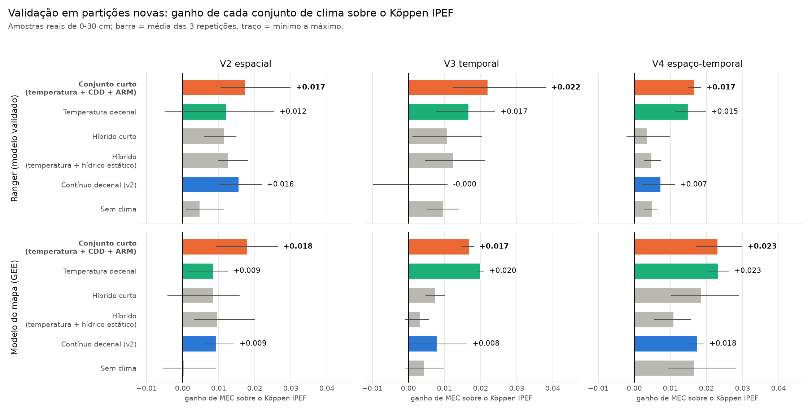
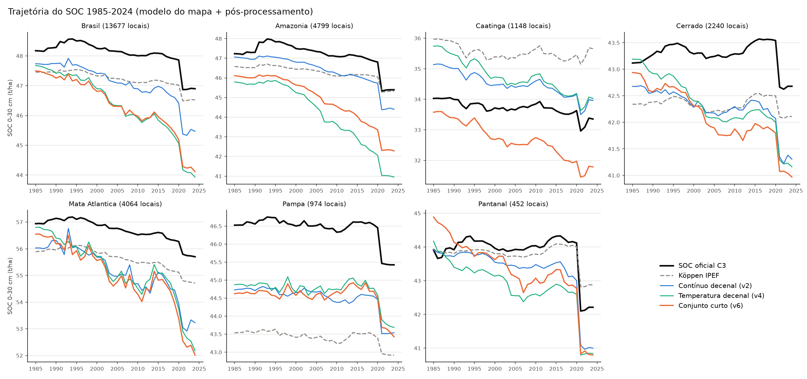

# Clima para estimativas de SOC no MapBiomas Solo

**Existe uma representação do clima melhor que o Köppen para o modelo de carbono orgânico do solo?**

Síntese dos relatórios técnicos v1 a v7 (outubro de 2026)
Fabrício Correia de Oliveira (UTFPR)

---

## O problema

- O MapBiomas Solo C3 usa o **Köppen IPEF** (Alvares et al. 2013) como **única** informação climática no
  modelo de SOC: 13 dummies, num modelo com 131 covariáveis.
- O produto é **anual (1985-2024)**, mas o Köppen é **estático** e **categórico**.
- Pergunta: trocar o Köppen melhora a estimativa do SOC
  - **onde não há amostra** (espaço),
  - **em anos sem amostra** (tempo),
  - **nos dois ao mesmo tempo**?

---

## Caminho percorrido: 7 experimentos

| | Experimento | Tratamentos de clima testados |
|---|---|---|
| **v1** | Bases climáticas e classificações (modelo aproximado) | Köppen, Holdridge, Thornthwaite, zonas k10, 12 variáveis contínuas, estratificação por zona |
| **v2** | Pipeline de produção reconstruído; espaço **e** tempo | 9 cenários: classes estáticas, contínuo CHELSA, **contínuo decenal**, seleção aninhada; + 6 algoritmos |
| **v3** | Classificações que mudam por **década** | Köppen, Holdridge, Thornthwaite, k10: estático × decenal (Xavier) |
| **v4** | 39 variáveis decenais (ETo pelo Rn, balanço hídrico) | 5 grupos: temperatura, chuva, energia, balanço hídrico (2 CADs); todas; com seleção |
| **v5** | Köppen **dinâmico** por média móvel de 30 anos | Köppen recalculado a cada ano (normal Y−30 a Y−1) |
| **v6** | Validação final em **partições novas** | conjunto curto (temperatura + CDD + ARM), híbrido (temperatura + hídrico estático), contra as referências |
| **v7** | Conjunto curto com o **Xavier v3.2.4** (até 2025) | mesmo teste do v6 com a grade nova; Köppen 1991-2020 e normal no GEE |

---

## Como foi feito (comum a v2-v7)

- **Matriz de treino idêntica à de produção** (`trainingFinal`: 27.425 linhas); o OOB publicado pelo MapBiomas
  foi reproduzido na 2ª casa decimal (MEC 0,73 e 0,58).
- **Só o clima muda** entre os cenários; as outras 118 covariáveis são as da produção.
- **Dois modelos:**
  - o **ranger** que o MapBiomas validou;
  - o **modelo que gera o mapa** (`smileRandomForest`, maxNodes 40), que é outro modelo.
- **Três validações**, 3 repetições cada, perfil e réplicas sempre na mesma dobra:
  - **V2 espacial**: blocos de 2°;
  - **V3 temporal**: deixa uma década de fora;
  - **V4 espaço-temporal**: lugar e década novos.
- Métrica: **MEC** nas amostras reais de 0-30 cm; ganho pareado sobre o Köppen na mesma dobra.

---

## v1: base climática e primeiras comparações

**Base climática** (22 estações, 2010-2019):
- Temperatura: CHELSA e Xavier equivalentes (r ≈ 0,99).
- Chuva: **Xavier** é o melhor (r 0,92 contra 0,82 das outras).
- O CHELSA foi escolhido para as classificações (1 km e ETP pronta).

**Dentro do modelo** (ganho de R² no SOC sobre o Köppen):

| Clima | Ganho |
|---|---|
| **12 variáveis contínuas** | **+0,025 a +0,038** |
| Zonas k10 | +0,009 a +0,015 |
| Thornthwaite / Holdridge | +0,002 a +0,010 |
| Sem clima | +0,002 |

- O Köppen não acrescenta nada: tirá-lo não piora o modelo.
- **Estratificar (um modelo por zona) piora.**

---

## v2: no modelo de produção, espaço × tempo

MEC, amostras reais 0-30 cm (ganho sobre o Köppen):

| Cenário | Ranger V2 | Ranger V3 | Ranger V4 | Mapa V2 | Mapa V3 | Mapa V4 |
|---|---|---|---|---|---|---|
| Köppen IPEF | 0,240 | 0,172 | 0,152 | 0,179 | 0,124 | 0,111 |
| Sem clima | −0,002 | **+0,011** | +0,004 | **+0,007** | **+0,005** | **+0,010** |
| Contínuo CHELSA (estático) | **+0,014** | **+0,006** | +0,001 | **+0,034** | **−0,016** | −0,003 |
| **Contínuo decenal** | **+0,011** | **+0,013** | +0,007 | **+0,015** | **+0,008** | **+0,011** |
| Contínuo selecionado | **+0,015** | **+0,010** | **+0,002** | **+0,025** | −0,004 | +0,003 |
| Thornthwaite CAD solo | +0,003 | **+0,009** | **+0,006** | **+0,010** | **+0,010** | +0,005 |

Em negrito: mesmo sinal nas 3 repetições.

---

## v2: o que aprendemos

1. **O Köppen não é o melhor em nenhum esquema, com nenhum dos dois modelos.** No modelo do mapa, até
   **tirar o clima** é melhor que ele.
2. **Clima contínuo estático** (normais CHELSA) é o melhor **no espaço**, mas **piora no tempo** com o
   modelo do mapa.
3. **Clima contínuo decenal** (temperatura e chuva dos 10 anos anteriores + dias secos consecutivos) é,
   entre os cenários do v2, o **único que ganha do Köppen nos três esquemas com o modelo do mapa**.
4. **Robusto ao algoritmo:** o decenal ganha do Köppen em **26 de 27** combinações (9 algoritmos × 3
   esquemas).
5. **Achado lateral:** o mapa usa árvores rasas (maxNodes 40). Usar o ranger validado no mapa dá
   **+0,04 a +0,06** de MEC, mais que qualquer troca de clima.

---

## v2: trajetórias 1985-2024

- As **classificações** só deslocam o nível (~1 t/ha); a forma das trajetórias não muda.
- **Só o clima decenal muda a dinâmica:** a tendência dobra (−0,53 t/ha/década; oficial −0,28).
- Limite: só 289 pares com coletas repetidas, e nenhum modelo acerta nem o sinal da variação temporal.

---

## v3: classificar por década resolve?

O mesmo sistema em duas versões (Xavier): **estática** (1991-2020) × **decenal** (década da amostra).

| Decenal − estática | V2 | V3 | V4 |
|---|---|---|---|
| Köppen | +0,009 / +0,011 | +0,002 / −0,002 | 0,000 / −0,004 |
| Holdridge | +0,001 / +0,003 | 0,000 / +0,003 | −0,002 / −0,007 |
| Thornthwaite | +0,008 / +0,011 | −0,003 / +0,003 | −0,003 / **−0,011** |
| k10 | +0,002 / −0,003 | +0,002 / +0,006 | +0,005 / +0,006 |

(ranger / modelo do mapa)

- **Não.** No tempo, a diferença fica perto de zero ou é negativa. O ganho na V2 é efeito da resolução, não
  do tempo.
- **O Köppen perde por ser classe** (sem gradiente e redundante com biomas e fitofisionomias), **não por ser
  estático**.
- Surpresa: o **Holdridge do Xavier** é a melhor classificação. Ganha do Köppen nos 3 esquemas e nos 2
  modelos e, no modelo do mapa, é o melhor cenário (V2 0,199; V3 0,141; V4 0,129). Mas, com o CHELSA, o
  Holdridge foi o pior: **depende da fonte dos dados**.

---

## v4: mais variáveis decenais ajudam?

39 variáveis em média móvel de 10 anos (ETo de Penman-Monteith pelo Rn, balanço hídrico com 2 CADs).

| Grupo (ranger) | V2 | V3 | V4 |
|---|---|---|---|
| Contínuo decenal v2 (3 variáveis) | 0,251 | 0,184 | 0,159 |
| **Temperatura (7)** | 0,251 | 0,191 | **0,163** |
| Chuva (6) | 0,240 | 0,178 | 0,145 |
| Balanço hídrico CAD 100 (9) | 0,234 | 0,158 | 0,123 |
| **Todas (39)** | 0,245 | 0,157 | **0,109** |
| Todas com seleção | 0,251 | **0,195** | 0,148 |

- **Mais variáveis pioram no tempo:** com as 39, a V4 cai de 0,159 para 0,109.
- Apenas a **temperatura decenal** ajuda no tempo nos dois modelos e na importância por permutação (+0,025
  de MEC na V3 e na V4).
- **Balanço hídrico, energia e chuva decenais** ajudam no espaço, mas viram **"marcadores de período"** no
  tempo.
- Ajudam nos três esquemas: armazenamento (ARM) com a CAD do solo, CDD, temperatura do mês mais frio e
  biotemperatura.

---

## v5: e um Köppen dinâmico de 30 anos?

Köppen recalculado **a cada ano** com a normal completa dos 30 anos anteriores (Xavier).

- 15,8% do Brasil mudou de classe entre 1985 e 2024 (Am → Aw, Af → Am, Aw → BSh).
- Nos pontos, 28% dos locais mudam de classe, mas a maioria das trocas é **oscilação na fronteira**:
  10.098 trocas em 3.882 locais.

| Ganho sobre o IPEF | V2 | V3 | V4 |
|---|---|---|---|
| ranger | −0,009 | +0,007 | −0,001 |
| modelo do mapa | +0,006 | +0,002 | +0,002 |

- **Empate.** Os ganhos ficam abaixo de 0,015 e na maioria trocam de sinal entre as repetições.
- Confirma o v3: **o problema é ser classe, não ser estático.**

---

## Quanto cada clima melhora sobre o Köppen

Relatórios v2 a v5, nas partições originais da validação.

- **Azul:** a família **decenal** (média móvel dos 10 anos anteriores). As duas versões ganham do Köppen nos
  **6 painéis**, quase sempre nas 3 repetições. Pelo ganho médio, a temperatura decenal fica em 1º e o
  contínuo decenal em 3º (o 2º é o Holdridge do Xavier).
- **Contínuo estático (CHELSA):** é o maior ganho no espaço com o mapa (+0,034), mas **piora no tempo**
  (−0,016).
- **39 variáveis juntas:** desabam no espaço-tempo (−0,043).

---

## Todos os tratamentos, todos os esquemas

- Ganho **consistente** (mesmo sinal nas 3 repetições) em pelo menos 5 das 6 combinações: só a **temperatura
  decenal** (6), o **Holdridge do Xavier** (6) e o **contínuo decenal** (5).
- Thornthwaite e zonas k10 também ficam positivos nas 6, mas com ganhos pequenos e que oscilam entre as
  repetições.
- **Temperatura decenal** tem o maior ganho em 3 das 6 colunas (V3 nos dois modelos e V4 no ranger).

---

## Métricas: Köppen × clima decenal

Amostras reais de 0-30 cm, média das 3 repetições. **MEC** (maior é melhor), **RMSE** e **ME** em t/ha.

| Modelo | Esquema | Köppen IPEF | Sem clima | **Contínuo decenal** | **Temperatura decenal** |
|---|---|---|---|---|---|
| ranger | V2 espacial | 0,240 / 48,2 / −2,0 | 0,238 / 48,3 / −2,0 | **0,251** / 47,8 / −2,1 | **0,251** / 47,9 / −1,9 |
| ranger | V3 temporal | 0,172 / 50,3 / −4,1 | 0,182 / 50,0 / −3,5 | **0,184** / 49,9 / −2,9 | **0,191** / 49,7 / −3,2 |
| ranger | V4 espaço-tempo | 0,152 / 50,9 / −3,8 | 0,156 / 50,8 / −3,4 | **0,159** / 50,7 / −2,9 | **0,163** / 50,6 / −3,1 |
| mapa | V2 espacial | 0,179 / 50,1 / −7,4 | 0,187 / 49,8 / −7,1 | **0,195** / 49,6 / −7,3 | **0,198** / 49,5 / −7,2 |
| mapa | V3 temporal | 0,124 / 51,7 / −9,2 | 0,129 / 51,6 / −8,8 | **0,132** / 51,5 / −8,3 | **0,142** / 51,2 / −9,2 |
| mapa | V4 espaço-tempo | 0,111 / 52,1 / −9,0 | 0,121 / 51,8 / −8,6 | **0,122** / 51,8 / −8,4 | **0,127** / 51,7 / −8,8 |

(cada célula: MEC / RMSE / ME)

- Sobre o Köppen, o decenal melhora o MEC em **5 a 15%** e reduz o RMSE em 0,2 a 0,6 t/ha.
- No ranger, o viés no tempo também diminui: o ME vai de −4,1 para −2,9 t/ha na V3.

---

## v6: a validação final, em partições novas

O conjunto curto do v4 foi escolhido olhando as mesmas dobras que o avaliaram. No v6 ele é testado em
**partições novas** (independentes das antigas) e com **sementes novas**, contra as referências.

- **Conjunto curto** (7 de temperatura decenal + CDD + ARM com a CAD do solo): ganha do Köppen nas **6
  combinações, em todas as repetições** (pior repetição +0,009). É o único cenário com isso.
- **Híbrido** (temperatura + normais hídricas estáticas): **perde no tempo** para a temperatura sozinha, em
  todas as repetições.

---

## v6: métricas do conjunto final

Partições novas; amostras reais de 0-30 cm; média das 3 repetições. Cada célula: MEC / RMSE (t/ha).

| Modelo | Esquema | Köppen IPEF | Contínuo decenal (v2) | Temperatura decenal | **Conjunto curto** |
|---|---|---|---|---|---|
| ranger | V2 espacial | 0,229 / 48,5 | 0,245 / 48,0 | 0,242 / 48,1 | **0,247 / 48,0** |
| ranger | V3 temporal | 0,176 / 50,2 | 0,176 / 50,2 | 0,193 / 49,7 | **0,198 / 49,5** |
| ranger | V4 espaço-tempo | 0,161 / 50,6 | 0,168 / 50,4 | 0,175 / 50,2 | **0,177 / 50,1** |
| mapa | V2 espacial | 0,181 / 50,0 | 0,190 / 49,7 | 0,189 / 49,8 | **0,199 / 49,5** |
| mapa | V3 temporal | 0,123 / 51,8 | 0,130 / 51,5 | **0,142 / 51,2** | 0,139 / 51,3 |
| mapa | V4 espaço-tempo | 0,114 / 52,0 | 0,131 / 51,5 | **0,137 / 51,4** | **0,137 / 51,4** |

- O conjunto curto melhora o MEC do Köppen em **8 a 20%** e reduz o RMSE em 0,5 a 0,7 t/ha.
- Sobre a temperatura sozinha, o ganho é pequeno e vem do **espaço** (mapa V2 +0,009, em todas as repetições).
- O contínuo decenal do v2 perdeu o ganho na V3 do ranger com as sementes novas (0,000): é o menos estável no
  tempo.

---

## v6: o que muda nas trajetórias

- Com o conjunto curto, o SOC do mapa cai **3,4 t/ha de 1985 a 2024** (−0,78 t/ha/década), contra 1,3 t/ha no
  oficial. A queda é maior na Amazônia (−1,0 t/ha/década) e na Mata Atlântica (−0,95).
- **Por quê:** a temperatura decenal subiu 1,1 °C nos locais (23,4 → 24,5 °C), o CDD subiu 6,7 dias e o ARM
  caiu 4,5 mm. O modelo aplica ao aquecimento a relação que aprendeu no espaço (lugar mais quente = menos
  carbono).
- **Atenção:** a direção faz sentido, mas a **magnitude não tem validação** no tempo.

---

## v7: com a grade nova do Xavier (v3.2.4, até 2025)

Até o v6, o Xavier do GEE parava em **07/2020** (temperatura, umidade, radiação, vento) e **2022** (chuva): as
janelas de 2021-2024 ficavam incompletas. A **v3.2.4** do autor vai até **31/12/2025** em todas as variáveis.

| Ganho sobre o Köppen | Ranger V2 | V3 | V4 | Mapa V2 | V3 | V4 |
|---|---|---|---|---|---|---|
| Conjunto curto, Xavier v3.2.2 (v6) | +0,017 | +0,022 | +0,017 | +0,018 | +0,017 | +0,023 |
| **Conjunto curto, Xavier v3.2.4 (v7)** | **+0,014** | **+0,019** | **+0,020** | **+0,012** | **+0,015** | **+0,022** |

- **A recomendação se mantém:** ganha nos 6 casos, em todas as repetições (pior repetição +0,006).
- A versão do Xavier muda a validação em no máximo ±0,005, dentro do ruído entre repetições.
- **Trajetórias:** iguais até 2020; depois, a queda é um pouco maior (−0,2 t/ha em 2024 no Brasil, −1,0 no
  Pantanal), porque o **ARM** deixa de ficar parado em 2020. A temperatura de 2024 quase não muda.

---

## v7: Köppen 1991-2020 e normal do Xavier no GEE

- Köppen-Geiger com a normal **completa** 1991-2020 do Xavier v3.2.4 (`agrometeorologiapy`, Alvares et al.
  2013): Aw 46%, Af 19%, Am 18%, BSh 7%, Cfa 6%.
- Concordância: 97,6% com o Xavier antigo e 87,8% com o CHELSA 1991-2020.
- **Publicados em `projects/fcoliveira/assets/Climas2/`**, com descrição, legenda e exemplo de código:
  - `koppen_xavier_1991_2020` (com e sem filtro de moda);
  - `xavier_normal_1991_2020` (temperatura e chuva mensais e anuais).

---

## Quadro geral dos tratamentos

| Tratamento | Espaço (V2) | Tempo (V3) | Espaço-tempo (V4) | Veredito |
|---|---|---|---|---|
| Köppen IPEF (hoje) | ref. | ref. | ref. | pior que "sem clima" no mapa |
| Köppen decenal / móvel 30 anos | ≈ | ≈ | ≈ | não ajuda |
| Zonas k10 | ≈ / + | ≈ | ≈ | neutro no modelo de produção |
| Thornthwaite (CAD do solo) | + | **+** | + | melhor classe na v2 |
| Holdridge Xavier | **+** | **+** | **+** | melhor classe; depende da fonte |
| Contínuo estático (CHELSA) | **++** | − (mapa) | ≈ | melhor no espaço |
| **Contínuo decenal** | **+** | **+** | **+** | ganha nos 3 esquemas, nos 2 modelos e em 26/27 algoritmos |
| **Temperatura decenal** | **+** | **++** | **++** | maior ganho no tempo |
| **Conjunto curto (v6, v7)** | **++** | **++** | **++** | **ganha nos 6 casos em todas as repetições, em partições novas e com as duas versões do Xavier** |
| Híbrido: temperatura + hídrico estático (v6) | + | − | − | as normais hídricas tiram ganho no tempo |
| 39 variáveis decenais juntas | ≈ | − | −− | redundância e ruído |
| Estratificar por zona (v1) | − | | | piora |

---

## Mensagens principais

1. **O Köppen pode ser trocado com vantagem.** Ele não é o melhor em nenhum esquema, e no modelo do mapa
   perde até para "sem clima".
2. **Gradiente vence classe.** Variáveis contínuas ajudam mais que qualquer classificação, estática, decenal
   ou móvel.
3. **No tempo, menos é mais.** O que funciona é um clima decenal **curto e centrado na temperatura**; chuva e
   balanço hídrico (decenais ou estáticos) adicionam ruído no tempo.
4. **O clima decenal muda a trajetória do mapa:** traz uma queda de SOC associada ao aquecimento, que precisa
   de validação temporal.
5. **Os ganhos de clima são pequenos** (0,01-0,03 de MEC, até ~1 t/ha de RMSE). O maior ganho disponível é
   **usar no mapa o modelo validado** (+0,04 a +0,06).

---

## Recomendação: 3 abordagens climáticas para o SOC

| # | Abordagem | Variáveis | Quando usar |
|---|---|---|---|
| **1** | **Conjunto curto decenal** (média móvel dos 10 anos anteriores) | 7 de temperatura (média, máxima, mínima, mês quente, mês frio, amplitude, biotemperatura) + CDD + ARM com a CAD do solo | **mapa anual 1985-2024** (escolha principal) |
| **2** | **Contínuo decenal operacional** | temperatura e chuva decenais do GT de clima + CDD (3 variáveis) | implantação imediata, com os dados que o MapBiomas já tem |
| **3** | **Uma classificação com gradiente físico**: Holdridge (Xavier) ou Thornthwaite (CAD do solo) | dummies L1-L2 | quando a equipe **precisa de uma classe** interpretável |

---

## Por que 1: conjunto curto decenal

- **Venceu a validação final (v6) e se manteve com a grade nova do Xavier (v7):** ganha do Köppen nas 6
  combinações de modelo e esquema, em **todas as repetições** e em partições que não foram usadas para
  escolhê-lo: +0,012 a +0,023 de MEC.
- É o **maior ganho médio** de todos os cenários testados, nos dois modelos (+0,019).
- **Por que essas variáveis:**
  - a **temperatura** é o único clima que ajuda no tempo (v4) e tem tendência suave e bem medida;
  - o **CDD** e o **ARM com a CAD do solo** acrescentam no espaço sem perder no tempo (o ARM traz a água que o
    solo consegue guardar).
- **Núcleo mínimo:** só as 7 de temperatura já entregam quase todo o ganho.
- **Dados:** usar o Xavier **v3.2.4** (`projects/ee-alexandrexavier/assets/BR-DWGD`, até 2025): janelas
  completas até 2026.
- **Custo:** as variáveis foram calculadas aqui (Xavier + `agrometeorologiapy`); precisam ser publicadas como
  assets anuais no GEE.

---

## Por que 2: contínuo decenal operacional

- Usa os dados que o MapBiomas **já tem**: temperatura e chuva decenais do GT de clima, mais o CDD.
- Ganha do Köppen em **5 das 6** combinações no v6 e em **26 de 27** combinações de algoritmo no v2.
- É o **passo intermediário**: troca o Köppen por clima que muda no tempo sem novo processamento.
- **Limite:** é o menos estável no tempo. Com as sementes novas, o ganho na V3 do ranger caiu para zero; a
  chuva decenal traz ruído (v4).

---

## Por que 3: uma classificação, se for preciso

- Às vezes a equipe precisa de uma covariável **categórica e interpretável** (zoneamento, comunicação,
  estratificação de relatórios).
- **Holdridge (Xavier):** é a melhor classificação. Ganha do Köppen nos 3 esquemas e nos 2 modelos e é o
  melhor cenário com o modelo do mapa. Usa a biotemperatura e a razão ETP/P, que têm sentido físico para a
  decomposição.
  - **Ressalva:** o resultado depende da fonte (com o CHELSA foi o pior), por causa da fronteira de 24 °C.
- **Thornthwaite (CAD do solo):** é a alternativa estável. Foi a melhor classe na v2 (ganha na V3 e na V4) e
  integra o solo pela AWC.
- Usar a versão **estática** da classe: classificar por década ou recalcular a cada ano não ajuda (v3, v5).

---

## O que não recomendamos

- **Manter o Köppen IPEF**: no modelo do mapa ele perde até para o modelo sem clima.
- **Köppen decenal ou dinâmico de 30 anos**: empate. Ele continua sendo classe, com oscilação na fronteira.
- **Colocar todas as variáveis climáticas**: com 39 variáveis decenais a V4 cai 0,05.
- **Balanço hídrico no modelo de tempo, decenal ou estático**: o decenal vira marcador de período (v4) e as
  normais estáticas tiram o ganho da temperatura no tempo (v6).
- **Um modelo por zona climática**: cada modelo fica com poucos dados.

---

## Próximos passos

1. **Publicar as 9 variáveis do conjunto curto como assets anuais no GEE** (1985-2026, Xavier v3.2.4), na
   pasta `Climas2`, para o script de produção do MapBiomas.
2. Levar o conjunto curto ao **mapa com o ranger** (ou aumentar o maxNodes no GEE): é o maior ganho disponível.
3. Estender o mapa a 2025-2026: o clima já está calculado com janelas completas (v7).
4. **Validar a queda temporal do SOC:** testar janelas mais longas para a temperatura (20-30 anos) e comparar
   com experimentos de longa duração e locais com coletas repetidas.

---

# Obrigado

Relatórios completos em `relatorios/`: `relatorio_tecnico.md` (v1) a `relatorio_tecnicov7.md`
Código e resultados: GitHub `fcoliveira-utfpr/climate_for_soil`
