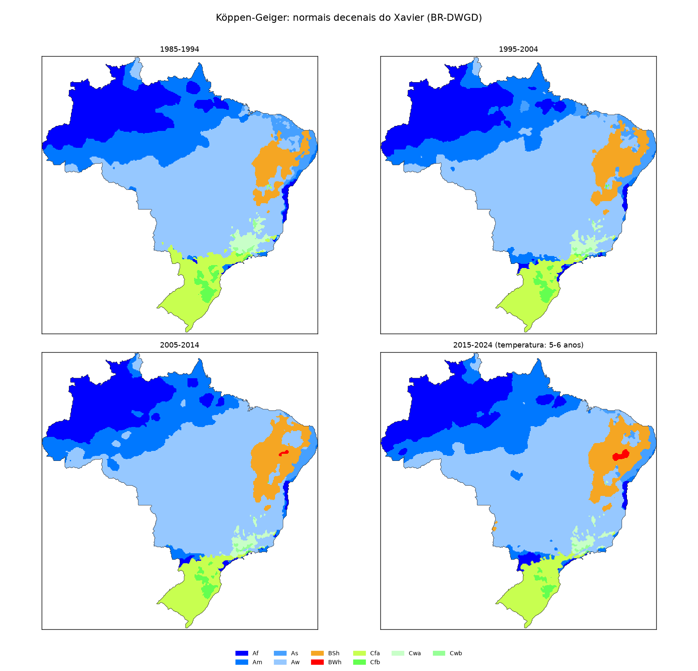
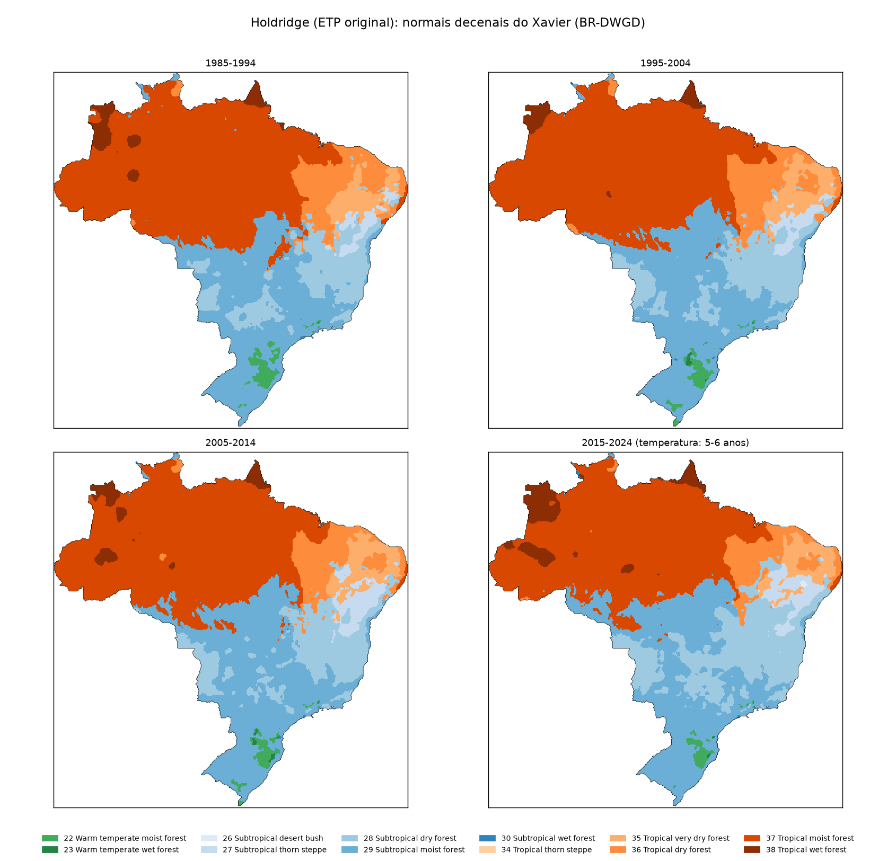
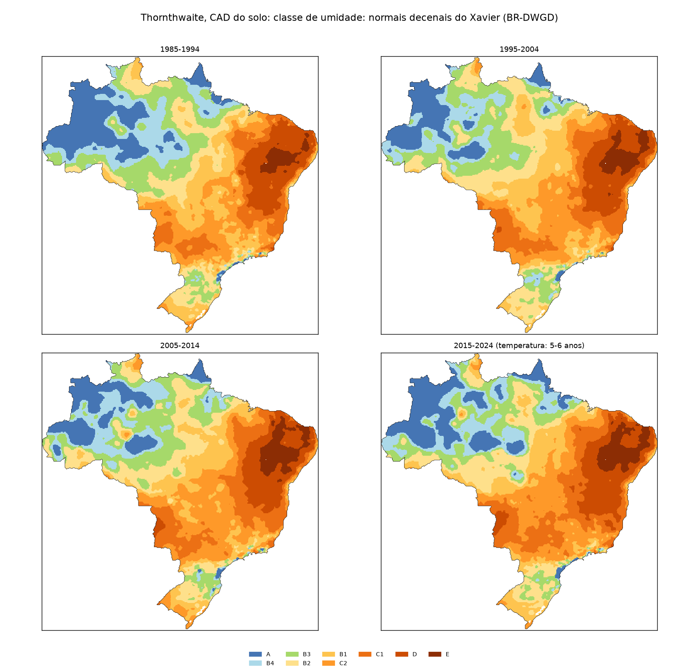
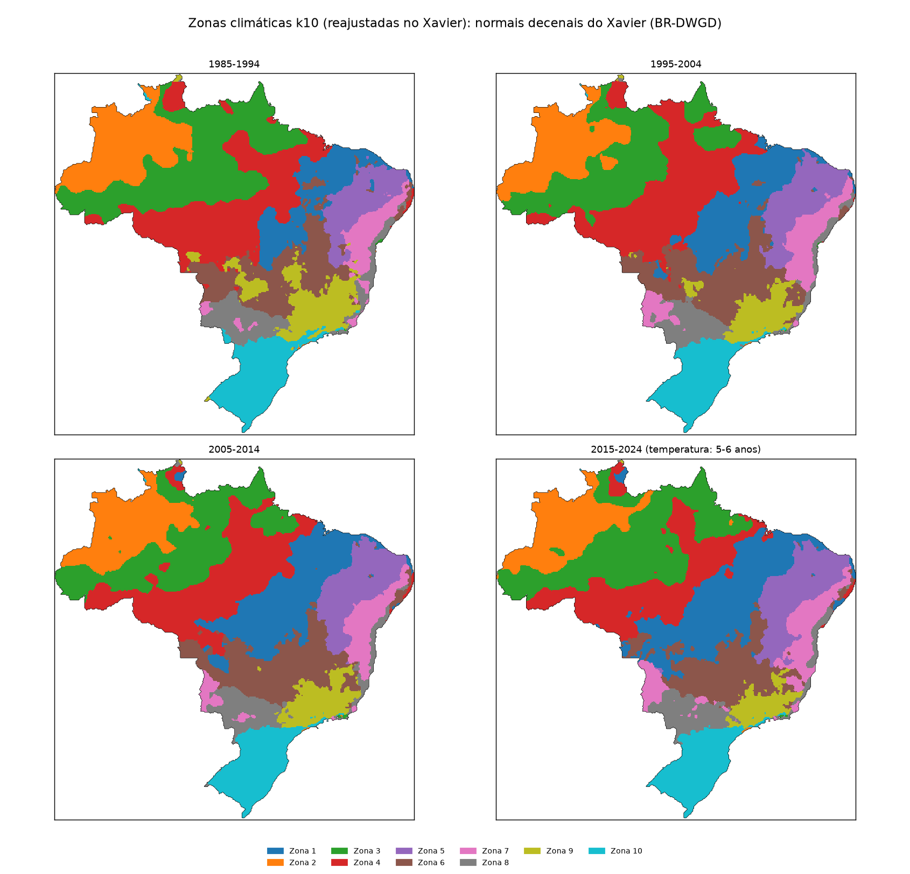
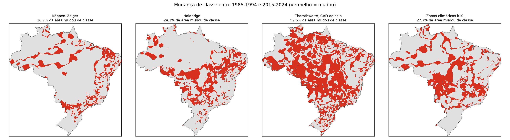
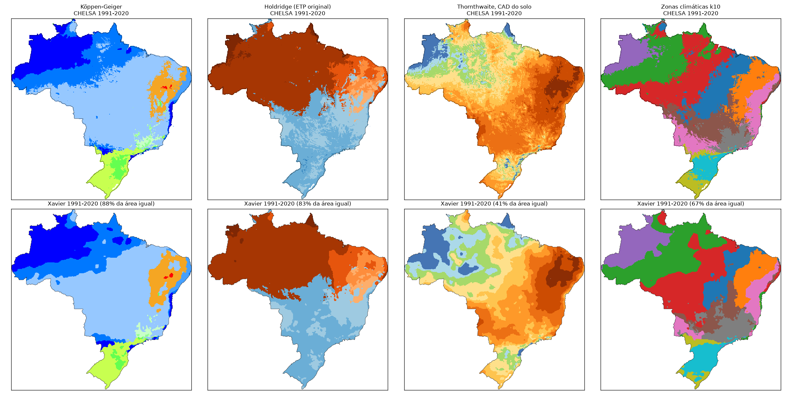

# Relatório técnico v3: classificações climáticas que mudam no tempo (Xavier, 1985-2024) no modelo de SOC

**Repositório:** `MapBiomas_analises` (GitHub `fcoliveira-utfpr/climate_for_soil`), pasta `climas_tempo/`
**Período das análises:** 13 de outubro de 2026
**Escopo:** classificar o clima do Brasil por década (1985-1994, 1995-2004, 2005-2014, 2015-2024) com os
dados diários do Xavier (BR-DWGD), em quatro sistemas (Köppen-Geiger, Holdridge com a ETP original,
Thornthwaite com a CAD do solo e zonas k10), mapear as mudanças e testar no modelo de SOC do MapBiomas Solo C3
se uma classificação que **muda no tempo** representa o clima melhor do que as normais estáticas. Continua os
relatórios [v1](relatorio_tecnico.md) (classificações a partir do CHELSA) e [v2](relatorio_tecnicov2.md)
(reconstrução do pipeline de produção e validação espaço-temporal).

---

## Sumário

1. [Pergunta](#1-pergunta)
2. [Dados e método](#2-dados-e-método)
3. [A biblioteca agrometeorologiapy](#3-a-biblioteca-agrometeorologiapy)
4. [Mapas: o clima do Brasil por década](#4-mapas-o-clima-do-brasil-por-década)
5. [As classificações no modelo de SOC](#5-as-classificações-no-modelo-de-soc)
6. [Síntese](#6-síntese)
7. [Limitações e próximos passos](#7-limitações-e-próximos-passos)
8. [Anexo: arquivos, comandos e reprodução](#8-anexo-arquivos-comandos-e-reprodução)

---

## 1. Pergunta

No relatório v2, o Köppen IPEF (a única variável de clima do modelo de SOC do MapBiomas) ficou entre os
piores cenários, e o melhor no tempo foi o **clima contínuo decenal** (temperatura, chuva e dias secos
consecutivos da década anterior à amostra). Ficou em aberto **por que** o Köppen perde:

- por ser **classe** (13 dummies, sem gradiente, quase toda a informação já presente em biomas e
  fitofisionomias; relatório v2, §5.7); ou
- por ser **estático** (uma normal só, 1991-2020 no CHELSA ou ~1950-1990 no IPEF, aplicada a amostras de
  1985 a 2024).

Este capítulo separa os dois efeitos: cada sistema de classificação entra no modelo em duas versões, com a
**mesma fonte de dados (Xavier)** e o **mesmo sistema**, uma **estática** (normal 1991-2020) e uma
**decenal** (a década de cada amostra). A diferença entre as duas é o efeito de o clima mudar no tempo.

---

## 2. Dados e método

### 2.1 Xavier (BR-DWGD)

Xavier et al. (2022, *Int. J. Climatol.*, doi 10.1002/joc.7731), versão 3.2.2 no GEE
(`projects/sat-io/open-datasets/BR-DWGD/`): dados diários interpolados de estações e pluviômetros, grade de
0,1° (391 × 393 pixels sobre o Brasil). Os valores estão codificados como inteiros:

| Variável | Coleção | Conversão | Cobertura no GEE |
|---|---|---|---|
| Temperatura máxima e mínima (°C) | `TMAX`, `TMIN` | valor × 0,001068148 + 15 | 01/01/1961 a 31/07/2020 |
| Chuva (mm) | `PR` | valor × 0,006866665 + 225 | 01/01/1961 a 31/12/2022 |
| ETo, Penman-Monteith FAO-56 (mm) | `ET` | valor × 0,051181102 | 01/01/1961 a 31/07/2020 |

`codigo/baixar_xavier.py` agrega no GEE, para cada ano de 1961 a 2022, a temperatura média mensal (média de
(Tmax + Tmin)/2), a chuva e a ETo mensais, e baixa os arrays (`computePixels`, ~22 MB por ano).
Conferência em Curitiba, 2010: temperatura de 15,1 °C (agosto) a 23,8 °C (fevereiro), chuva de 332 mm em
janeiro, ETo de 46 a 114 mm/mês.

### 2.2 Décadas

Uma classificação por década, alinhada à série anual de SOC do MapBiomas (1985-2024): **1985-1994,
1995-2004, 2005-2014 e 2015-2024** (os mesmos períodos da validação temporal V3 do relatório v2). A normal da
década é a média de cada mês nos anos disponíveis. Como a temperatura e a ETo terminam em 07/2020 e a chuva em
2022, **a última década tem 5 a 6 anos de temperatura e 8 de chuva**. Para a conferência com o relatório v1,
também foi calculada a normal 1991-2020.

### 2.3 Classificações

Feitas localmente, pixel a pixel, com a biblioteca do autor, `agrometeorologiapy` 0.3.0 (§3):

| Sistema | Entradas | Função | Níveis usados no modelo |
|---|---|---|---|
| Köppen-Geiger (Alvares et al. 2013; f/s/w de Kottek et al. 2006) | T, P mensais | `classificacao_koppen_grade` | L1 (A, B, C), L2 (Af, Am, As, Aw, BS, BW, Cf, Cs, Cw), L3 (classe) |
| Holdridge, ETP original (58,93 × biotemperatura) | T, P mensais | `classificacao_holdridge_grade` | L1 (faixa térmica), L2 (zona de vida) |
| Thornthwaite (1948), CAD do solo | P e ETo mensais | `classificacao_thornthwaite_grade` | L1 (umidade), L2 (umidade + subtipo) |
| Zonas k10 | 9 variáveis do clima contínuo | k-means (§2.4) | zona |

- **CAD do solo:** a AWC do relatório v1 (mm por metro de solo, grade de 1 km), média em cada pixel de 0,1°.
- **Filtro de moda 3 × 3 em todas as classificações** (decisão do autor): o `focalMode` que no v1 só
  existia no Holdridge (vinha do script JS original) passa a valer para os quatro sistemas. Na grade de
  0,1° a janela cobre ~33 km (no CHELSA, ~3 km). No Thornthwaite, a moda é tomada no código L2.

### 2.4 Zonas k10 reajustadas no Xavier

As zonas do v1 foram ajustadas no CHELSA; com os centróides do CHELSA, as zonas do Xavier concordavam só em
67% da área, por diferença de base (a ETo do Xavier é ~12% menor que a ETP do CHELSA). Por decisão do autor,
o k-means foi **reajustado no Xavier**, com o mesmo método do v1 (`corelacao/codigo/zonas_clima.py`): k = 10,
as 9 variáveis (temperatura média e do mês mais frio, chuva anual e do mês mais seco, sazonalidade da chuva,
ETP anual, DEF, EXC e Im do balanço hídrico com CAD de 100 mm), padronizadas, chuva/DEF/EXC em log, ajuste na
normal 1991-2020 do Xavier com peso pela área (cos da latitude), zonas numeradas da mais quente para a mais
fria. Cada década recebe a zona do centróide mais próximo.

| Zona | T média (°C) | T mês frio | Chuva (mm) | Chuva mês seco | ETP (mm) | DEF (mm) | EXC (mm) | Im |
|---|---|---|---|---|---|---|---|---|
| 1 | 27,2 | 26,0 | 1.432 | 2 | 1.544 | 557 | 423 | 9,7 |
| 2 | 27,2 | 26,5 | 2.639 | 126 | 1.242 | 0 | 1.378 | 114,8 |
| 3 | 27,2 | 26,4 | 2.328 | 50 | 1.312 | 82 | 1.109 | 82,2 |
| 4 | 26,6 | 25,5 | 1.940 | 13 | 1.361 | 272 | 855 | 52,0 |
| 5 | 26,5 | 24,6 | 653 | 1 | 1.848 | 1.158 | 0 | −38,0 |
| 6 | 24,7 | 22,0 | 1.301 | 4 | 1.453 | 428 | 242 | 3,2 |
| 7 | 24,6 | 21,5 | 769 | 17 | 1.511 | 612 | 0 | −27,4 |
| 8 | 24,2 | 20,8 | 1.376 | 38 | 1.422 | 108 | 92 | 2,4 |
| 9 | 21,6 | 18,3 | 1.375 | 13 | 1.254 | 193 | 324 | 18,0 |
| 10 | 19,5 | 14,6 | 1.702 | 92 | 1.140 | 2 | 549 | 51,5 |

---

## 3. A biblioteca agrometeorologiapy

A versão instalada era a 0.2.0 (sem classificação climática); a 0.3.0, do GitHub do autor, tem o módulo
`classificacao_climatica` (Köppen, Thornthwaite, Camargo e Holdridge, cada um em versão pontual e vetorizada
para grade).

**Revisão das regras.** Köppen (grupos, limiar de aridez 2T/2T+14/2T+28, Af/Am/As/Aw, f/s/w de Kottek,
a/b/c/d, troca de estações no hemisfério norte), Holdridge (correção de latitude só acima de 24 °C, ETP
original, 38 zonas de Leemans/Jungkunst) e Thornthwaite (Im = Ih − 0,6 Ia, Tabelas de Aparecido et al. 2016
com as três correções pelo original) conferem com a literatura e com as correções feitas no relatório v1.
Única ressalva: no grupo D (frio continental), a letra *d* (Tmin < −38 °C) tem precedência sobre *a*/*b*,
quando pelo Kottek só vale depois delas; não ocorre no Brasil.

**Teste numérico.** Com as normais do CHELSA 1991-2020 em 3.000 locais, a 0.3.0 reproduz o Köppen dos mapas
do v1 em **100%** (2.998 de 2.998) e o Holdridge (ETP original) em **98,9%**; as 32 diferenças estão em
fronteiras de classe (biotemperatura perto de 18 e 24 °C, ETP/P perto de 0,5, 1 e 2) e vêm do filtro de moda
do mapa do v1, já que a biblioteca classifica pixel a pixel.

---

## 4. Mapas: o clima do Brasil por década

Código: `codigo/classificar.py` e `codigo/mapas.py`. Paletas do v1, exceto o Holdridge, que ganhou uma
família de cores por faixa térmica (a paleta do v1 repetia os azuis entre temperado quente e subtropical).

### 4.1 Köppen-Geiger


*Figura 1. Köppen-Geiger por década, Xavier.*

| Classe (% da área) | 1985-1994 | 1995-2004 | 2005-2014 | 2015-2024 |
|---|---|---|---|---|
| Aw | 42,9 | 46,0 | 48,4 | 46,7 |
| Am | 20,2 | 18,1 | 17,7 | 19,1 |
| Af | 18,8 | 18,3 | 17,2 | 17,6 |
| Cfa | 7,0 | 5,7 | 5,7 | 5,7 |
| BSh | 5,1 | 6,3 | 7,3 | 7,3 |
| As | 3,0 | 3,2 | 1,5 | 1,6 |
| Cwa | 1,7 | 1,3 | 1,2 | 1,0 |
| Cfb | 1,1 | 0,9 | 0,8 | 0,5 |

O Aw avança sobre o sul da Amazônia, o semiárido (BSh) cresce de 5,1% para 7,3% e surge o **BWh (árido)** no
centro do semiárido a partir de 2005-2014; o Cfb das serras do Sul encolhe.

### 4.2 Holdridge (ETP original)


*Figura 2. Zonas de vida de Holdridge por década, Xavier.*

| Zona (% da área) | 1985-1994 | 1995-2004 | 2005-2014 | 2015-2024 |
|---|---|---|---|---|
| 37 Tropical moist forest | 49,7 | 47,7 | 45,4 | 42,0 |
| 29 Subtropical moist forest | 23,0 | 23,9 | 25,8 | 23,9 |
| 28 Subtropical dry forest | 10,9 | 12,0 | 12,0 | 17,3 |
| 36 Tropical dry forest | 7,9 | 7,8 | 6,9 | 5,9 |
| 35 Tropical very dry forest | 3,4 | 4,0 | 3,9 | 3,3 |
| 38 Tropical wet forest | 2,4 | 1,5 | 2,1 | 3,8 |
| 27 Subtropical thorn steppe | 1,6 | 1,8 | 2,9 | 2,9 |
| 22 Warm temperate moist forest | 1,2 | 1,0 | 0,9 | 0,6 |

**O Holdridge não enxerga o aquecimento.** A temperatura média do Brasil sobe 1 °C (25,13 → 26,10 °C) e a
ETo sobe 100 mm, mas a biotemperatura fica em ~24,1 °C nas quatro décadas: a correção de latitude
(t − 3·|lat|/100·(t − 24)², nos meses acima de 24 °C) desconta cada vez mais à medida que os meses quentes
esquentam. Como o Brasil está em média na fronteira tropical/subtropical (24 °C), a mudança aparece como
"tropical → subtropical" no Brasil Central, um efeito do método, não um resfriamento.

| Média do Brasil | 1985-1994 | 1995-2004 | 2005-2014 | 2015-2024 |
|---|---|---|---|---|
| Temperatura (°C) | 25,13 | 25,62 | 25,80 | 26,10 |
| Chuva (mm/ano) | 1.775 | 1.732 | 1.753 | 1.771 |
| ETo (mm/ano) | 1.331 | 1.392 | 1.423 | 1.430 |
| Biotemperatura (°C) | 24,12 | 24,18 | 24,19 | 24,11 |

### 4.3 Thornthwaite (CAD do solo)


*Figura 3. Classe de umidade de Thornthwaite por década, Xavier.*

| Classe de umidade (% da área) | 1985-1994 | 1995-2004 | 2005-2014 | 2015-2024 |
|---|---|---|---|---|
| A (superúmido) | 14,1 | 8,8 | 9,4 | 12,6 |
| B4 | 11,6 | 9,1 | 9,8 | 10,3 |
| B3 | 14,7 | 15,4 | 13,9 | 11,3 |
| B2 | 12,3 | 15,5 | 13,7 | 12,7 |
| B1 | 14,4 | 14,7 | 12,9 | 11,0 |
| C2 | 13,3 | 13,8 | 16,4 | 15,1 |
| C1 | 8,4 | 10,5 | 11,2 | 12,9 |
| D (semiárido) | 9,3 | 9,2 | 8,7 | 10,1 |
| E (árido) | 1,9 | 3,0 | 4,0 | 4,0 |

Ressecamento: com a chuva estável e a ETo 100 mm/ano maior, o índice de umidade cai e as classes secas (C1,
D, E) crescem. Como as faixas de umidade são estreitas (20 pontos de Im), **52% da área muda de classe**. A ETo
do Xavier depende de vento, radiação e umidade, interpolados de bem menos estações que a chuva, e deixa
"anéis" em torno das estações (Figura 5), o que amplia a mudança.

### 4.4 Zonas k10 (reajustadas no Xavier)


*Figura 4. Zonas climáticas k10 por década, Xavier.*

| Zona (% da área) | 1985-1994 | 1995-2004 | 2005-2014 | 2015-2024 |
|---|---|---|---|---|
| 1 (a mais quente, DEF 557 mm) | 8,2 | 11,5 | 14,4 | **16,5** |
| 2 (quente e superúmida) | 11,9 | 10,7 | 10,7 | 10,1 |
| 3 (quente e úmida) | 20,9 | 16,9 | 16,9 | 19,9 |
| 4 (quente, seca moderada) | 18,9 | 20,5 | 18,5 | 15,5 |
| 5 (semiárido) | 6,1 | 7,1 | 7,7 | 8,4 |
| 6 | 10,6 | 12,1 | 11,7 | 10,0 |
| 7 (semiárido ameno) | 4,0 | 5,5 | 4,8 | 5,9 |
| 8 | 5,2 | 4,5 | 4,5 | 4,5 |
| 9 (amena) | 7,1 | 4,6 | 4,2 | **2,9** |
| 10 (a mais fria, Sul) | 7,2 | 6,6 | 6,4 | 6,3 |

A zona mais quente e com seca marcada (1) dobra de área; a zona amena (9) cai para menos da metade.

### 4.5 Mudança de classe e conferência com o CHELSA


*Figura 5. Pixels que mudaram de classe entre 1985-1994 e 2015-2024.*

| Sistema | Área que mudou de classe | Principais transições | Concordância Xavier × CHELSA, 1991-2020 |
|---|---|---|---|
| Köppen | 16,7% | Am → Aw, Af → Am, Aw → BSh | **88%** |
| Holdridge | 24,1% | 29 → 28, 37 → 29, 37 → 38 | 83% |
| Thornthwaite (umidade) | 52,5% (L2: 57,6%) | B1 → C2, C2 → C1, B3 → B2 | 41% |
| k10 | 27,7% | 4 → 1, 3 → 4, 9 → 6 | 76% (após parear as zonas) |


*Figura 6. Normal 1991-2020: CHELSA (relatório v1, em cima) e Xavier (embaixo).*

A concordância alta no Köppen confirma que o Xavier e o CHELSA descrevem o mesmo clima; a baixa no
Thornthwaite vem da ETo do Xavier ser ~200 mm/ano (12%) menor que a ETP do CHELSA (1.401 × 1.600 mm, média do
Brasil), o que deixa o país mais úmido no Xavier.

---

## 5. As classificações no modelo de SOC

### 5.1 Desenho

Mesma matriz, covariáveis, dobras e modelos do relatório v2 (capítulos 1 e 2): matriz = `trainingFinal`
reconstruída (27.425 linhas), 118 covariáveis da produção + o clima do cenário, validações **V2** (espacial,
blocos de 2°), **V3** (temporal, deixa uma das quatro décadas de fora) e **V4** (espaço-temporal), 3
repetições, perfil e réplicas sempre na mesma dobra. Dois modelos: o **ranger** que o MapBiomas validou e o
**modelo do mapa** (`smileRandomForest` com maxNodes 40, emulado). Métricas `error_statistics` do MapBiomas
em t/ha, aqui **só nas amostras reais de 0-30 cm** (9.787 linhas, sem réplicas `trep` e sem pseudoamostras).

Cenários novos (`codigo/cenarios_tempo.py`), cada sistema em duas versões, com dummies hierárquicas como as
do Köppen na produção (descartadas as com menos de 30 ocorrências):

| Cenário | Clima | Dummies | Classe difere da versão estática em |
|---|---|---|---|
| `koppen_est` / `koppen_dec` | Köppen do Xavier: normal 1991-2020 / década da amostra | 21 / 21 | 10,0% das linhas |
| `holdridge_est` / `holdridge_dec` | Holdridge (ETP original) do Xavier | 12 / 12 | 13,4% |
| `thornthwaite_est` / `thornthwaite_dec` | Thornthwaite (CAD do solo) do Xavier | 28 / 29 | 42,0% |
| `k10_est` / `k10_dec` | zonas k10 reajustadas no Xavier | 10 / 10 | 14,7% |

Referências do relatório v2: Köppen IPEF (produção), contínuo decenal e sem clima. Cada amostra recebe a
classe da sua década pelo ano da linha (as réplicas `trep`, com o ano recuado, recebem a da década do seu
ano); 141 pontos do litoral, fora da grade de 0,1°, recebem a classe do pixel válido mais próximo.
Validação: `validacao.R` e `validacao_gee.py` do relatório v2, com a matriz e os cenários do capítulo 3
(variáveis `VAL_MATRIZ`, `VAL_CENARIOS`, `VAL_OOF`); métricas: `codigo/metricas_cap3.py`.

### 5.2 Resultados

MEC nas amostras reais de 0-30 cm e, entre parênteses, o ganho sobre o Köppen IPEF [mínimo; máximo nas 3
repetições].

**ranger (o modelo validado):**

| Cenário | V2 espacial | V3 temporal | V4 espaço-tempo |
|---|---|---|---|
| **Köppen IPEF** (produção) | 0,240 | 0,172 | 0,152 |
| Sem clima | 0,238 (−0,002) | 0,183 (+0,011) | 0,156 (+0,004) |
| Contínuo decenal (v2) | **0,251** (+0,011) | **0,184** (+0,013) | **0,159** (+0,007) |
| Köppen Xavier, estático | 0,225 (−0,015 [−0,018; −0,010]) | 0,170 (−0,002) | 0,147 (−0,005) |
| Köppen Xavier, decenal | 0,235 (−0,005) | 0,172 (0,000) | 0,147 (−0,005) |
| Holdridge Xavier, estático | 0,247 (+0,006 [+0,002; +0,014]) | **0,184** (+0,012 [+0,008; +0,017]) | 0,158 (+0,006 [+0,005; +0,007]) |
| Holdridge Xavier, decenal | 0,247 (+0,007) | **0,184** (+0,012 [+0,009; +0,015]) | 0,156 (+0,004 [+0,002; +0,006]) |
| Thornthwaite Xavier, estático | 0,233 (−0,007) | 0,172 (0,000) | 0,150 (−0,002) |
| Thornthwaite Xavier, decenal | 0,241 (+0,001) | 0,169 (−0,003 [−0,005; −0,001]) | 0,148 (−0,004 [−0,010; −0,001]) |
| k10 Xavier, estático | 0,236 (−0,004) | 0,176 (+0,004) | 0,147 (−0,005) |
| k10 Xavier, decenal | 0,238 (−0,002) | 0,178 (+0,006) | 0,152 (0,000) |

**Modelo do mapa (`smileRandomForest`, maxNodes 40):**

| Cenário | V2 espacial | V3 temporal | V4 espaço-tempo |
|---|---|---|---|
| **Köppen IPEF** (produção) | 0,179 | 0,124 | 0,111 |
| Sem clima | 0,187 (+0,007) | 0,129 (+0,005) | 0,121 (+0,010) |
| Contínuo decenal (v2) | 0,195 (+0,015) | 0,132 (+0,008) | 0,122 (+0,011) |
| Köppen Xavier, estático | 0,172 (−0,007) | 0,123 (−0,001) | 0,113 (+0,002) |
| Köppen Xavier, decenal | 0,183 (+0,004) | 0,121 (−0,003) | 0,109 (−0,002) |
| Holdridge Xavier, estático | 0,196 (+0,017 [+0,011; +0,027]) | 0,138 (+0,014 [+0,009; +0,017]) | **0,129** (+0,017 [+0,012; +0,024]) |
| Holdridge Xavier, decenal | **0,199** (+0,019 [+0,010; +0,035]) | **0,141** (+0,017 [+0,009; +0,027]) | 0,122 (+0,010 [+0,007; +0,014]) |
| Thornthwaite Xavier, estático | 0,174 (−0,005) | 0,119 (−0,005) | 0,114 (+0,003) |
| Thornthwaite Xavier, decenal | 0,185 (+0,006) | 0,122 (−0,002) | 0,103 (−0,008 [−0,010; −0,005]) |
| k10 Xavier, estático | 0,186 (+0,007) | 0,121 (−0,003) | 0,107 (−0,005) |
| k10 Xavier, decenal | 0,184 (+0,004) | 0,127 (+0,003) | 0,113 (+0,002) |

**A pergunta do capítulo: decenal − estática, mesmo sistema e mesma fonte** (MEC; [mínimo; máximo]):

| Sistema | Modelo | V2 espacial | V3 temporal | V4 espaço-tempo |
|---|---|---|---|---|
| Köppen | ranger | +0,009 [−0,001; +0,015] | +0,002 [0,000; +0,006] | 0,000 [−0,004; +0,008] |
| Köppen | mapa | **+0,011** [+0,007; +0,014] | −0,002 [−0,004; −0,001] | −0,004 [−0,010; +0,001] |
| Holdridge | ranger | +0,001 | 0,000 | −0,002 [−0,005; 0,000] |
| Holdridge | mapa | +0,003 | +0,003 | −0,007 [−0,014; +0,002] |
| Thornthwaite | ranger | **+0,008** [+0,004; +0,014] | −0,003 | −0,003 [−0,004; −0,001] |
| Thornthwaite | mapa | +0,011 [0,000; +0,022] | +0,003 | **−0,011** [−0,014; −0,008] |
| k10 | ranger | +0,002 | +0,002 | +0,005 [−0,005; +0,018] |
| k10 | mapa | −0,003 | +0,006 | +0,006 [+0,001; +0,017] |

Tabelas completas: `climas_tempo/resultados/tabelas/cap3_metricas.csv`, `cap3_resumo.csv` (também nos
recortes "todas as linhas" e "0-30 cm") e `cap3_dec_vs_est.csv`.

### 5.3 Leitura

1. **Atualizar a classificação por década não melhora a estimativa no tempo.** Na V3 e na V4, a diferença
   entre a versão decenal e a estática do mesmo sistema fica em torno de zero ou negativa, nos quatro sistemas
   e nos dois modelos. Onde a versão decenal ganha é na **V2 (espaço)**, o que não é efeito de tempo (ver 2).
2. **O ganho decenal na V2 é efeito de resolução.** O Köppen estático do Xavier (grade de 0,1° com moda de
   ~33 km) perde até do Köppen IPEF (100 m) na V2 (−0,015 com o ranger); as quatro versões decenais,
   ligeiramente diferentes entre si, devolvem parte do detalhe espacial perdido.
3. **Logo, o Köppen perde por ser classe, não por ser estático.** A classificação que muda no tempo continua
   sem gradiente e quase toda redundante com biomas e fitofisionomias (v2, §5.7). O que ajuda no tempo é o
   **clima contínuo decenal**, que traz a variação entre décadas como número (v2: melhor na V3).
4. **O Thornthwaite decenal piora no tempo** (V3/V4 negativas em todas as repetições em parte dos casos): as
   mudanças de classe vêm em boa parte do ruído da ETo interpolada (§4.3) e confundem o modelo.
5. **O Holdridge do Xavier é a melhor classificação**, estático ou decenal: ganha do Köppen IPEF nos três
   esquemas e nos dois modelos, empata com o contínuo decenal na V3 com o ranger (0,184) e, com o modelo do
   mapa, é o melhor cenário de todos (V2 0,199; V3 0,141; V4 0,129). No relatório v2, o Holdridge do CHELSA
   tinha sido o pior. A diferença está na **fronteira tropical/subtropical** (biotemperatura de 24 °C): nas
   amostras reais, só 76% das linhas caem na mesma zona nas duas fontes, e 1.445 linhas são *Tropical moist
   forest* no CHELSA e *Subtropical moist forest* no Xavier (o Xavier é ~0,7 °C mais quente, e a correção de
   latitude desconta mais). Essa fronteira separa melhor o carbono das amostras, mas o resultado **depende da
   fonte de dados**, o que pede cautela.
6. **As zonas k10 continuam neutras**, como no v2.
7. **Os ganhos continuam pequenos** (até ~0,02 de MEC). Nenhuma classificação, estática ou decenal, chega perto
   do ganho de usar no mapa o modelo validado (ranger × maxNodes 40: +0,04 a +0,06; v2, §11).

---

## 6. Síntese

1. **Mapas.** Com o Xavier, as quatro classificações mostram o clima do Brasil mudando de 1985 a 2024: o
   Köppen tem 17% da área mudando de classe (Aw avança, BSh cresce de 5% para 7%, surge BWh no semiárido); as
   zonas k10, 28% (a zona mais quente e seca dobra de área); o Thornthwaite, 52% (ressecamento por ETo maior
   com chuva estável, ampliado pelo ruído da ETo); e o Holdridge, 24%, mas sem enxergar o aquecimento (a
   biotemperatura fica em 24,1 °C enquanto a temperatura sobe 1 °C).
2. **A biblioteca `agrometeorologiapy` 0.3.0 está correta** e reproduz os mapas do relatório v1 (Köppen 100%,
   Holdridge 98,9%).
3. **Classificar por década não melhora a estimativa do SOC no tempo.** A diferença decenal − estática é
   ~0 ou negativa na V3 e na V4 em todos os sistemas. O Köppen perde por ser **classe** (sem gradiente e
   redundante), não por ser estático; o que funciona no tempo é o **clima contínuo decenal** (relatório v2).
4. **O Holdridge do Xavier foi a melhor classificação**, à frente do Köppen IPEF em todos os esquemas e
   modelos e, com o modelo do mapa, à frente de todos os cenários; mas com o CHELSA ele tinha sido o pior. O
   resultado depende da fonte e da posição da fronteira dos 24 °C.
5. **Recomendação para o MapBiomas Solo:** trocar o Köppen pelo clima contínuo decenal (relatório v2) segue
   sendo a opção mais consistente. Se a preferência for manter uma classificação, o Holdridge do Xavier é o
   candidato, com a ressalva do item 4. Nenhuma troca de clima rende tanto quanto usar no mapa o modelo que
   foi validado.

---

## 7. Limitações e próximos passos

**Limitações**

- **Temperatura e ETo do Xavier terminam em 07/2020 no GEE:** a década 2015-2024 tem 5 a 6 anos de
  temperatura e 8 de chuva. A versão 3.2.3 do BR-DWGD, fora do GEE, vai até 2024 e poderia completar a década.
- **Resolução:** 0,1° com moda 3 × 3 (~33 km) é muito mais grosseira que o Köppen IPEF (100 m) e o CHELSA
  (1 km); parte dos resultados (§5.3, item 2) é efeito de resolução.
- **ETo interpolada:** os "anéis" em torno das estações (§4.5) ampliam as mudanças do Thornthwaite e do k10.
- **Holdridge sensível à fonte:** o resultado inverteu entre CHELSA e Xavier (§5.3, item 5); não foi testado
  com uma terceira base.
- **Sem trajetórias:** os cenários do capítulo 3 não foram levados ao painel 1985-2024 nem ao mapa.
- As limitações do relatório v2 continuam valendo (emulação do modelo do GEE, máscara de areia ilegível,
  verdade de campo temporal restrita a 289 pares).

**Próximos passos**

1. Completar 2020-2024 com o BR-DWGD 3.2.3 (fora do GEE) e refazer a última década.
2. Testar o Holdridge com uma terceira base (ex.: ERA5-Land ou TerraClimate) para ver se o resultado se
   sustenta.
3. Testar a classificação decenal sem a moda 3 × 3 (ou com janela menor), para separar o efeito de
   resolução.
4. Levar o melhor cenário (Holdridge do Xavier ou contínuo decenal) ao painel e ao script de simulação de
   mapas no GEE (`simulacao_mapas_soc`).

---

## 8. Anexo: arquivos, comandos e reprodução

Código em `climas_tempo/codigo/` (versionado); dados por pixel e por ponto em `climas_tempo/dados/` (fora
do git); figuras e tabelas em `climas_tempo/resultados/`; decisões em `climas_tempo/planejamento.md`.

| Etapa | Comando (em `climas_tempo/codigo/`) | Saída principal |
|---|---|---|
| 1. Dados mensais do Xavier (GEE) | `python baixar_xavier.py 1961 2022` | `dados/xavier_mensal/<ano>.npz` |
| 2. Classificações por década e k10 | `python classificar.py` | `dados/classes_decadas.npz`, `classes_1991_2020.npz`, `resultados/tabelas/zonas_k10_xavier_*.csv` |
| 3. Mapas e tabelas | `python mapas.py` | `resultados/figuras/*.png`, `area_classes_decadas.csv`, `mudancas.csv`, `conferencia_chelsa.csv` |
| 4. Classes nos pontos de SOC | `python cenarios_tempo.py` | `dados/matriz_cap3.parquet`, `codigo/cenarios_cap3.json` |
| 5. Validação, ranger | ver abaixo | `dados/oof_ranger/*.parquet` |
| 6. Validação, modelo do mapa | ver abaixo | `dados/oof_mapa/*.parquet` |
| 7. Métricas | `python metricas_cap3.py` | `resultados/tabelas/cap3_*.csv` |

Validações (PowerShell, em `climas/analise_espaco_tempo/codigo/`):

```powershell
$env:VAL_MATRIZ = "C:\Python\MapBiomas_analises\climas_tempo\dados\matriz_cap3.parquet"
$env:VAL_CENARIOS = "C:\Python\MapBiomas_analises\climas_tempo\codigo\cenarios_cap3.json"
$env:VAL_OOF = "C:\Python\MapBiomas_analises\climas_tempo\dados\oof_ranger"
& "C:\Program Files\R\R-4.6.1\bin\Rscript.exe" validacao.R todos v2,v3,v4 direta
$env:VAL_OOF = "C:\Python\MapBiomas_analises\climas_tempo\dados\oof_mapa"
python validacao_gee.py todos
```

Ambiente: Python 3.13 com `agrometeorologiapy` 0.3.0 (`pip install git+https://github.com/fcoliveira-utfpr/agrometeorologiapy`),
earthengine-api, rasterio, scikit-learn, scipy, pandas, matplotlib; R 4.6.1 com `ranger`, `data.table`,
`arrow`, `jsonlite`; GEE pelo projeto `mapbiomas-brazil`. Depende dos dados do relatório v2
(`climas/dados_espaco_tempo/matriz_cenarios.parquet` e as predições de referência em `oof/` e `oof_gee/`) e
da AWC do relatório v1 (`climas/dados_chelsa/awc/`).
