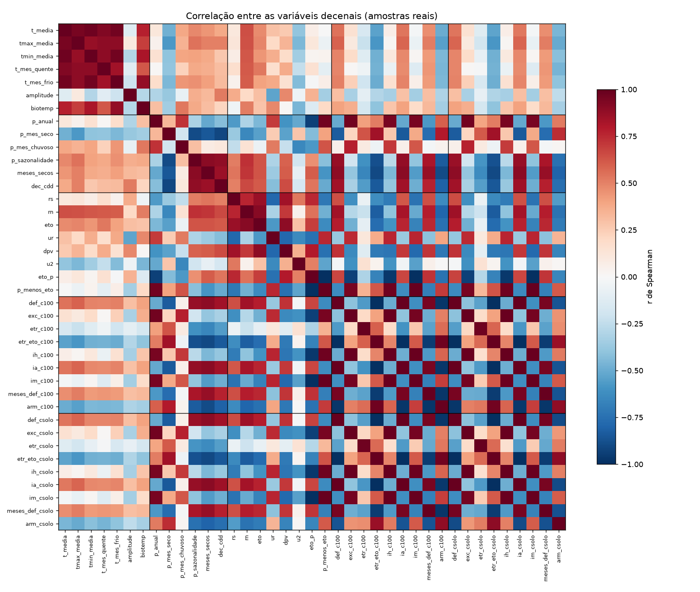
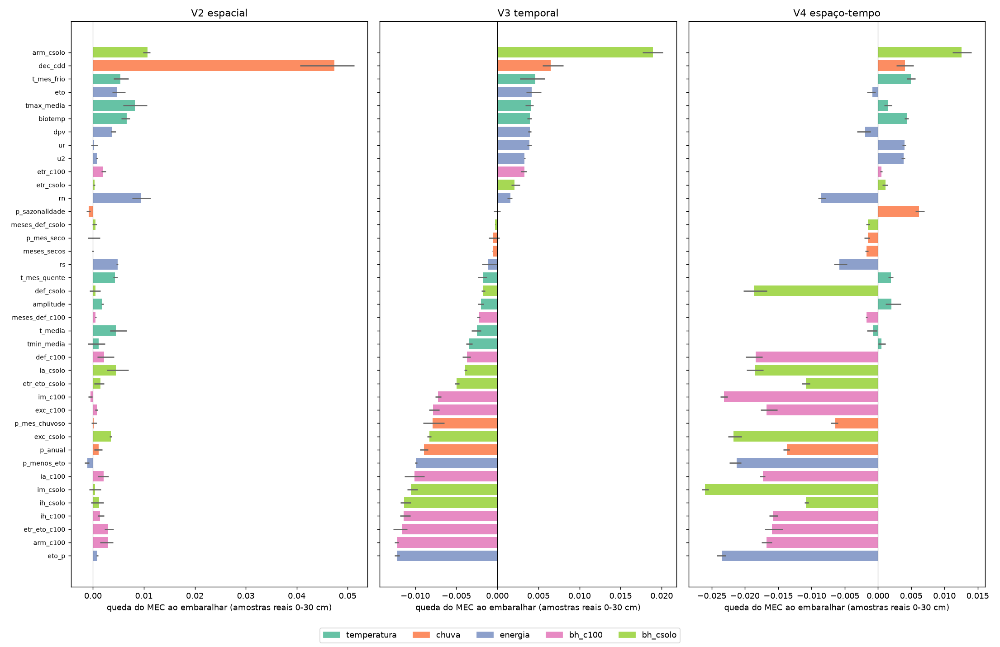

# Relatório técnico v4: quais variáveis climáticas decenais afetam a predição do SOC

**Repositório:** `MapBiomas_analises` (GitHub `fcoliveira-utfpr/climate_for_soil`), pasta `clima_decenal/`
**Período das análises:** 13 e 14 de outubro de 2026
**Escopo:** gerar, a partir dos dados diários do Xavier (BR-DWGD), 38 variáveis climáticas em média móvel de
10 anos, com a ETo de Penman-Monteith calculada pelo saldo de radiação (Rn) e o balanço hídrico climatológico
da biblioteca `agrometeorologiapy` do autor, e avaliar quais delas, e quais grupos, ajudam a predizer o
estoque de carbono orgânico do solo (SOC) do MapBiomas Solo C3 no espaço e no tempo. Continua os relatórios
[v2](relatorio_tecnicov2.md) (pipeline de produção, contínuo decenal) e [v3](relatorio_tecnicov3.md)
(classificações por década).

---

## Sumário

1. [Pergunta](#1-pergunta)
2. [Dados e método](#2-dados-e-método)
3. [As variáveis e a redundância entre elas](#3-as-variáveis-e-a-redundância-entre-elas)
4. [Grupos de variáveis no modelo de SOC](#4-grupos-de-variáveis-no-modelo-de-soc)
5. [Importância de cada variável fora da amostra](#5-importância-de-cada-variável-fora-da-amostra)
6. [Síntese](#6-síntese)
7. [Limitações e próximos passos](#7-limitações-e-próximos-passos)
8. [Anexo: arquivos, comandos e reprodução](#8-anexo-arquivos-comandos-e-reprodução)

---

## 1. Pergunta

Os relatórios anteriores mostraram que o clima que ajuda a estimar o SOC **no tempo** é o **contínuo
decenal** (média dos 10 anos anteriores à amostra), e não uma classificação, nem estática (v2) nem por década
(v3). Esse contínuo decenal tinha só três variáveis: temperatura e chuva do GT de clima do MapBiomas e o CDD
(dias secos consecutivos). Aqui ele é ampliado para 39 variáveis, com energia, umidade do ar e balanço
hídrico, para responder:

1. Mais variáveis climáticas decenais melhoram a predição no espaço (V2), no tempo (V3) e nos dois (V4)?
2. Que **tipo** de informação ajuda: temperatura, chuva, energia ou balanço hídrico?
3. Quais **variáveis** mais pesam, medindo a importância fora da amostra?

---

## 2. Dados e método

### 2.1 Dados do Xavier

Xavier et al. (2022), BR-DWGD v3.2.2 no GEE, diário, 0,1° (391 × 393 pixels). `codigo/baixar_xavier.py`
baixa, para cada ano de 1961 a 2022, as médias mensais de Tmax, Tmin, umidade relativa, radiação solar global
(Rs) e vento a 2 m, com as escalas do catálogo (T: × 0,001068148 + 15; UR: × 0,393700787; Rs: × 0,157086614;
vento: × 0,059055118). A chuva mensal vem do capítulo anterior (`climas_tempo/dados/xavier_mensal`). No GEE,
**temperatura, umidade, radiação e vento terminam em 07/2020** e a chuva em 2022.

**Altitude:** média de cada pixel de 0,1° a partir do ETOPO1 (NOAA, 1 minuto de arco, ~1,8 km). O MERIT de
90 m estoura o limite de pixels do GEE nessa redução; a altitude só entra na pressão atmosférica e na
radiação de céu claro, pouco sensíveis a ela.

### 2.2 ETo de Penman-Monteith pelo saldo de radiação

Por decisão do autor, a ETo **não** é a pronta do Xavier: é calculada mês a mês pela equação de
Penman-Monteith FAO-56 com as funções da `agrometeorologiapy` 0.3.0 (`codigo/eto_rn.py`):

| Termo | Cálculo |
|---|---|
| Qo (irradiância extraterrestre) | `irradiancia_extraterrestre` com `nda`, `declinacao_solar`, `angulo_horario_nascer` e `fator_correcao_distancia`, no dia 15 do mês |
| Qg_cs (céu claro) | (0,75 + 2·10⁻⁵·z) · Qo (FAO-56, eq. 37) |
| BOC (ondas curtas) | `boc_saldo(Rs, r=0.23)`: albedo da grama de referência (o padrão da função é 0,25) |
| BOL (ondas longas) | `bol_saldo(Tmax, Tmin, ea, Rs, Qg_cs)` com Rs/Qg_cs limitado a 1 (FAO-56, eq. 39; a função não limita) |
| **Rn** | `saldo_radiacao(BOC, BOL)` |
| G (calor no solo) | 0,14 · (T_mês − T_mês anterior) (FAO-56, eq. 44) |
| es, ea | média de `es_tetens(Tmax)` e `es_tetens(Tmin)`; `ea_umidade(es, UR)` (FAO-56, eq. 12 e 19) |
| Δ, γ | `declive_pressao_vapor(Tmed)`; `constante_psicrometrica(patm_altitude(z))` |
| **ETo** | `eto_penman_monteith_fao56(Rn, G, Tmed, u2, es, ea, Δ, γ)` × dias do mês |

**Conferência com a ETo do Xavier** (também FAO-56, calculada dia a dia), 1961-2020: **r = 0,998**,
diferença média de −0,8% (~1 mm/mês), sem tendência entre os anos. A ETo do Xavier serviu só para essa
conferência; todas as variáveis usam a ETo calculada aqui.

### 2.3 Média móvel e balanço hídrico

Para cada ano Y de 1985 a 2024, a normal mensal de **Y−10 a Y−1** (a mesma janela do GT de clima e do contínuo
decenal do v2), com os anos disponíveis em cada mês (para 2021-2024, de 9 a 6 anos de temperatura,
radiação e vento). Sobre a normal, `codigo/variaveis.py` calcula as variáveis e roda o
`balanco_hidrico_climatologico_grade` da biblioteca (Thornthwaite & Mather 1955, armazenamento inicial de
equilíbrio do ciclo anual) com a ETo pelo Rn, em duas CADs: **100 mm** e a **CAD do solo** (AWC do
relatório v1, por metro de solo, média no pixel de 0,1°).

### 2.4 Pontos e validação

Cada linha da matriz de treino (a `trainingFinal` reconstruída no v2, 27.425 linhas) recebe as variáveis do
**seu ano** no pixel do Xavier (`codigo/pontos.py`; 141 pontos do litoral → pixel válido mais próximo; sem
faltas). Mesmas validações e modelos dos relatórios anteriores: **V2** espacial (blocos de 2°), **V3** temporal
(deixa uma das quatro décadas de fora), **V4** espaço-temporal, 3 repetições, perfil e réplicas na mesma
dobra; **ranger** (o modelo validado pelo MapBiomas) e **modelo do mapa** (`smileRandomForest`, maxNodes 40,
emulado). Métricas `error_statistics` do MapBiomas em t/ha, **nas amostras reais de 0-30 cm** (9.787 linhas).

---

## 3. As variáveis e a redundância entre elas

| Grupo | Variáveis (média móvel de 10 anos) | Média nas amostras |
|---|---|---|
| Temperatura (7) | média, máxima, mínima, do mês mais quente, do mês mais frio, amplitude diária (Tmax − Tmin), biotemperatura de Holdridge | T 23,9 °C; amplitude 10,7 °C |
| Chuva (6) | anual, do mês mais seco, do mês mais chuvoso, sazonalidade (CV mensal), nº de meses secos (P < 60 mm), CDD decenal | 1.672 mm; 2,9 meses secos |
| Energia e ar (8) | Rs, **Rn**, ETo, umidade relativa, déficit de pressão de vapor (DPV), vento, ETo/P, P − ETo | Rn 10,5 MJ/m² dia; ETo 1.284 mm |
| Balanço hídrico, CAD 100 (9) | DEF, EXC, ETR, ETR/ETo, Ih, Ia, Im, meses com deficiência (> 5 mm), armazenamento médio (ARM) | DEF 237 mm; EXC 625 mm |
| Balanço hídrico, CAD do solo (9) | as mesmas | DEF 233 mm; ARM 78 mm |


*Figura 1. Correlação de Spearman entre as 39 variáveis, nas amostras reais (linhas pretas separam os grupos).*

**85 pares de variáveis têm |r| > 0,9.** As duas versões do balanço hídrico são quase idênticas (como no v1:
no equilíbrio anual, EXC − DEF = P − ETP, qualquer que seja a CAD), e dentro de cada grupo as variáveis medem
quase a mesma coisa (DEF, Ia, ETR/ETo, meses com deficiência). A exceção é o **armazenamento (ARM)**, que
depende da CAD: com a CAD do solo, ele carrega a informação do solo.

---

## 4. Grupos de variáveis no modelo de SOC

Cenários (`codigo/cenarios_cd.py`): as 118 covariáveis da produção + um grupo de clima decenal; "todas" (as
39) e "todas com seleção" (seleção aninhada em cada dobra, só com o treino: em cada par com |r| > 0,9 fica a
mais importante; `selecao_continuas.R`). Referências do v2: Köppen IPEF, contínuo decenal (3 variáveis) e sem
clima. MEC nas amostras reais de 0-30 cm; entre parênteses, o ganho sobre o **contínuo decenal do v2** [mínimo;
máximo nas 3 repetições].

**ranger (o modelo validado):**

| Cenário | V2 espacial | V3 temporal | V4 espaço-tempo |
|---|---|---|---|
| Köppen IPEF (produção) | 0,240 | 0,172 | 0,152 |
| Sem clima | 0,238 | 0,183 | 0,156 |
| **Contínuo decenal (v2, 3 variáveis)** | **0,251** | 0,184 | 0,159 |
| Temperatura (7) | **0,251** (0,000) | 0,191 (+0,007 [−0,002; +0,018]) | **0,163** (+0,004 [−0,001; +0,008]) |
| Chuva (6) | 0,240 (−0,011) | 0,178 (−0,006) | 0,145 (−0,013) |
| Energia e ar (8) | 0,250 (−0,001) | 0,183 (−0,001) | 0,130 (**−0,029** [−0,036; −0,015]) |
| Balanço hídrico CAD 100 (9) | 0,234 (−0,017) | 0,158 (**−0,026**) | 0,123 (**−0,036**) |
| Balanço hídrico CAD do solo (9) | 0,240 (−0,011) | 0,166 (−0,018) | 0,134 (−0,025) |
| Todas (39) | 0,245 (−0,006) | 0,157 (**−0,027** [−0,030; −0,025]) | **0,109** (**−0,050** [−0,073; −0,026]) |
| Todas com seleção | **0,251** (0,000) | **0,195** (**+0,010** [+0,004; +0,015]) | 0,148 (−0,010 [−0,018; −0,006]) |

**Modelo do mapa (`smileRandomForest`, maxNodes 40):**

| Cenário | V2 espacial | V3 temporal | V4 espaço-tempo |
|---|---|---|---|
| Köppen IPEF (produção) | 0,179 | 0,124 | 0,111 |
| Sem clima | 0,187 | 0,129 | 0,121 |
| Contínuo decenal (v2, 3 variáveis) | 0,195 | 0,132 | 0,122 |
| Temperatura (7) | 0,198 (+0,003) | **0,142** (**+0,010** [+0,006; +0,014]) | **0,127** (**+0,004** [+0,001; +0,011]) |
| Chuva (6) | 0,186 (−0,008) | 0,128 (−0,004) | 0,117 (−0,006) |
| Energia e ar (8) | 0,200 (+0,006) | 0,139 (+0,007) | 0,110 (−0,012) |
| Balanço hídrico CAD 100 (9) | 0,186 (−0,009) | 0,118 (−0,014) | 0,090 (−0,032) |
| Balanço hídrico CAD do solo (9) | 0,189 (−0,005) | 0,121 (−0,011) | 0,107 (−0,015) |
| Todas (39) | 0,194 (−0,001) | 0,108 (−0,024) | 0,084 (−0,039) |
| Todas com seleção | **0,207** (+0,012) | 0,137 (+0,005) | 0,115 (−0,008) |

Em negrito, o melhor de cada coluna e os ganhos com o mesmo sinal nas três repetições. Tabelas completas:
`clima_decenal/resultados/tabelas/cd_resumo.csv` (também nos recortes "0-30 cm" e "todas as linhas").

**Leitura.**

1. **A temperatura decenal é o único grupo que melhora no tempo nos dois modelos.** Com o ranger, é o melhor
   cenário da V4 (0,163) e o segundo da V3 (0,191); com o modelo do mapa, o melhor na V3 e na V4, à frente do
   contínuo decenal do v2 em todas as repetições.
2. **Balanço hídrico e energia decenais pioram no tempo.** No espaço (V2) ficam perto do Köppen, mas na V3 e na
   V4 caem abaixo dele, e o balanço hídrico com CAD 100 é o pior grupo (V4: 0,123 com o ranger, 0,090 com o
   modelo do mapa).
3. **Mais variáveis não é melhor.** Com as 39 juntas, o modelo tem o pior resultado da V4 (0,109 com o ranger).
4. **A seleção aninhada recupera parte:** "todas com seleção" é o melhor cenário da V3 com o ranger (0,195;
   +0,010 sobre o contínuo decenal do v2, em todas as repetições), mas perde na V4. Manteve em média 17
   variáveis por dobra, sempre amplitude térmica, chuva do mês mais chuvoso, umidade relativa, vento e ARM com
   a CAD do solo, e quase sempre o CDD, a sazonalidade da chuva, o DPV, a biotemperatura e a Tmax.

---

## 5. Importância de cada variável fora da amostra

`codigo/importancia_cd.py`: random forest do scikit-learn configurado como o ranger, com as 118 covariáveis
da produção e as 39 variáveis decenais, treinado em cada dobra (repetição 1 de V2, V3 e V4). No **teste**, cada
variável (e cada grupo inteiro) é embaralhada e o MEC recalculado: **importância = MEC original − MEC
embaralhado**. Valor positivo: a variável ajuda a prever onde ou quando não houve treino. **Valor negativo:
o modelo fica melhor sem ela**, isto é, ela atrapalha fora da amostra. Embaralhar o grupo inteiro contorna a
redundância (com a variável sozinha, a "gêmea" compensa).

**Por grupo** (queda do MEC; [mínimo; máximo] em 3 embaralhamentos):

| Grupo embaralhado | V2 espacial | V3 temporal | V4 espaço-tempo |
|---|---|---|---|
| Temperatura | +0,057 [+0,052; +0,060] | **+0,025** [+0,025; +0,025] | **+0,024** [+0,022; +0,026] |
| Chuva (com CDD) | **+0,059** [+0,054; +0,068] | −0,004 [−0,008; −0,002] | −0,008 [−0,008; −0,006] |
| Energia e ar | +0,043 | −0,001 | **−0,037** [−0,043; −0,032] |
| Balanço hídrico CAD 100 | +0,045 | **−0,011** [−0,013; −0,008] | **−0,060** [−0,063; −0,053] |
| Balanço hídrico CAD do solo | +0,032 | −0,008 | −0,054 |


*Figura 2. Importância de cada variável fora da amostra (queda do MEC ao embaralhá-la no teste), em V2, V3 e
V4; ordenada pela V3. Barras à esquerda do zero: a variável atrapalha.*

**Variáveis com importância positiva nos três esquemas:** ARM com a CAD do solo (V2 +0,011; V3 +0,019; V4
+0,013), CDD decenal (+0,047; +0,007; +0,004), temperatura do mês mais frio (+0,005; +0,005; +0,005),
biotemperatura, Tmax, e, no tempo, umidade relativa e vento. As que mais atrapalham no tempo: Im, Ih, ETR/ETo,
EXC e ARM com CAD 100, ETo/P, P − ETo e a chuva anual.

**Leitura.** No **espaço**, todos os grupos carregam informação (as normais distinguem regiões). No **tempo**,
só a temperatura ajuda de forma consistente; o balanço hídrico, a energia e a própria chuva viram
"marcadores de período": variam entre as décadas de um jeito que o modelo associa ao SOC das amostras daquela
época, e essa associação não vale fora dela. Há duas razões prováveis: (a) a variação decenal da chuva e do
balanço hídrico é pequena perto da variação espacial e muito influenciada por anos extremos e pela rede de
estações que alimenta o Xavier; (b) radiação, umidade e vento do Xavier vêm de bem menos estações que a chuva
(os "anéis" do relatório v3), e as janelas de 2021-2024 estão incompletas. A temperatura, ao contrário, tem
tendência suave e bem medida (+1 °C de 1985-94 a 2015-24).

O ARM com a CAD do solo é a exceção no balanço hídrico porque carrega a informação da **capacidade de água do
solo**, que é estática e muda pouco com o clima.

---

## 6. Síntese

1. **A ETo pelo Rn com a `agrometeorologiapy` reproduz a do Xavier** (r = 0,998, −0,8%), e o Rn passa a estar
   disponível como variável.
2. **Mais variáveis climáticas decenais não melhoram a predição do SOC no tempo; pioram.** Com as 39 juntas, a
   validação espaço-temporal cai de 0,159 (contínuo decenal do v2) para 0,109.
3. **A temperatura decenal é o grupo que ajuda no tempo**, nos dois modelos e na importância por permutação
   (V3 e V4 com +0,025 de MEC). É o melhor cenário espaço-temporal (V4) com o ranger (0,163) e o melhor no tempo
   com o modelo do mapa.
4. **Balanço hídrico, energia e chuva decenais ajudam no espaço, mas atrapalham no tempo**: o modelo os usa
   como marcadores de período.
5. **Variáveis que ajudam nos três esquemas:** ARM com a CAD do solo, CDD decenal, temperatura do mês mais
   frio, biotemperatura e Tmax.
6. **Recomendação:** para o clima decenal no modelo do MapBiomas, um conjunto **curto e centrado na
   temperatura** (temperatura decenal + CDD + ARM com a CAD do solo); as variáveis hídricas e de energia, se
   usadas, na versão **estática** (normal), que dá a informação espacial sem o ruído temporal. Ver §7 para o
   teste desse conjunto.

---

## 7. Limitações e próximos passos

**Limitações**

- **Cobertura temporal:** no GEE, temperatura, umidade, radiação e vento do Xavier vão até 07/2020; as janelas
  de 2021-2024 têm de 9 a 6 anos dessas variáveis.
- **Rede de estações:** radiação, umidade e vento do Xavier vêm de menos estações que a chuva; parte da
  variação decenal pode ser artefato da interpolação.
- **Importância com um só modelo de referência** (repetição 1, scikit-learn configurado como o ranger) e
  permutação marginal (não condicional); com tanta redundância, os grupos são a leitura mais segura.
- **A recomendação do §6 (conjunto curto) foi tirada da importância nas mesmas dobras**: precisa ser validada
  de forma independente antes de virar resultado.
- As limitações dos relatórios v2 e v3 continuam valendo.

**Próximos passos**

1. **Validar o conjunto curto** (temperatura decenal + CDD + ARM CAD do solo) e o **híbrido** (temperatura
   decenal + balanço hídrico estático 1991-2020) nas mesmas V2/V3/V4, com a seleção feita dentro das dobras.
2. Completar 2020-2024 com o BR-DWGD 3.2.3 (fora do GEE) e verificar se a piora no tempo do balanço hídrico
   diminui.
3. Avaliar a variação decenal das variáveis do Xavier contra estações independentes (INMET), para separar
   mudança climática de artefato de interpolação.

---

## 8. Anexo: arquivos, comandos e reprodução

Código em `clima_decenal/codigo/` (versionado); dados por pixel e por ponto em `clima_decenal/dados/` (fora
do git); figuras e tabelas em `clima_decenal/resultados/`; decisões em `clima_decenal/planejamento.md`.

| Etapa | Comando (em `clima_decenal/codigo/`) | Saída principal |
|---|---|---|
| 1. Xavier mensal e altitude (GEE) | `python baixar_xavier.py 1961 2022` | `dados/xavier_mensal/<ano>.npz`, `dados/altitude.npy` |
| 2. ETo pelo Rn | `python eto_rn.py` | `dados/eto_rn/<ano>.npz`, `resultados/tabelas/conferencia_eto.csv` |
| 3. Variáveis decenais | `python variaveis.py` | `dados/variaveis/<ano>.npz`, `n_anos.csv` |
| 4. Variáveis nos pontos | `python pontos.py` | `dados/matriz_cd.parquet`, `resultados/tabelas/variaveis_cd.csv` |
| 5a. Cenários e correlação | `python cenarios_cd.py` | `codigo/cenarios_cd.json`, `correlacao_cd.*`, `pares_redundantes_cd.csv` |
| 5b. Validações | ver abaixo | `dados/oof_ranger/`, `dados/oof_mapa/`, `selecao_cd_dobras*.csv` |
| 5c. Métricas | `python metricas_cd.py` | `resultados/tabelas/cd_metricas.csv`, `cd_resumo.csv` |
| 5d. Importância por permutação | `python importancia_cd.py` | `importancia_cd.csv`, `importancia_cd.png` |

Validações (PowerShell, em `climas/analise_espaco_tempo/codigo/`):

```powershell
$D = "C:\Python\MapBiomas_analises\clima_decenal"
$env:VAL_MATRIZ = "$D\dados\matriz_cd.parquet"
$env:VAL_CENARIOS = "$D\codigo\cenarios_cd.json"
$env:VAL_OOF = "$D\dados\oof_ranger"; $env:VAL_SELECAO = "$D\resultados\tabelas\selecao_cd_dobras.csv"
& "C:\Program Files\R\R-4.6.1\bin\Rscript.exe" validacao.R todos v2,v3,v4 direta
$env:VAL_OOF = "$D\dados\oof_mapa"; $env:VAL_SELECAO = "$D\resultados\tabelas\selecao_cd_dobras_mapa.csv"
python validacao_gee.py todos
```

Ambiente: Python 3.13 com `agrometeorologiapy` 0.3.0, earthengine-api, scikit-learn, pandas, matplotlib; R
4.6.1 com `ranger`; GEE pelo projeto `mapbiomas-brazil`. Depende da matriz e das predições de referência do
relatório v2 (`climas/dados_espaco_tempo/`), da chuva mensal e da grade do relatório v3
(`climas_tempo/dados/`) e da AWC do relatório v1 (`climas/dados_chelsa/awc/`).
