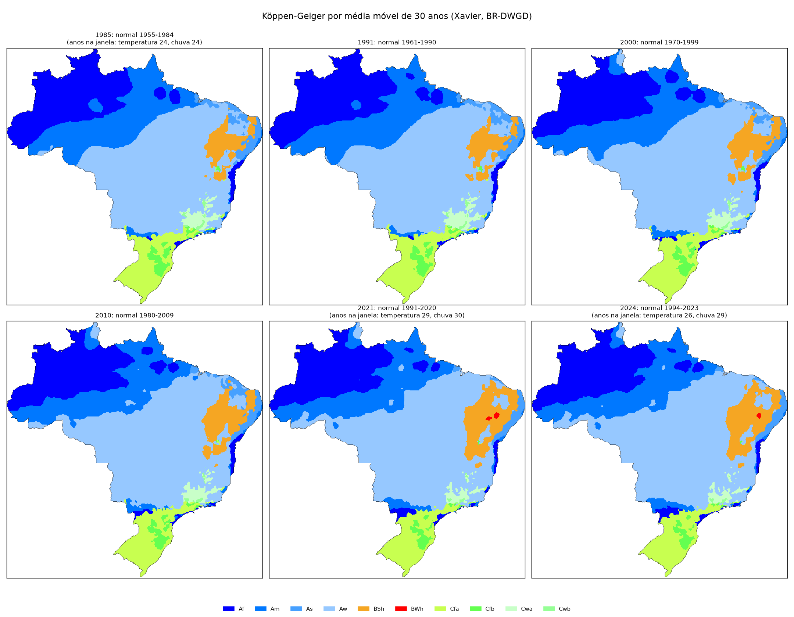
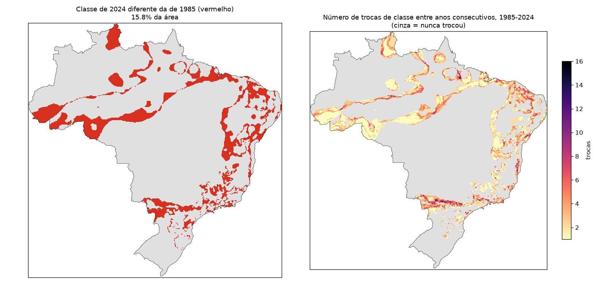
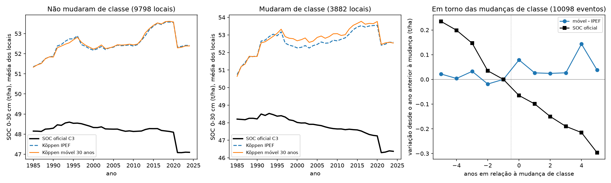
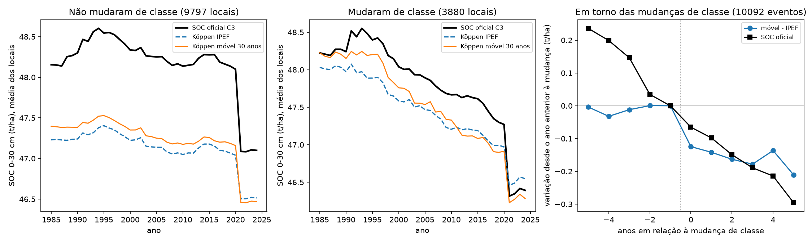

# Relatório técnico v5: Köppen dinâmico por média móvel de 30 anos no modelo de SOC

**Repositório:** `MapBiomas_analises` (GitHub `fcoliveira-utfpr/climate_for_soil`), pasta `climas/koppen_movel30/`
**Período das análises:** 27 de outubro de 2026
**Escopo:** calcular, com os dados do Xavier (BR-DWGD), um Köppen que **anda com o tempo** (cada ano Y
classificado pela normal de Y−30 a Y−1, de 1985 a 2024) e testar se ele representa o clima para o SOC do
MapBiomas Solo C3 melhor do que o Köppen IPEF estático usado na produção, no espaço, no tempo e nas
trajetórias 1985-2024. Continua os relatórios [v2](relatorio_tecnicov2.md) (pipeline de produção),
[v3](relatorio_tecnicov3.md) (classificações por década) e [v4](relatorio_tecnicov4.md) (variáveis contínuas
decenais).

---

## Sumário

1. [Pergunta](#1-pergunta)
2. [Dados e método](#2-dados-e-método)
3. [O Köppen móvel: quanto o clima mudou de classe](#3-o-köppen-móvel-quanto-o-clima-mudou-de-classe)
4. [Validação fora da amostra](#4-validação-fora-da-amostra)
5. [Trajetórias 1985-2024](#5-trajetórias-1985-2024)
6. [Síntese](#6-síntese)
7. [Limitações e próximos passos](#7-limitações-e-próximos-passos)
8. [Anexo: arquivos, comandos e reprodução](#8-anexo-arquivos-comandos-e-reprodução)

---

## 1. Pergunta

O v3 testou o Köppen por **década fixa** (normais de 10 anos), que troca de classe de 10 em 10 anos e com
normais curtas, e ele não ganhou do estático. Aqui a classificação usa uma **normal completa de 30 anos**
(o período da OMM), recalculada **a cada ano**: muda devagar e de forma contínua. A pergunta é:

> Uma classificação Köppen que acompanha o clima dos 30 anos anteriores a cada ano melhora a predição do SOC,
> no espaço (V2), no tempo (V3) e nos dois (V4), e muda as trajetórias de 1985-2024?

Só dois cenários, iguais em tudo menos no clima:

| Cenário | Clima | Muda no tempo? |
|---|---|---|
| `koppen_ipef` (referência) | Köppen IPEF (Alvares et al. 2013), dummies L1-L3 da produção | não |
| `koppen_movel30` | Köppen do Xavier, normal de Y−30 a Y−1, dummies L1-L3 | sim, a cada ano |

---

## 2. Dados e método

**Clima.** Xavier et al. (2022), BR-DWGD v3.2.2, 0,1° (391 × 393 pixels), o mesmo download mensal do v3
(`climas_tempo/dados/xavier_mensal/`, 1961-2022): temperatura média mensal = média de (Tmax + Tmin)/2 diários;
chuva mensal = soma. No asset do GEE a temperatura termina em 07/2020 e a chuva em 2022.

**Janelas.** Para cada ano Y de 1985 a 2024, normal mensal de T e de chuva sobre os anos Y−30 a Y−1
disponíveis ([janelas.csv](../climas/koppen_movel30/resultados/tabelas/janelas.csv)):

| Anos Y | Anos com T | Anos com chuva | Observação |
|---|---|---|---|
| 1985-1990 | 24-29 | 24-29 | o Xavier começa em 1961 |
| 1991-2020 | 30 | 30 | janelas completas |
| 2021-2024 | 29 → 26 | 30 → 29 | T termina em 07/2020; chuva em 2022 |

**Classificação.** `classificacao_koppen_grade` da `agrometeorologiapy` 0.3.0 (a mesma do v3, validada com
100% de concordância com o Köppen do v1 nas normais do CHELSA) e filtro de moda 3 × 3 em todos os anos.

**Pontos.** Cada linha da matriz de SOC do v2 (27.425 linhas, a `trainingFinal` reconstruída) recebe o
Köppen do **ano da coleta**; cada local-ano do painel 1985-2024 recebe o do ano correspondente. Dummies
hierárquicas L1, L2 e L3 como as da produção, descartando as com menos de 30 ocorrências (sobram 19); ponto em
pixel sem dado (141 linhas da matriz) recebe a classe do pixel válido mais próximo.

**Validação.** As mesmas do v2: V2 espacial (blocos de 2°), V3 temporal (deixa uma década de fora), V4
espaço-temporal, 3 repetições, com o **ranger validado** e com o **modelo do mapa oficial** (random forest do
GEE emulado). O `koppen_ipef` não foi refeito: suas predições fora da amostra são as do v2, nas mesmas dobras.
Métricas do MapBiomas em t/ha, 0-30 cm.

---

## 3. O Köppen móvel: quanto o clima mudou de classe



**Consistência.** O mapa de 2021 (janela 1991-2020) concorda em **87,8%** da área com o Köppen do CHELSA
1991-2020 do v1 ([conferencia_chelsa.csv](../climas/koppen_movel30/resultados/tabelas/conferencia_chelsa.csv)),
com as diferenças nas fronteiras entre classes.

**Quanto muda.** Em 2024, **15,8%** da área do Brasil está em classe diferente da de 1985
([mudancas.csv](../climas/koppen_movel30/resultados/tabelas/mudancas.csv)):

| Transição 1985 → 2024 | Área do Brasil (%) |
|---|---|
| Am → Aw | 4,2 |
| Af → Am | 2,9 |
| Aw → BSh | 2,3 |
| Am → Af | 1,1 |
| Cwa → Aw | 0,7 |
| As → BSh, As → Aw | 0,7 cada |

São as transições esperadas: secamento no arco do desmatamento (Am → Aw, Af → Am), expansão do semiárido
(Aw → BSh, As → BSh) e aquecimento no Sudeste (Cwa → Aw).



**Ano a ano**, a cada ano entre 0,9% e 2,7% da área troca de classe (média 1,6%,
[mudancas_por_ano.csv](../climas/koppen_movel30/resultados/tabelas/mudancas_por_ano.csv)). As janelas incompletas
de 2021-2024 não produzem um salto: 2021 troca 2,1% (dentro da faixa dos anos completos) e 2022-2024 trocam
1,0-1,5%, abaixo da média.

**Nos pontos de SOC.** 28,4% dos locais do painel (3.882 de 13.680) têm mais de uma classe em 1985-2024, e
15,3% das linhas da matriz estão em classe diferente da janela 1991-2020. Mas boa parte disso é **oscilação**
na fronteira entre classes: são 10.098 trocas nesses 3.882 locais (2,6 por local), 1.548 locais trocam 3 vezes
ou mais, e só 2.961 locais terminam 2024 em classe diferente da de 1985 (1.361 deles em Am → Aw).

---

## 4. Validação fora da amostra

MEC em 0-30 cm, só amostras reais; entre parênteses, o ganho sobre o Köppen IPEF e, entre colchetes, o mínimo e
o máximo nas 3 repetições ([movel30_resumo.csv](../climas/koppen_movel30/resultados/tabelas/movel30_resumo.csv)):

| Modelo | Cenário | V2 espacial | V3 temporal | V4 espaço-temporal |
|---|---|---|---|---|
| ranger | `koppen_ipef` | 0,240 | 0,172 | 0,152 |
| ranger | `koppen_movel30` | 0,231 (−0,009 [−0,024; −0,001]) | 0,178 (+0,007 [+0,005; +0,011]) | 0,151 (−0,001 [−0,008; +0,005]) |
| mapa | `koppen_ipef` | 0,179 | 0,124 | 0,111 |
| mapa | `koppen_movel30` | 0,185 (+0,006 [−0,003; +0,017]) | 0,126 (+0,002 [−0,003; +0,007]) | 0,113 (+0,002 [−0,001; +0,005]) |

Com todas as amostras de 0-30 cm a leitura é a mesma (ranger: −0,007, +0,008, 0,000; mapa: +0,013, +0,002,
+0,002). Todos os ganhos ficam abaixo de 0,015 de MEC, e o RMSE muda menos de 0,5 t/ha.

- **V2 (espaço):** empate. O ranger perde nas 3 repetições, por pouco; o modelo do mapa ganha em média, mas
  com uma repetição negativa.
- **V3 (tempo):** o único ganho consistente é o do ranger (+0,007, as 3 repetições positivas). É pequeno e não
  se repete no modelo do mapa.
- **V4 (espaço-tempo):** empate nos dois modelos.

**Importância.** No modelo final do ranger, as dummies do Köppen móvel somam 3,2% da importância por impureza
(a melhor na posição 27, `Cfb`), contra 2,8% do Köppen IPEF (melhor na posição 29)
([importancia_movel30.csv](../climas/koppen_movel30/resultados/tabelas/importancia_movel30.csv)). O OOB R² é
praticamente o mesmo (0,726 contra 0,727).

---

## 5. Trajetórias 1985-2024

Modelos finais (matriz inteira) dos dois cenários aplicados ao painel local × ano, 0-30 cm, comparados entre
si e com o SOC oficial da C3 nos mesmos locais e anos
([trajetorias_movel30_*.csv](../climas/koppen_movel30/resultados/tabelas/)).

**Efeito geral** ([trajetorias_movel30_efeito_clima.csv](../climas/koppen_movel30/resultados/tabelas/trajetorias_movel30_efeito_clima.csv)):

| Modelo | Série | SOC médio (t/ha) | Tendência média (t/ha/década) | r da tendência com a oficial | Variação anual média (t/ha) | Diferença absoluta média para o IPEF (t/ha) |
|---|---|---|---|---|---|---|
| ranger | `koppen_ipef` | 52,5 | +0,33 | 0,21 | 0,76 | — |
| ranger | `koppen_movel30` | 52,6 | +0,35 | 0,21 | 0,79 | 2,0 |
| mapa | `koppen_ipef` | 47,2 | −0,22 | 0,89 | 0,15 | — |
| mapa | `koppen_movel30` | 47,3 | −0,27 | 0,88 | 0,17 | 1,0 |
| — | SOC oficial C3 | 48,1 | −0,28 | 1 | 0,18 | — |

O Köppen móvel deixa o nível médio igual (diferença média de +0,05 a +0,10 t/ha) e a concordância da
tendência com o mapa oficial igual. Local a local, ele desloca o SOC previsto em 1-2 t/ha, em média, em
relação ao IPEF.

**Locais que mudaram de classe × que não mudaram**
([trajetorias_movel30_grupos.csv](../climas/koppen_movel30/resultados/tabelas/trajetorias_movel30_grupos.csv)):





- Nos 9.798 locais **sem mudança de classe**, as duas trajetórias coincidem, como deveriam: as mesmas
  covariáveis e a mesma classe em todos os anos.
- Nos 3.882 locais **que mudaram**, a diferença aparece. No ranger, o móvel fica 0,2 t/ha acima do IPEF a
  partir de 1997 e tem mais variação ano a ano (0,91 contra 0,76 t/ha), sem aproximar a tendência da oficial
  (r 0,28 contra 0,31). No modelo do mapa, o móvel começa mais perto do oficial (1985-1997) e **cai mais
  rápido** (−0,51 contra −0,39 t/ha por década; a oficial cai −0,45), com a variação anual maior (0,27 contra
  0,19).
- **Em torno de cada mudança de classe** (painel da direita, diferença em relação ao ano anterior à mudança):
  no modelo do mapa, a diferença móvel − IPEF cai cerca de 0,12 t/ha no ano da troca e acompanha a queda do
  SOC oficial nos anos seguintes; no ranger, a diferença não tem padrão (oscila em torno de +0,03). Isso diz
  que o modelo do mapa usa a troca de classe para separar locais que estão perdendo carbono (mais secos), mas
  não diz que ele acerta: o SOC oficial é produto de outro modelo, não verdade de campo.

**Conversões de uso** ([trajetorias_movel30_conversoes.csv](../climas/koppen_movel30/resultados/tabelas/trajetorias_movel30_conversoes.csv)):
a variação do SOC 5 anos depois de uma conversão vegetação natural → agropecuária é quase a mesma nos dois
cenários (ranger −1,5 contra −1,7 t/ha; mapa −0,6 contra −0,7 t/ha). O clima não muda a resposta ao uso.

---

## 6. Síntese

1. **O Köppen móvel de 30 anos empata com o Köppen IPEF.** Nenhum ganho passa de 0,015 de MEC, e na maioria
   dos casos o sinal muda entre as repetições. A única melhora consistente (+0,007 no V3 do ranger) é pequena e
   não aparece no modelo do mapa.
2. **O clima mudou de classe, mas pouco nos pontos e de forma ruidosa.** 15,8% da área do Brasil trocou de
   classe entre 1985 e 2024, com as transições esperadas (Am → Aw, Aw → BSh). Nos pontos, 28% dos locais têm
   mais de uma classe, mas a maioria das trocas é oscilação na fronteira entre classes, que o modelo não tem
   como transformar em sinal de SOC.
3. **Nas trajetórias, o efeito fica concentrado nos locais que mudaram de classe**, com mais variação anual e,
   no modelo do mapa, uma queda um pouco mais rápida, na direção da queda do SOC oficial. Sem amostras
   repetidas no tempo, não há como saber se isso é melhor.
4. **Mesma conclusão do v3:** o Köppen perde por ser **classe** (sem gradiente dentro da classe), não por ser
   estático. Usar uma normal de 30 anos e recalcular a cada ano deixa o sinal mais estável que o das décadas
   fixas, mas não o transforma em informação útil para o SOC. Para o clima no tempo, a direção continua sendo a
   das variáveis contínuas do v4.

---

## 7. Limitações e próximos passos

**Limitações.**

- **Janelas incompletas** nas pontas: 1985-1990 (24-29 anos, o Xavier começa em 1961) e 2021-2024 (26-29
  anos de temperatura). A troca de classe nesses anos não ficou acima da média, mas a grade do Xavier
  atualizada em 03/2025 (NetCDF do GitHub do BR-DWGD) fecharia as janelas recentes.
- **Oscilação na fronteira:** o filtro de moda 3 × 3 é espacial; não há suavização no tempo, e locais na borda
  entre duas classes trocam várias vezes.
- **Referência das trajetórias:** o SOC oficial é produto de modelo, não observação; as poucas coletas
  repetidas no mesmo local (v2) não permitem validar a variação temporal.
- O `koppen_ipef` vem das rodadas do v2 (mesmas dobras, mesma semente e mesmos hiperparâmetros), não de uma
  rodada nova lado a lado.

**Próximos passos possíveis.**

1. Exigir que a nova classe dure alguns anos seguidos antes de valer (histerese), para tirar a oscilação, e
   ver se o ganho no V3 cresce.
2. Trocar as dummies de classe pela **distância ao limiar** de cada critério do Köppen (por exemplo, a chuva
   do mês mais seco menos o limiar Am/Aw), que mantém a lógica da classificação mas com gradiente.
3. Refazer as janelas recentes com o Xavier de 03/2025.

---

## 8. Anexo: arquivos, comandos e reprodução

Código em `climas/koppen_movel30/codigo/` (versionado); dados por pixel e por ponto em
`climas/dados_koppen_movel30/` (fora do git); figuras e tabelas em `climas/koppen_movel30/resultados/`;
decisões em [planejamento.md](../climas/koppen_movel30/planejamento.md).

| Etapa | Comando (em `climas/koppen_movel30/codigo/`) | Saída principal |
|---|---|---|
| 1. Xavier mensal 1961-2022 | `python climas_tempo/codigo/baixar_xavier.py` (do v3) | `climas_tempo/dados/xavier_mensal/` |
| 2. Köppen móvel 1985-2024 | `python classificar_movel30.py` | `koppen_movel30.npz`, `grade.npz` |
| 3. Mapas e conferências | `python mapas.py` | `figuras/koppen_movel30_anos.png`, `mudancas_movel30.png`, `area_classes_movel30.png`, `conferencia_chelsa.png`; `tabelas/janelas.csv`, `mudancas*.csv`, `area_classes_anos.csv`, `conferencia_chelsa.csv` |
| 4. Cenários nos pontos | `python cenarios.py` | `matriz_movel30.parquet`, `codigo/cenarios_movel30.json` |
| 5a. Validações | ver abaixo | `oof_ranger/`, `oof_mapa/` |
| 5b. Métricas | `python metricas.py` | `tabelas/movel30_metricas.csv`, `movel30_resumo.csv` |
| 6a. Painel | `python painel_movel30.py` | `painel_movel30.parquet` |
| 6b. Predição do painel | ver abaixo | `painel_predicoes.parquet`, `painel_predicoes_gee.parquet`, `tabelas/importancia_movel30.csv` |
| 6c. Trajetórias | `python trajetorias_movel30.py` | `tabelas/trajetorias_movel30_*.csv`, `figuras/trajetorias_movel30*.png` |

Validações e predição do painel (PowerShell, em `climas/analise_espaco_tempo/codigo/`; `prever_painel.R` e
`prever_painel_gee.py` passaram a aceitar `VAL_PAINEL`, `VAL_PREDICOES` e `VAL_IMPORTANCIA`, além de
`VAL_MATRIZ` e `VAL_CENARIOS`):

```powershell
$D = "C:\Python\MapBiomas_analises\climas\dados_koppen_movel30"
$C = "C:\Python\MapBiomas_analises\climas\koppen_movel30"
$env:VAL_MATRIZ = "$D\matriz_movel30.parquet"
$env:VAL_CENARIOS = "$C\codigo\cenarios_movel30.json"
$env:VAL_OOF = "$D\oof_ranger"
& "C:\Program Files\R\R-4.6.1\bin\Rscript.exe" validacao.R todos v2,v3,v4 direta
$env:VAL_OOF = "$D\oof_mapa"
python validacao_gee.py todos

$env:VAL_PAINEL = "$D\painel_movel30.parquet"
$env:VAL_PREDICOES = "$D\painel_predicoes.parquet"; $env:VAL_IMPORTANCIA = "$C\resultados\tabelas\importancia_movel30.csv"
& "C:\Program Files\R\R-4.6.1\bin\Rscript.exe" prever_painel.R
$env:VAL_PREDICOES = "$D\painel_predicoes_gee.parquet"
python prever_painel_gee.py
```

Tempos nesta máquina: validação do ranger 17 min (V2 4,6; V3 3,0; V4 9,3), do modelo do mapa 5 min; predição
do painel 1 min em cada modelo.

Ambiente: Python 3.13 com `agrometeorologiapy` 0.3.0, pandas, scikit-learn, rasterio, matplotlib; R 4.6.1 com
`ranger` 0.18.0. Depende da matriz, do painel e das predições de referência do relatório v2
(`climas/dados_espaco_tempo/`), do Xavier mensal do relatório v3 (`climas_tempo/dados/`) e do Köppen do CHELSA
do relatório v1 (`climas/dados_chelsa/koppen/`). As etapas 2 e 3 rodaram primeiro no Mac e foram reproduzidas
neste PC (diferença de 0,01 ponto na concordância com o CHELSA).
