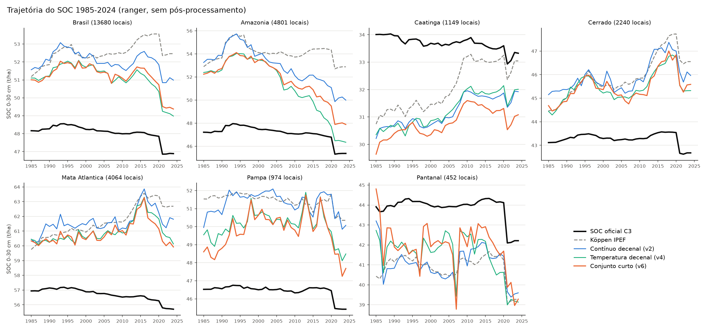

# Relatório técnico v6: conjunto final de clima para o modelo de SOC

**Repositório:** `MapBiomas_analises` (GitHub `fcoliveira-utfpr/climate_for_soil`), pasta `clima_final/`
**Período das análises:** 28 de outubro de 2026
**Escopo:** fechar a recomendação de clima para o modelo de SOC do MapBiomas Solo C3. O relatório v4 sugeriu,
pela importância por permutação, um **conjunto curto** (temperatura decenal + CDD + armazenamento de água
com a CAD do solo) e um **híbrido** (temperatura decenal + balanço hídrico estático), mas essa escolha foi feita
nas mesmas dobras que avaliaram o resultado. Aqui os dois são validados em **partições novas** e levados às
trajetórias 1985-2024. Continua os relatórios [v2](relatorio_tecnicov2.md), [v4](relatorio_tecnicov4.md) e
[v5](relatorio_tecnicov5.md).

---

## Sumário

1. [Pergunta](#1-pergunta)
2. [Cenários e método](#2-cenários-e-método)
3. [Resultados da validação](#3-resultados-da-validação)
4. [Trajetórias 1985-2024](#4-trajetórias-1985-2024)
5. [Síntese e recomendação](#5-síntese-e-recomendação)
6. [Limitações e próximos passos](#6-limitações-e-próximos-passos)
7. [Anexo: arquivos, comandos e reprodução](#7-anexo-arquivos-comandos-e-reprodução)

---

## 1. Pergunta

Os relatórios v2 a v5 mostraram que o clima que ajuda o modelo de SOC no tempo é o **contínuo decenal**
(média dos 10 anos anteriores ao ano da amostra), e o v4 mostrou que, dentro dele, é a **temperatura** que
ajuda; chuva, energia e balanço hídrico decenais viram "marcadores de período" e pioram no tempo. A
importância por permutação do v4 apontou ainda duas variáveis não térmicas úteis nos três esquemas: o **CDD**
decenal (dias secos consecutivos) e o **ARM** com a CAD do solo (armazenamento médio de água do balanço
hídrico). As perguntas:

1. O **conjunto curto** (temperatura decenal + CDD + ARM) ganha da temperatura sozinha, em partições que não
   foram usadas para escolhê-lo?
2. O **híbrido** (temperatura decenal + balanço hídrico estático) junta o ganho das normais no espaço com o da
   temperatura decenal no tempo?
3. Qual conjunto recomendar ao MapBiomas no lugar do Köppen IPEF?

---

## 2. Cenários e método

**Cenários** (todos com as 118 covariáveis da produção; só o clima muda; `clima_final/codigo/cenarios_final.json`):

| Cenário | Clima | Nº |
|---|---|---|
| `koppen_ipef` | Köppen IPEF, dummies L1-L3 da produção (referência) | 13 |
| `sem_clima` | nenhum (controle) | 0 |
| `cont_decenal` | `dec_tmean`, `dec_prec`, `dec_cdd` (v2; GT de clima + CDD do Xavier) | 3 |
| `temperatura` | média, máxima, mínima, do mês mais quente, do mês mais frio, amplitude diária e biotemperatura, em média móvel de 10 anos (v4) | 7 |
| **`curto`** | temperatura + `dec_cdd` + `cd_arm_csolo` | 9 |
| `hibrido` | temperatura + normais hídricas do CHELSA 1991-2020: chuva anual, do mês mais seco e sazonalidade, ETP anual e DEF anual | 12 |
| `hibrido_curto` | temperatura + CDD + ARM + normais hídricas | 14 |

As normais hídricas do híbrido são as que a seleção aninhada do v2 manteve no modelo final; as normais de
temperatura ficam de fora (a temperatura entra só decenal).

**Partições novas.** Mesmo procedimento do v2 (blocos de 2°, 5 dobras equilibradas em linhas, perfil e
réplicas `trep` sempre juntos), com outra semente (2027) para as três repetições da V2 e da V4
([particoes.csv](../clima_final/resultados/tabelas/particoes.csv)). A concordância com a partição antiga (índice
de Rand entre os blocos) é 0,66-0,67, a mesma esperada entre duas partições sorteadas ao acaso (0,68): as
dobras são independentes das usadas no v4. Na **V3** os períodos são fixos (1985-94, 1995-2004, 2005-14,
2015-24); mudam só as sementes dos modelos (base 2984 em vez de 1984). A V3 é, portanto, a parte menos
independente do teste.

**Validação.** Ranger validado pelo MapBiomas e modelo do mapa (`smileRandomForest`, maxNodes 40, emulado),
3 repetições, métricas `error_statistics` em t/ha. Recorte principal: **amostras reais de 0-30 cm** (9.787
linhas, sem réplicas e sem pseudoamostras). Ganhos pareados (mesma repetição, mesmas dobras) sobre o Köppen,
sobre o contínuo decenal do v2 e sobre a temperatura sozinha.

**Critério de decisão** (fixado antes de rodar, `clima_final/planejamento.md`): o conjunto recomendado é o que
ganha do Köppen nos três esquemas e nos dois modelos com o mesmo sinal nas repetições; entre os que cumprem
isso, o de maior ganho médio, e, em empate, o de menos variáveis.

---

## 3. Resultados da validação


*Figura 1. Ganho de MEC de cada conjunto sobre o Köppen IPEF nas partições novas (amostras reais, 0-30 cm).
Barra: média das 3 repetições; traço: mínimo a máximo.*

**MEC e ganho sobre o Köppen** [mínimo; máximo nas 3 repetições]; amostras reais de 0-30 cm
([final_resumo.csv](../clima_final/resultados/tabelas/final_resumo.csv)):

| Cenário | Ranger V2 | Ranger V3 | Ranger V4 | Mapa V2 | Mapa V3 | Mapa V4 |
|---|---|---|---|---|---|---|
| Köppen IPEF | 0,229 | 0,176 | 0,161 | 0,181 | 0,123 | 0,114 |
| Sem clima | +0,005 [+0,001; +0,011] | +0,010 [+0,005; +0,014] | +0,005 [+0,003; +0,006] | 0,000 [−0,005; +0,009] | +0,004 [−0,001; +0,010] | +0,017 [+0,009; +0,028] |
| Contínuo decenal (v2) | +0,016 [+0,010; +0,022] | 0,000 [−0,010; +0,011] | +0,007 [+0,002; +0,011] | +0,009 [+0,006; +0,014] | +0,008 [+0,001; +0,016] | +0,018 [+0,015; +0,019] |
| Temperatura decenal | +0,012 [−0,005; +0,025] | +0,017 [+0,008; +0,024] | +0,015 [+0,011; +0,020] | +0,008 [+0,002; +0,013] | **+0,020** [+0,019; +0,021] | **+0,023** [+0,020; +0,026] |
| **Conjunto curto** | **+0,017** [+0,011; +0,030] | **+0,022** [+0,012; +0,038] | **+0,017** [+0,015; +0,018] | **+0,018** [+0,009; +0,026] | +0,017 [+0,015; +0,018] | **+0,023** [+0,017; +0,030] |
| Híbrido | +0,013 [+0,010; +0,018] | +0,013 [+0,004; +0,021] | +0,005 [+0,003; +0,007] | +0,010 [+0,003; +0,020] | +0,003 [−0,001; +0,006] | +0,011 [+0,005; +0,016] |
| Híbrido curto | +0,012 [+0,006; +0,015] | +0,011 [+0,001; +0,020] | +0,004 [−0,002; +0,010] | +0,009 [−0,004; +0,016] | +0,007 [+0,005; +0,010] | +0,019 [+0,010; +0,029] |

Em negrito, o maior ganho de cada coluna.

**MEC absoluto, amostras reais de 0-30 cm:**

| Cenário | Ranger V2 | Ranger V3 | Ranger V4 | Mapa V2 | Mapa V3 | Mapa V4 |
|---|---|---|---|---|---|---|
| Köppen IPEF | 0,229 | 0,176 | 0,161 | 0,181 | 0,123 | 0,114 |
| Contínuo decenal | 0,245 | 0,176 | 0,168 | 0,190 | 0,130 | 0,131 |
| Temperatura decenal | 0,242 | 0,193 | 0,175 | 0,189 | **0,142** | **0,137** |
| **Conjunto curto** | **0,247** | **0,198** | **0,177** | **0,199** | 0,139 | **0,137** |

Com todas as linhas (critério do MapBiomas) a ordem é a mesma: o conjunto curto tem o maior MEC em 4 das 6
colunas (ranger 0,360 / 0,302 / 0,275; mapa 0,312 / 0,225 / 0,226, contra o Köppen 0,334 / 0,279 / 0,254 e
0,284 / 0,211 / 0,194), e a temperatura sozinha nas outras 2 (mapa V3 0,229 e V4 0,233).

**Erros em t/ha** (RMSE / ME, amostras reais 0-30 cm):

| Cenário | Ranger V2 | Ranger V3 | Ranger V4 | Mapa V2 | Mapa V3 | Mapa V4 |
|---|---|---|---|---|---|---|
| Köppen IPEF | 48,5 / −2,2 | 50,2 / −4,1 | 50,6 / −3,6 | 50,0 / −7,5 | 51,8 / −9,3 | 52,0 / −9,1 |
| Conjunto curto | 48,0 / −2,0 | 49,5 / −3,3 | 50,1 / −3,3 | 49,5 / −7,5 | 51,3 / −9,1 | 51,4 / −9,2 |

**Leitura.**

1. **O conjunto curto cumpre o critério.** É o único cenário que ganha do Köppen nas **6 combinações com o
   mínimo das repetições sempre positivo** (pior repetição: +0,009). Tem o maior ganho médio (ranger +0,019;
   mapa +0,019) e reduz o RMSE em 0,5-0,7 t/ha.
2. **A escolha do v4 se confirma em dobras novas.** O ganho do conjunto curto sobre a temperatura sozinha é
   pequeno (ranger +0,005, +0,005, +0,002; mapa +0,009, −0,003, 0,000) e só é consistente nas 3 repetições na
   V2 do modelo do mapa (+0,009 [+0,006; +0,015]). O CDD e o ARM acrescentam sobretudo **no espaço**, sem
   perder no tempo. A temperatura sozinha fica bem perto, mas tem uma repetição negativa na V2 do ranger.
3. **O híbrido não funciona.** As normais hídricas estáticas **tiram ganho no tempo**: comparado à temperatura
   sozinha, perde na V3 e na V4 em todas as repetições, nos dois modelos (ranger −0,004 e −0,010; mapa −0,017 e
   −0,012). O híbrido curto também perde da temperatura sozinha no tempo (em 3 dos 4 casos em todas as
   repetições). Confirma o v2: com as normais, o modelo gasta divisões em
   variáveis estáticas que, sem elas, iriam para o que varia no tempo.
4. **O contínuo decenal do v2 é frágil na V3.** Nas sementes novas, o ganho dele na V3 do ranger foi de
   +0,013 (v2) para 0,000 [−0,010; +0,011]; a temperatura (+0,017) e o conjunto curto (+0,022) mantêm o ganho.
   Ele continua ganhando do Köppen nos outros 5 casos.
5. **A variação entre partições é da ordem dos ganhos.** O MEC do próprio Köppen mudou de 0,240 (partição
   do v2) para 0,229 (partição nova) na V2 do ranger. Por isso o teste se apoia no ganho **pareado** e na
   consistência entre repetições, não no MEC absoluto.

**Importância no modelo final** (ranger, impureza; `importancia_final.csv`): as 9 variáveis do conjunto curto
somam 20% da importância, contra 3% das 13 dummies do Köppen; ficam entre a 10ª e a 20ª posição das 127
covariáveis (temperatura do mês mais frio em 10º, ARM em 14º, CDD em 17º).

---

## 4. Trajetórias 1985-2024

Modelo final de cada cenário (matriz inteira) aplicado ao painel de 13.680 locais × 40 anos (0-30 cm), com as
variáveis decenais do ano de cada linha ([trajetorias_final_efeito_clima.csv](../clima_final/resultados/tabelas/trajetorias_final_efeito_clima.csv)).


*Figura 2. SOC médio de 0-30 cm, 1985-2024, no Brasil e por bioma, com o modelo do mapa e o pós-processamento:
oficial (preto), Köppen IPEF reproduzido (tracejado), contínuo decenal do v2, temperatura decenal e conjunto
curto.*


*Figura 3. O mesmo com o ranger, sem pós-processamento.*

| Modelo do mapa | SOC médio (t/ha) | Tendência (t/ha/década) | r da tendência com a oficial | Variação ano a ano (t/ha) | SOC 1985 → 2024 |
|---|---|---|---|---|---|
| SOC oficial C3 | 48,1 | −0,28 | 1 | 0,18 | 48,2 → 46,9 |
| Köppen IPEF | 47,2 | −0,22 | 0,89 | 0,15 | 47,5 → 46,5 |
| Contínuo decenal | 47,1 | −0,53 | 0,85 | 0,31 | — |
| Temperatura decenal | 46,3 | −0,88 | 0,81 | 0,33 | — |
| **Conjunto curto** | 46,3 | **−0,78** | 0,81 | 0,36 | **47,5 → 44,1** |

**Tendência por bioma** (t/ha por década, modelo do mapa):

| Bioma | Oficial | Köppen | Contínuo decenal | Conjunto curto |
|---|---|---|---|---|
| Amazônia | −0,41 | −0,28 | −0,59 | **−1,00** |
| Mata Atlântica | −0,32 | −0,32 | −0,74 | **−0,95** |
| Pantanal | −0,21 | −0,11 | −0,48 | −0,75 |
| Caatinga | −0,16 | −0,11 | −0,31 | −0,48 |
| Cerrado | −0,04 | −0,02 | −0,25 | −0,43 |
| Pampa | −0,18 | −0,11 | −0,22 | −0,13 |

**Leitura.**

- **Com o clima decenal, o mapa ganha um sinal climático no tempo.** Com o Köppen, a trajetória só reflete o
  uso da terra e os índices de vegetação; com o conjunto curto, o SOC cai **3,4 t/ha (−7%) de 1985 a 2024**,
  contra 1,3 t/ha no mapa oficial, e a queda é mais forte na Amazônia e na Mata Atlântica.
- **De onde vem a queda:** nos locais do painel, a temperatura média decenal subiu **1,1 °C** de 1985 para 2024
  (23,4 → 24,5 °C; a do mês mais frio, de 20,7 para 21,8 °C), o CDD subiu 6,7 dias (40,7 → 47,4) e o ARM caiu
  4,5 mm (80,3 → 75,8). O modelo aprendeu no espaço que lugares mais quentes e secos têm menos carbono e aplica
  essa relação ao aquecimento observado.
- **Não sabemos se a magnitude está certa.** A relação vem do espaço (comparação entre lugares), e o solo
  responde ao clima em décadas a séculos; a queda prevista pode estar adiantada ou exagerada. Os 289 pares com
  coletas repetidas do v2 não bastam para validar a variação temporal. Este é o principal ponto a discutir com
  a equipe antes de adotar o conjunto no mapa.
- **Uso da terra:** a perda de carbono 5 anos depois de uma conversão de vegetação natural para agropecuária
  fica parecida (mapa: −0,73 t/ha com o curto, −0,58 com o Köppen; oficial −0,99). O clima muda a magnitude,
  não o sinal.
- **Com o ranger,** a tendência do conjunto curto (−0,30 t/ha/década) fica próxima da oficial (−0,28), enquanto
  o Köppen sobe (+0,33); mas o nível fica ~3 t/ha acima do oficial e a variação ano a ano é 7 vezes maior, como
  em todos os cenários sem o pós-processamento.

---

## 5. Síntese e recomendação

1. **O conjunto curto é o clima recomendado para o modelo de SOC:** 9 variáveis em média móvel dos 10 anos
   anteriores ao ano do mapa:
   - temperatura média, máxima e mínima, do mês mais quente, do mês mais frio, amplitude térmica diária e
     biotemperatura;
   - CDD (maior sequência de dias com chuva < 1 mm);
   - ARM do balanço hídrico de Thornthwaite-Mather com a CAD do solo.

   Ganha do Köppen IPEF nas 6 combinações de modelo e esquema, em todas as repetições e em partições que não
   foram usadas para escolhê-lo (+0,017 a +0,023 de MEC; até 0,7 t/ha de RMSE).
2. **A temperatura decenal é o núcleo:** sozinha, já entrega a maior parte do ganho. Se for preciso o conjunto
   mínimo, são as 7 de temperatura; o CDD e o ARM acrescentam no espaço.
3. **O balanço hídrico deve ficar fora, tanto decenal (v4) quanto estático (aqui):** nos dois casos piora no
   tempo.
4. **O contínuo decenal do v2 (3 variáveis) é a alternativa operacional:** já existe no GT de clima, ganha do
   Köppen em 5 das 6 combinações, mas é menos estável no tempo (V3 do ranger sem ganho nas sementes novas).
5. **O conjunto muda a trajetória do mapa:** introduz uma queda de SOC associada ao aquecimento (−0,78
   t/ha/década, contra −0,28 do oficial). É o que se espera de um clima que muda no tempo, mas a magnitude não
   tem validação independente.
6. **O maior ganho continua não sendo o clima:** usar no mapa o modelo validado (ranger) em vez das árvores
   rasas do GEE vale +0,04 a +0,06 de MEC (v2), mais que o dobro do ganho do conjunto curto.

---

## 6. Limitações e próximos passos

**Limitações.**

- **V3 com períodos fixos:** só as sementes mudaram; a V3 é a parte menos independente do teste.
- **Janelas incompletas:** temperatura, umidade, radiação e vento do Xavier no GEE vão até 07/2020; para
  2021-2024 a média móvel usa de 9 a 6 anos de temperatura (v4). O CDD usa chuva até 2022.
- **Validação temporal:** a queda de SOC das trajetórias vem da relação espacial clima-carbono e não tem
  verdade de campo no tempo.
- **Disponibilidade operacional:** as 7 variáveis de temperatura e o ARM foram calculados aqui com a
  `agrometeorologiapy`; não existem prontos no GEE do MapBiomas (só a temperatura média e a chuva decenais do GT
  de clima).
- **A queda de 2021** em todas as trajetórias, inclusive a oficial, continua sem explicação (v2) e não vem do
  clima.

**Próximos passos.**

1. **Publicar as 9 variáveis como assets anuais no GEE** (grade de 0,1° do Xavier, 1985-2024), para que o
   MapBiomas possa usá-las no script de produção.
2. **Atualizar a grade do Xavier** (BR-DWGD de 03/2025, fora do GEE) para fechar as janelas de 2021-2024.
3. **Testar a sensibilidade da queda temporal:** por exemplo, com uma janela mais longa (20-30 anos) para a
   temperatura, que deixa o sinal mais lento, e comparar com séries de longo prazo de experimentos de campo.
4. Levar o conjunto curto, junto com o ranger, ao mapa completo 1985-2024 e comparar com o produto oficial.

---

## 7. Anexo: arquivos, comandos e reprodução

Código em `clima_final/codigo/` (versionado); dados em `clima_final/dados/` (fora do git); figuras e tabelas em
`clima_final/resultados/`; decisões em [planejamento.md](../clima_final/planejamento.md).

| Etapa | Comando (em `clima_final/codigo/`) | Saída principal |
|---|---|---|
| 1. Cenários e partições | `python cenarios_final.py` | `dados/matriz_final.parquet`, `codigo/cenarios_final.json`, `tabelas/particoes.csv` |
| 2. Validações | ver abaixo | `dados/oof_ranger/`, `dados/oof_mapa/` |
| 3. Métricas | `python metricas_final.py` | `tabelas/final_metricas.csv`, `final_resumo.csv` |
| 3b. Figura dos ganhos | `python figura_ganhos.py` | `figuras/ganhos_final.png` |
| 4. Painel | `python painel_final.py` | `dados/painel_final.parquet` |
| 5. Predição do painel | ver abaixo | `dados/painel_predicoes*.parquet`, `tabelas/importancia_final.csv` |
| 6. Trajetórias | `python trajetorias_final.py` | `tabelas/trajetorias_final_*.csv`, `figuras/trajetorias_final*.png` |

Validações e predição do painel (PowerShell, em `climas/analise_espaco_tempo/codigo/`; `validacao.R` e
`validacao_gee.py` passaram a aceitar `VAL_SEMENTE`, a semente base dos modelos):

```powershell
$D = "C:\Python\MapBiomas_analises\clima_final"
$env:VAL_MATRIZ = "$D\dados\matriz_final.parquet"
$env:VAL_CENARIOS = "$D\codigo\cenarios_final.json"
$env:VAL_SEMENTE = "2984"
$env:VAL_OOF = "$D\dados\oof_ranger"
& "C:\Program Files\R\R-4.6.1\bin\Rscript.exe" validacao.R todos v2,v3,v4 direta
$env:VAL_OOF = "$D\dados\oof_mapa"
python validacao_gee.py todos

$env:VAL_PAINEL = "$D\dados\painel_final.parquet"
$env:VAL_PREDICOES = "$D\dados\painel_predicoes.parquet"; $env:VAL_IMPORTANCIA = "$D\resultados\tabelas\importancia_final.csv"
& "C:\Program Files\R\R-4.6.1\bin\Rscript.exe" prever_painel.R
$env:VAL_PREDICOES = "$D\dados\painel_predicoes_gee.parquet"
python prever_painel_gee.py
```

Tempos nesta máquina: validação do ranger ~50 min (7 cenários), do modelo do mapa ~20 min; predição do painel
~2 min (ranger) e ~4 min (mapa).

Ambiente: Python 3.13 (pandas, scikit-learn, matplotlib), R 4.6.1 com `ranger` 0.18.0. Depende da matriz do
relatório v4 (`clima_decenal/dados/matriz_cd.parquet` e `variaveis/`), do painel e do SOC oficial do v2
(`climas/dados_espaco_tempo/`) e da grade do Xavier do v3 (`climas_tempo/dados/grade.npz`).
