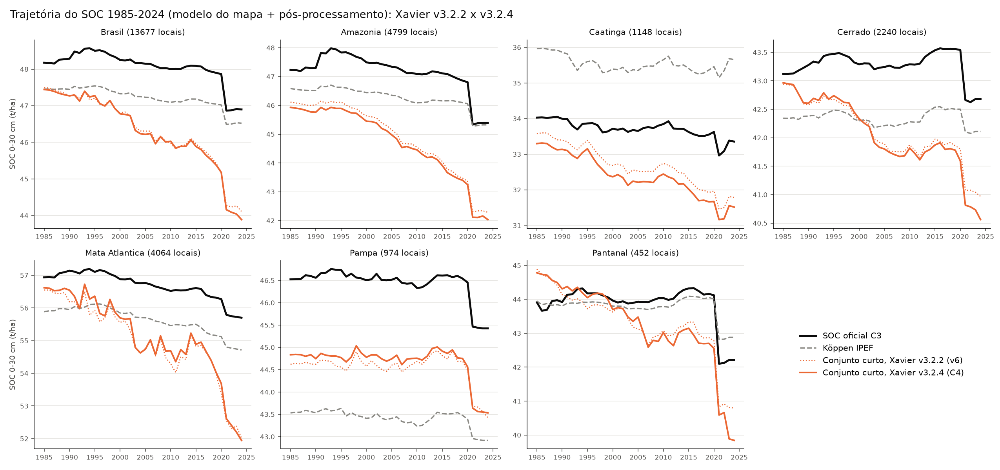
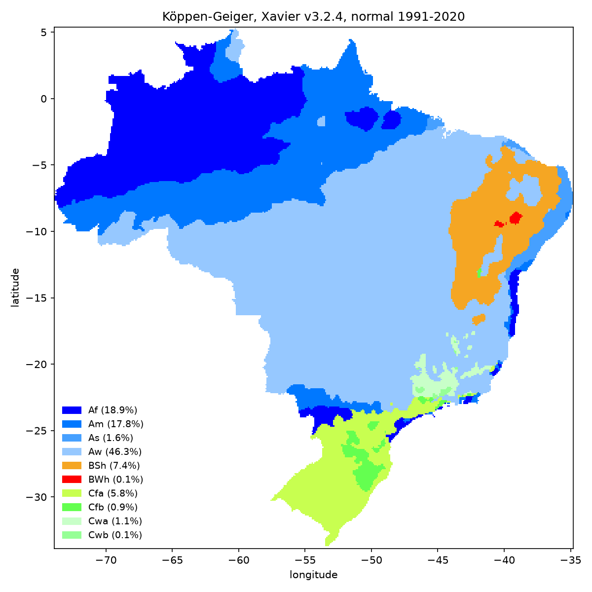

# Relatório técnico v7: o conjunto curto com o Xavier v3.2.4 (1961-2025) e o Köppen 1991-2020 no GEE

**Repositório:** `MapBiomas_analises` (GitHub `fcoliveira-utfpr/climate_for_soil`), pasta `C4/`
**Período das análises:** 30 de outubro de 2026
**Escopo:** refazer o conjunto de clima recomendado no [v6](relatorio_tecnicov6.md) com a versão nova da grade do
Xavier (BR-DWGD v3.2.4, todas as variáveis até 2025), que fecha as janelas de 10 anos de 2021-2024, e verificar
se a validação e as trajetórias mudam. Como subproduto, gera o Köppen-Geiger do Xavier com a normal 1991-2020 e
a própria normal de temperatura e chuva, publicados como assets no GEE.

---

## Sumário

1. [Pergunta](#1-pergunta)
2. [A versão nova do Xavier](#2-a-versão-nova-do-xavier)
3. [Cadeia de cálculo](#3-cadeia-de-cálculo)
4. [Validação](#4-validação)
5. [Trajetórias 1985-2024](#5-trajetórias-1985-2024)
6. [Köppen 1991-2020 e normal de temperatura e chuva no GEE](#6-köppen-1991-2020-e-normal-de-temperatura-e-chuva-no-gee)
7. [Síntese](#7-síntese)
8. [Limitações e próximos passos](#8-limitações-e-próximos-passos)
9. [Anexo: arquivos, comandos e reprodução](#9-anexo-arquivos-comandos-e-reprodução)

---

## 1. Pergunta

Até o v6, todo o clima do Xavier veio do asset do catálogo comunitário do GEE
(`projects/sat-io/open-datasets/BR-DWGD/`, v3.2.2), em que temperatura, umidade, radiação e vento terminam em
**31/07/2020** e a chuva em **2022**. Nas médias móveis de 10 anos, os anos de 2021 a 2024 ficavam com 9 a 6
anos de temperatura e com o ARM (que depende da ETo) parado em 2020. As perguntas:

1. A vantagem do conjunto curto sobre o Köppen IPEF (v6) se mantém com a grade nova?
2. As trajetórias 1985-2024 mudam, sobretudo depois de 2020?

---

## 2. A versão nova do Xavier

O autor publicou a **v3.2.4** (abril de 2026), que está no GEE em `projects/ee-alexandrexavier/assets/BR-DWGD`
desde maio de 2026 (conferido: 23.741 imagens diárias, de 01/01/1961 a 31/12/2025, com as 7 variáveis).

| | v3.2.2 (usada até o v6) | v3.2.4 (C4) |
|---|---|---|
| Asset | `projects/sat-io/open-datasets/BR-DWGD/` | `projects/ee-alexandrexavier/assets/BR-DWGD` |
| Chuva | até 31/12/2022 | até 31/12/2025 |
| Tmax, Tmin, UR, Rs, vento, ETo | até 31/07/2020 | até 31/12/2025 |
| Escalas | fixas | nas propriedades de cada imagem (`BAND_*_MULT`, `BAND_*_ADD`); UR, Rs, vento e ETo com deslocamento diferente de zero |

- A **grade é a mesma** (0,1°, 391 × 393 pixels).
- A **coleção mensal do autor** (`BR-DWGD_Monthly`) não foi usada: num teste em Brasília (01/2010), a chuva dela
  (171 mm) não bate com a soma dos dias (114 mm). Os meses foram agregados a partir do diário.
- **A reinterpolação muda pouco o passado.** Em 2010, as médias mensais da v3.2.4 e da v3.2.2 são quase iguais
  (Tmax 31,37 × 31,38 °C; chuva 134,5 × 134,7 mm/mês), com correlação de 0,97 (vento) a 0,999 (Tmax). Nos pontos
  de SOC, as variáveis do conjunto curto das duas versões têm r = 0,98 (CDD) a 1,00 (temperaturas)
  ([variaveis_c4.csv](../C4/resultados/tabelas/variaveis_c4.csv)).

---

## 3. Cadeia de cálculo

A mesma do v4 e do v6, refeita em `C4/codigo/` com a v3.2.4:

1. **Download** (`baixar_xavier.py`): para cada ano de 1961 a 2025, médias mensais de Tmax, Tmin, UR, Rs e
   vento, somas mensais de chuva e da ETo do Xavier, e o **CDD anual** (índice ETCCDI, mesmo algoritmo do v2,
   calculado no GEE e baixado como array).
2. **ETo pelo Rn** (`eto_rn.py`, Penman-Monteith FAO-56 com a `agrometeorologiapy`). Conferência com a ETo do
   próprio Xavier v3.2.4: **r = 0,998**, diferença média de −0,8% em todos os anos de 1961 a 2025
   ([conferencia_eto.csv](../C4/resultados/tabelas/conferencia_eto.csv)), o mesmo resultado do v4.
3. **Variáveis em média móvel de 10 anos** (`variaveis.py`), de 1985 a 2026. **Todas as janelas ficam
   completas** (10 anos de todas as variáveis), inclusive as de 2021-2026.
4. **Pontos** (`pontos.py`): as variáveis do ano de cada linha na matriz do v6 (mesma partição das dobras).

**Validação pareada com o v6.** As partições (semente 2027) e as sementes dos modelos (`VAL_SEMENTE` = 2984) são
as do v6. Só a temperatura decenal e o conjunto curto foram refeitos; as referências (Köppen IPEF, sem clima,
contínuo decenal do GT) não dependem do Xavier, e as predições delas são as do v6. Assim, a diferença entre o
C4 e o v6 no mesmo cenário mede **só o efeito da versão do Xavier**.

---

## 4. Validação

**MEC e ganho sobre o Köppen IPEF** [mínimo; máximo nas 3 repetições], amostras reais de 0-30 cm
([c4_resumo.csv](../C4/resultados/tabelas/c4_resumo.csv)):

| Cenário | Ranger V2 | Ranger V3 | Ranger V4 | Mapa V2 | Mapa V3 | Mapa V4 |
|---|---|---|---|---|---|---|
| Köppen IPEF | 0,229 | 0,176 | 0,161 | 0,181 | 0,123 | 0,114 |
| Contínuo decenal (GT) | +0,016 | 0,000 | +0,007 | +0,009 | +0,008 | +0,018 |
| Conjunto curto, v3.2.2 (v6) | +0,017 [+0,011; +0,030] | +0,022 [+0,012; +0,038] | +0,017 [+0,015; +0,018] | +0,018 [+0,009; +0,026] | +0,017 [+0,015; +0,018] | +0,023 [+0,017; +0,030] |
| **Conjunto curto, v3.2.4 (C4)** | **+0,014** [+0,008; +0,024] | **+0,019** [+0,007; +0,034] | **+0,020** [+0,013; +0,025] | **+0,012** [+0,006; +0,017] | **+0,015** [+0,009; +0,021] | **+0,022** [+0,015; +0,031] |
| Temperatura decenal, v3.2.4 | +0,013 [−0,002; +0,026] | +0,013 [+0,003; +0,019] | +0,016 [+0,014; +0,017] | +0,011 [+0,001; +0,019] | +0,016 [+0,010; +0,018] | +0,021 [+0,016; +0,025] |

**Efeito só da versão do Xavier** (C4 − v6, mesmo cenário, mesmas dobras e sementes):

| Cenário | Ranger V2 | Ranger V3 | Ranger V4 | Mapa V2 | Mapa V3 | Mapa V4 |
|---|---|---|---|---|---|---|
| Conjunto curto | −0,004 [−0,006; −0,002] | −0,003 [−0,009; +0,005] | +0,004 [−0,002; +0,007] | −0,005 [−0,013; −0,001] | −0,002 [−0,005; +0,003] | −0,001 [−0,008; +0,003] |
| Temperatura decenal | 0,000 [−0,003; +0,003] | −0,003 [−0,007; +0,001] | +0,001 [−0,004; +0,006] | +0,003 [0,000; +0,006] | −0,004 [−0,009; −0,001] | −0,002 [−0,004; −0,001] |

**Leitura.**

1. **O resultado do v6 se mantém.** Com a grade nova, o conjunto curto continua ganhando do Köppen nas **6
   combinações, em todas as repetições** (pior repetição: +0,006), com +0,012 a +0,022 de MEC. A temperatura
   sozinha continua com uma repetição negativa (ranger V2).
2. **A versão do Xavier quase não muda a validação.** As diferenças C4 − v6 ficam entre −0,005 e +0,004, sem
   sinal consistente, da ordem da variação entre repetições. Era o esperado: a reinterpolação muda pouco o
   passado, e só as poucas amostras de 2021-2024 tinham janelas incompletas.
3. Os ganhos levemente menores no espaço (V2, −0,004 e −0,005) não aparecem na temperatura sozinha (0,000 e
   +0,003); provavelmente vêm do CDD, a variável que mais mudou entre as versões (r = 0,98; média 40,3 × 40,9
   dias nas amostras).

---

## 5. Trajetórias 1985-2024


*Figura 1. SOC médio de 0-30 cm, com o modelo do mapa e o pós-processamento: oficial, Köppen IPEF e o conjunto
curto com o Xavier v3.2.2 (v6, pontilhado) e v3.2.4 (C4, contínuo).*

| Modelo do mapa | Tendência (t/ha/década) | SOC 1985 → 2024 (t/ha) | Queda 1985-2024 |
|---|---|---|---|
| SOC oficial C3 | −0,28 | 48,2 → 46,9 | −1,3 |
| Köppen IPEF | −0,22 | 47,5 → 46,5 | −0,9 |
| Conjunto curto, v3.2.2 (v6) | −0,78 | 47,5 → 44,1 | −3,4 |
| **Conjunto curto, v3.2.4 (C4)** | **−0,80** | **47,4 → 43,9** | **−3,6** |

**Por bioma** (modelo do mapa; tendência em t/ha por década e diferença C4 − v6 em 2024):

| Bioma | Oficial | Curto v6 | Curto C4 | C4 − v6 em 2024 (t/ha) |
|---|---|---|---|---|
| Amazônia | −0,41 | −1,00 | −0,98 | −0,25 |
| Mata Atlântica | −0,32 | −0,95 | −0,99 | −0,07 |
| Pantanal | −0,21 | −0,75 | **−0,94** | **−0,96** |
| Caatinga | −0,16 | −0,48 | −0,49 | −0,27 |
| Cerrado | −0,04 | −0,43 | −0,50 | −0,41 |
| Pampa | −0,18 | −0,13 | −0,17 | +0,11 |
| Brasil | −0,28 | −0,78 | −0,80 | −0,22 |

**Leitura.**

- **Até 2020 as duas versões coincidem; a diferença está em 2021-2024**, e é pequena no Brasil (−0,2 t/ha em
  2024). Ela é maior no Pantanal (−1,0 t/ha) e no Cerrado (−0,4 t/ha).
- **O que mudou não foi a temperatura.** A temperatura média decenal nos locais em 2024 é praticamente a mesma
  nas duas versões (24,52 °C na v3.2.4, janela 2014-2023; 24,55 °C na v3.2.2, janela incompleta 2014-2020): a
  média dos anos disponíveis já captava o aquecimento recente.
- **O que ficava parado era o ARM.** Na v3.2.2, o ARM com a CAD do solo ficava constante em 75,8 mm de 2020 a
  2024, porque a ETo acabava em 07/2020. Na v3.2.4 ele continua caindo (75,6 mm em 2020 → 74,5 mm em 2024),
  e é isso que aprofunda a queda de SOC nos anos finais, sobretudo onde a água no solo pesa mais.
- A conclusão do v6 sobre as trajetórias não muda: com o conjunto curto, o mapa ganha uma queda de SOC associada
  ao aquecimento e ao secamento (−0,80 t/ha por década, contra −0,28 do oficial), com magnitude ainda sem
  validação temporal independente.

---

## 6. Köppen 1991-2020 e normal de temperatura e chuva no GEE

Com a v3.2.4, a normal 1991-2020 tem 30 anos completos de todas as variáveis (na v3.2.2 a temperatura acabava em
07/2020). Ela foi usada para gerar o Köppen-Geiger do Xavier e publicar os dois como assets.

**Köppen-Geiger** (`C4/codigo/koppen_1991_2020.py`): `classificacao_koppen_grade` da `agrometeorologiapy`
(Alvares et al. 2013, com a sazonalidade f/s/w de Kottek et al. 2006) e filtro de moda 3 × 3.


*Figura 2. Köppen-Geiger do Xavier v3.2.4, normal 1991-2020 (banda `koppen`, com moda 3 × 3).*

| Classe | Área no Brasil | Classe | Área no Brasil |
|---|---|---|---|
| Aw | 46,3% | Cfa | 5,8% |
| Af | 18,9% | As | 1,6% |
| Am | 17,8% | Cwa | 1,1% |
| BSh | 7,4% | Cfb | 0,9% |
| | | BWh, Cwb | 0,1% cada |

Concordância: **97,6%** com o Köppen do Xavier v3.2.2 do relatório v3, **87,8%** com o do CHELSA 1991-2020 do
relatório v1 e 98,5% entre as versões com e sem o filtro de moda.

**Assets no GEE** (pasta `projects/fcoliveira/assets/Climas2/`), com descrição completa (fonte, método, bandas,
legenda e exemplo de código para o Code Editor):

| Asset | Bandas | Conferência |
|---|---|---|
| `koppen_xavier_1991_2020` | `koppen` (com moda 3 × 3), `koppen_sem_filtro` | 100% dos pixels iguais ao GeoTIFF local |
| `xavier_normal_1991_2020` | `T_01`-`T_12` (°C), `P_01`-`P_12` (mm/mês), `T_anual`, `P_anual` | idêntica à normal local nas 24 bandas mensais (diferença máxima 0,0002 mm) |

O Köppen foi enviado sem Cloud Storage (o raster é pequeno: cada banda vai como `ee.Array` e a imagem é remontada
no GEE pela linha e coluna de cada pixel da grade); a normal foi calculada no próprio GEE a partir do asset
diário v3.2.4, com o mesmo método do cálculo local. Os GeoTIFFs locais, a legenda, os níveis da classe (grupo e
subgrupo) e os critérios da classificação (limiar de aridez, razão de aridez, limiar Am/Aw e outros) estão em
`C4/resultados/koppen_xavier_1991_2020/` ([subprodutos.csv](../C4/resultados/koppen_xavier_1991_2020/subprodutos.csv)).

---

## 7. Síntese

1. **A recomendação do v6 está confirmada com a grade nova do Xavier.** O conjunto curto (7 de temperatura
   decenal + CDD + ARM com a CAD do solo) ganha do Köppen IPEF nas 6 combinações, em todas as repetições
   (+0,012 a +0,022 de MEC).
2. **A versão do Xavier é um detalhe para a validação** (diferenças de −0,005 a +0,004 de MEC), mas **importa
   para o produto**: com a v3.2.4 as janelas de 2021-2026 ficam completas, o ARM deixa de ficar parado em 2020
   e o mapa pode ser estendido a 2025 e 2026 sem janelas incompletas.
3. **Para produção, usar a v3.2.4** (`projects/ee-alexandrexavier/assets/BR-DWGD`), com as escalas lidas das
   propriedades de cada imagem.
4. **O Köppen 1991-2020 e a normal do Xavier estão no GEE**, com descrição, legenda e exemplo de código, para
   uso direto pela equipe.

---

## 8. Limitações e próximos passos

- **A coleção mensal do autor não bate com o diário** num teste; vale perguntar ao autor antes de usá-la.
- **A queda temporal do SOC continua sem validação independente** (v6).
- O painel de covariáveis do MapBiomas vai até 2024; as variáveis de 2025 e 2026 estão calculadas, mas não
  foram usadas.

**Próximos passos.**

1. Publicar as 9 variáveis do conjunto curto como assets anuais (1985-2026) na mesma pasta `Climas2`, com a
   v3.2.4.
2. Levar o conjunto curto ao mapa com o ranger.
3. Testar janelas mais longas para a temperatura e comparar a queda temporal com experimentos de longa duração.

---

## 9. Anexo: arquivos, comandos e reprodução

Código em `C4/codigo/` (versionado); dados em `C4/dados/` (fora do git); resultados em `C4/resultados/`;
decisões em [planejamento.md](../C4/planejamento.md). Lê, sem copiar, a altitude e a grade dos capítulos
anteriores (`clima_decenal/dados/altitude.npy`, `climas_tempo/dados/grade.npz`) e a matriz, o painel e as
predições de referência do v6 (`clima_final/dados/`).

| Etapa | Comando (em `C4/codigo/`) | Saída principal |
|---|---|---|
| 1. Xavier v3.2.4 mensal + CDD | `python baixar_xavier.py 1961 2025` | `dados/xavier_mensal/<ano>.npz` |
| 2. ETo pelo Rn | `python eto_rn.py` | `dados/eto_rn/`, `tabelas/conferencia_eto.csv` |
| 3. Variáveis decenais | `python variaveis.py` | `dados/variaveis/<ano>.npz` (1985-2026) |
| 4. Pontos e cenários | `python pontos.py` | `dados/matriz_c4.parquet`, `codigo/cenarios_c4.json` |
| 5. Validações | ver abaixo | `dados/oof_ranger/`, `dados/oof_mapa/` |
| 6. Métricas | `python metricas_c4.py` | `tabelas/c4_metricas.csv`, `c4_resumo.csv` |
| 7. Painel | `python painel_c4.py` | `dados/painel_c4.parquet` |
| 8. Predição e trajetórias | ver abaixo; `python trajetorias_c4.py` | `tabelas/trajetorias_c4_*.csv`, `figuras/trajetorias_c4*.png` |
| 9. Köppen 1991-2020 | `python koppen_1991_2020.py`; `python subprodutos_koppen.py` | `resultados/koppen_xavier_1991_2020/` |
| 10. Assets no GEE | `python subir_koppen_gee.py exportar`, `normal`, `conferir`, `conferir_normal` | assets em `Climas2` |

```powershell
$D = "C:\Python\MapBiomas_analises\C4"
$env:VAL_MATRIZ = "$D\dados\matriz_c4.parquet"
$env:VAL_CENARIOS = "$D\codigo\cenarios_c4.json"
$env:VAL_SEMENTE = "2984"
$env:VAL_OOF = "$D\dados\oof_ranger"
& "C:\Program Files\R\R-4.6.1\bin\Rscript.exe" validacao.R todos v2,v3,v4 direta
$env:VAL_OOF = "$D\dados\oof_mapa"
python validacao_gee.py todos
$env:VAL_PAINEL = "$D\dados\painel_c4.parquet"
$env:VAL_PREDICOES = "$D\dados\painel_predicoes.parquet"; $env:VAL_IMPORTANCIA = "$D\resultados\tabelas\importancia_c4.csv"
& "C:\Program Files\R\R-4.6.1\bin\Rscript.exe" prever_painel.R
$env:VAL_PREDICOES = "$D\dados\painel_predicoes_gee.parquet"
python prever_painel_gee.py
```

(os quatro primeiros comandos em `climas/analise_espaco_tempo/codigo/`)

Ambiente: Python 3.13 com `agrometeorologiapy` 0.3.0, earthengine-api, rasterio, pandas, matplotlib; R 4.6.1 com
`ranger` 0.18.0; GEE pelo projeto `mapbiomas-brazil`.
